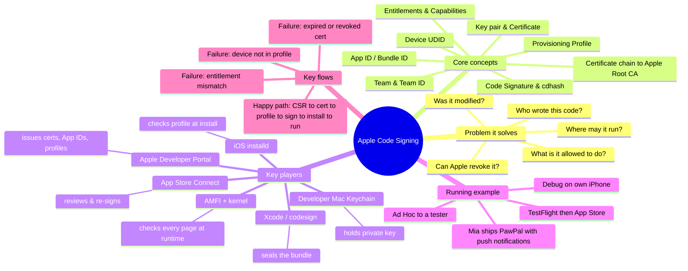

# Apple Code Signing, In Depth — A Series

> **Where you are:** the front door of an 8-part series on how Apple's developer program, signing certificates, and provisioning profiles fit together.
> **What you'll know after this file:** the whole map, the reading order, and the one story (PawPal) that ties every article together.

Most developers meet Apple code signing as a wall of red errors in Xcode: *"No profiles for 'com.x.y' were found"*, *"Provisioning profile doesn't include signing certificate"*, *"errSecInternalComponent"*. They click **Automatically manage signing**, it works, and the system stays a black box until it breaks on CI at 2 a.m.

This series opens the box. It doesn't start from menus. It starts from the security problem Apple had to solve and works forward from there, so each piece looks like something you would have had to invent yourself.

## The series

| # | Article | Question it answers |
|---|---|---|
| 1 | [Why code signing exists](01-why.md) | What breaks without it? |
| 2 | [What Apple code signing is (and isn't)](02-what.md) | What exactly is this system, and where are its edges? |
| 3 | [The concept map](03-concept-map.md) | What are the pieces, and who does what? |
| 4 | [The running example: shipping PawPal](04-running-example.md) | What does one real app's journey look like? |
| 5.1 | [The Developer Account & Team](05-deep-dives/01-developer-account-and-team.md) | Who is the root of identity? |
| 5.2 | [Signing Certificates & Private Keys](05-deep-dives/02-signing-certificates.md) | How does Apple vouch for *you*? |
| 5.3 | [App IDs, Capabilities & Entitlements](05-deep-dives/03-app-ids-and-entitlements.md) | How does Apple vouch for *what your app may do*? |
| 5.4 | [Registered Devices](05-deep-dives/04-devices.md) | How does Apple limit *where* a non-store build may run? |
| 5.5 | [Provisioning Profiles](05-deep-dives/05-provisioning-profiles.md) | How are who / what / where bound into one signed permission slip? |
| 5.6 | [codesign & the Signature Inside Your App](05-deep-dives/06-codesign-and-the-signature.md) | What does a signature physically look like inside the binary? |
| 5.7 | [On-Device Verification (installd, AMFI, the kernel)](05-deep-dives/07-on-device-verification.md) | How does the iPhone decide to run your code? |
| 5.8 | [Distribution & Apple Re-signing](05-deep-dives/08-distribution-and-resigning.md) | What changes for TestFlight, App Store, Ad Hoc, Enterprise, and macOS? |
| 6 | [Full walkthrough: PawPal end to end](06-walkthrough.md) | Every step again, at full depth |
| 7 | [Troubleshooting, CI & next steps](07-next-steps.md) | How do I fix it when it breaks? |

Reading order: go 1 → 6 straight through the first time. Each deep dive (5.x) also works on its own, because it recaps its role and ties back to the PawPal example.

## The whole territory, in one picture

*What are all the concepts and components, and how do they group?*

## The core idea in one paragraph

A signed iOS app makes **three claims** and has **one permission slip** that backs them. The claims: *"I was built by this Team"* (certificate), *"I have not been changed since"* (code signature hashes), and *"I may use these powers"* (entitlements). The permission slip is the **provisioning profile**, a plist that Apple signs and that says *"this Team's certificates may sign this App ID, with these entitlements, to run on these devices, until this date."* The device trusts Apple's root key and nothing else. So every claim has to trace back to something Apple signed.

---
Next → [01 — Why code signing exists](01-why.md)
