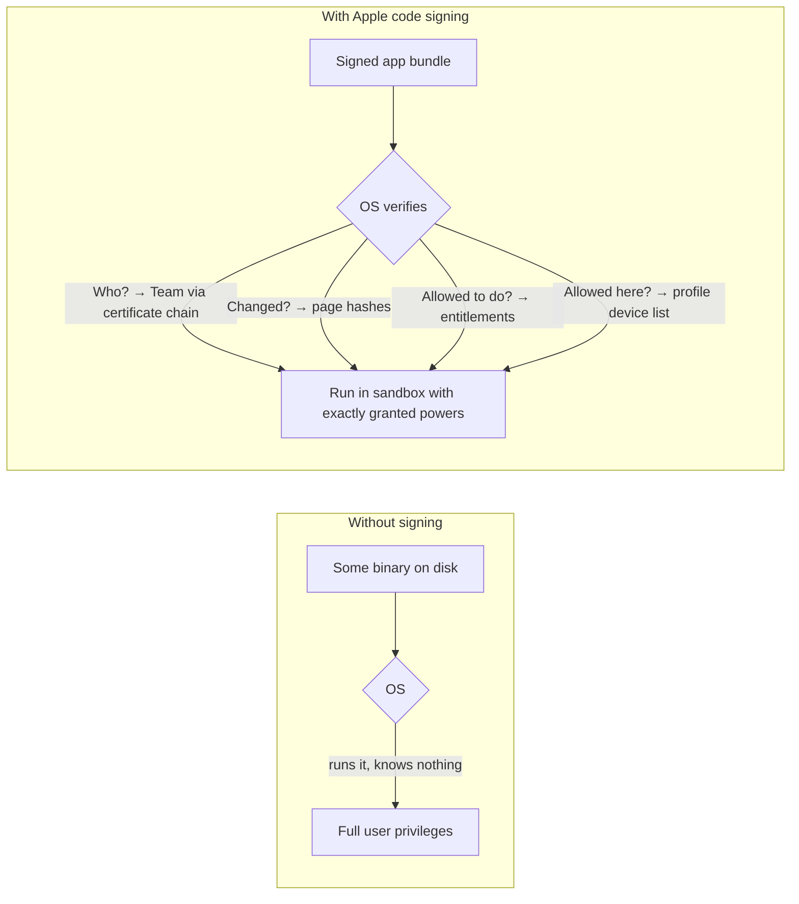

# Part 1 — Why Code Signing Exists

> **Where you are:** Stage 1, the problem.
> **What you'll know after this file:** the concrete threats Apple faced, why ordinary tools didn't answer them, and the constraints that shaped the design. By the end you should be able to *predict* roughly what certificates and profiles must do.

## 1. The world without signing

Picture a phone with no code signing, which is roughly desktop computing in the early 2000s:

- **Anyone can run anything.** A download link, an email attachment, or a compromised website can drop a native executable, and the OS runs it.
- **Code can be changed silently.** Malware can patch a legitimate app on disk, say a banking app, and the user can't tell.
- **No accountability.** When malicious code is found, nobody can say *who* wrote it, and there's no way to switch it off everywhere at once.
- **All-or-nothing privileges.** An app that can run at all can usually reach whatever the user can: contacts, keychain, network, other apps' files.

That was bearable on PCs, where users expected to manage risk themselves. It was unacceptable for the iPhone, a device that holds your identity, payments, location, and private conversations and is used by people who will never read a security dialog.

### Before vs. after

*How does signing change what the OS can know about a binary?*

## 2. The five questions Apple needed answered

Every security feature in this series exists to answer one of these, *on the device, offline, in milliseconds*:

| # | Question | Without an answer… |
|---|---|---|
| Q1 | **Who** produced this code? | No accountability, no way to ban bad actors |
| Q2 | Has it been **modified** since? | Malware can patch trusted apps |
| Q3 | What is it **allowed to do**? | Every app gets every privilege |
| Q4 | **Where** is it allowed to run? | A "test build" becomes a side channel that bypasses App Review |
| Q5 | Can Apple **revoke** it later? | A leaked key or rogue developer stays dangerous forever |

## 3. Why existing solutions weren't enough

**Plain hashes or checksums (MD5 next to the download).** These answer Q2 only, and only if the checksum comes from somewhere you trust. An attacker who can change the binary can change the checksum too.

**Classic Authenticode-style signing (Windows).** This answers Q1 and Q2: a Certificate Authority certifies the publisher's key, and the publisher signs the file. But:
- Many commercial CAs can issue certificates, so trust is spread out and hard to revoke.
- A signature says nothing about Q3 (privileges) or Q4 (which machines).
- Unsigned code still runs after a warning. Signing is advisory.

**"Just use the App Store."** Apple reviewing every binary answers a lot, but developers still have to:
- run unreviewed debug builds on their own phones, dozens of times a day,
- hand pre-release builds to a handful of testers,
- let large companies deploy internal apps to thousands of employees without public review.

Each of these is a hole in "only reviewed code runs". The system needs a way to allow **narrow, accountable, revocable exceptions**.

## 4. The constraints that shaped the design

1. **Apple is the only root of trust.** The device ships with Apple's root certificate. Every decision must chain back to it. No third-party CAs.
2. **Verification must work offline.** A phone on a plane still has to launch apps, so everything needed to verify must be **embedded in the app bundle**.
3. **Verification must be cheap at runtime.** Hashing a 200 MB binary at every launch is too slow, so hashes must be **per page** and checked lazily as memory is loaded.
4. **Private keys must stay with the developer.** Apple certifies keys but must never hold your signing key (for development builds at least).
5. **Exceptions must be bounded.** Debug and test builds are limited by **device list**, **time**, and **count**, so they can't become an unofficial store.
6. **Capabilities must be explicit.** Sensitive powers (push, iCloud, HealthKit, keychain sharing) must be **declared, approved for the App ID, and sealed into the signature**.

## 5. Predict the solution

From those constraints, you could sketch the design yourself:

- Apple needs to **certify a developer's public key** → a **signing certificate** issued by Apple's own CA (Q1, Q5).
- The developer needs to **seal every byte** of the app with that key → a **code signature** with per-page hashes (Q2).
- The app's privileges must be **declared and approved** → **entitlements**, tied to a registered **App ID** (Q3).
- Non-store builds must be **pinned to specific phones** → registered **device UDIDs** (Q4).
- Something Apple signs must **bind all of the above together** and ship inside the app, so the phone can check it offline → the **provisioning profile** (Q1, Q3, Q4, Q5).
- For App Store builds, Apple can simply **re-sign the app itself** after review, so end users' phones never need a profile listing them.

Everything else is detail. The rest of the series is that detail.

---
← [00 — Overview](00-overview.md) · Next → [02 — What it is](02-what.md) · [Concept map](03-concept-map.md)
