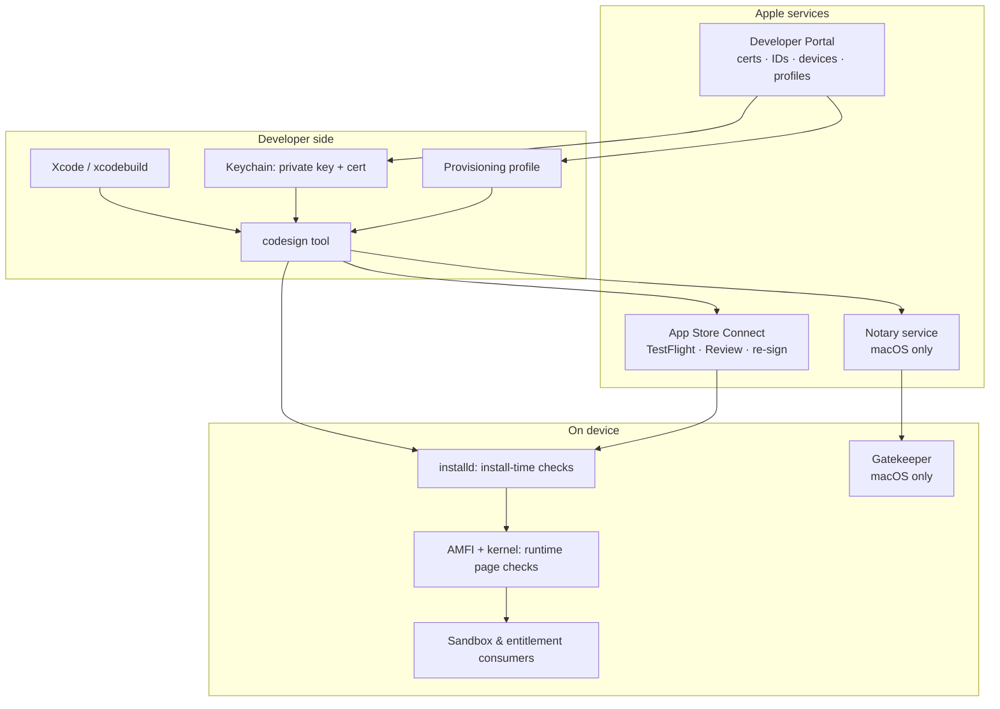

# Part 2 — What Apple Code Signing Is (and Isn't)

> **Where you are:** Stage 2, definition and boundaries.
> **What you'll know after this file:** a one-sentence definition, what the system deliberately does *not* do, and where it sits among neighbors like Gatekeeper, notarization, and App Review.

## 1. One-sentence definition

> **Apple code signing is a public-key system, rooted solely in Apple's certificate authority, that lets a device check offline who built a piece of code, that it is unmodified, what it may do, and where it may run, by checking a developer's signature against an Apple-signed provisioning profile embedded in the app.**

Each clause maps back to a question from Part 1:

| Clause | Answers |
|---|---|
| "rooted solely in Apple's CA" | Q5 (revocable), Q1 (trust chain) |
| "who built a piece of code" | Q1 |
| "that it is unmodified" | Q2 |
| "what it may do" | Q3 (entitlements) |
| "where it may run" | Q4 (device list) |
| "Apple-signed provisioning profile embedded in the app" | offline verification |

## 2. Boundaries: what it is **not**

- **Not a malware scanner.** A signature proves *origin and integrity*, not *good intent*. A validly signed app can still be malicious. Accountability and revocation are the deterrent, and App Review and notarization are the separate content checks.
- **Not encryption.** Signing doesn't hide your code. (App Store apps *are* also encrypted with FairPlay DRM, but that's a separate layer Apple adds at distribution time.)
- **Not the sandbox.** Entitlements are *inputs* to the sandbox and other OS policy. The enforcement lives in the kernel and in individual daemons.
- **Not user identity.** The certificate identifies a **Team** (a legal developer entity), not an end user or a device owner.
- **Not optional on iOS.** On macOS, unsigned or ad-hoc-signed code can still run in many cases. On iOS, iPadOS, watchOS, tvOS, and visionOS, **all third-party code must be validly signed** or the kernel refuses to run it.
- **Not permanent.** Certificates and profiles expire, which is the source of many "it worked last month" incidents.

## 3. Position in the ecosystem

*Where does code signing sit relative to the other Apple security layers?*

*Code signing is the thread that runs through every box. The other layers either produce signing inputs or consume what signing proves.*

### Neighbors, one line each

| Neighbor | How it differs from code signing |
|---|---|
| **App Review** | A *human and automated content review*. Signing proves who and what, Review judges whether it's acceptable. |
| **Notarization** (macOS) | Apple *scans* a Developer ID–signed app for malware and issues a ticket. It builds on signing and doesn't replace it. |
| **Gatekeeper** (macOS) | The *policy engine* that decides whether downloaded Mac software may launch. It reads signatures and notarization tickets. |
| **Sandbox** | Enforces *runtime isolation*. Its exceptions come from signed entitlements. |
| **FairPlay** | *DRM encryption* applied to App Store binaries. Unrelated to proving authorship. |
| **TLS/HTTPS certificates** | Same X.509 format, different trust store and purpose. Your website cert can't sign apps, and vice versa. |

## 4. Two vocabularies you'll hear

Apple's documentation and Xcode UI mix two kinds of word. Keep them apart:

- **Cryptographic objects:** key pair, certificate, certificate chain, CMS signature, CodeDirectory, cdhash. These are standard PKI and Mach-O concepts.
- **Apple policy objects:** Team, App ID, capability, entitlement, registered device, provisioning profile. These are Apple's rules for *who may sign what*.

Code signing is where the two meet. The crypto proves the facts, and the policy objects say which facts are acceptable.

---
← [01 — Why](01-why.md) · Next → [03 — Concept map](03-concept-map.md)
