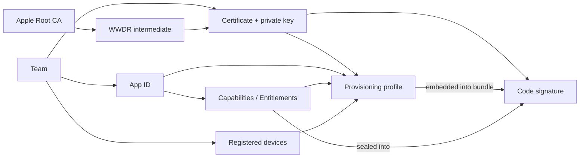
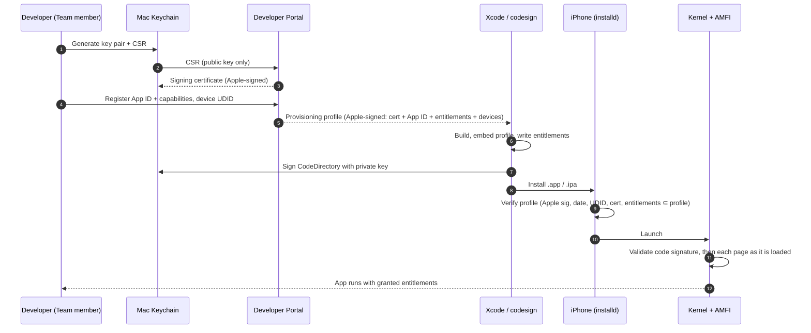

# Part 3 — The Concept Map

> **Where you are:** Stage 3, the whole territory at shallow depth.
> **What you'll know after this file:** the 8 core concepts in dependency order, the 7 key players with what each *owns / knows / does not do*, and the end-to-end happy path in one diagram. No internals yet; those come in the deep dives.

## 3.1 Domain mapping: from problem to concepts

Each concept is listed only after the ones it depends on.

| # | Real-world problem element | Apple concept | One-line definition | Why this abstraction |
|---|---|---|---|---|
| 1 | "A legally accountable developer" | **Team** (Team ID, e.g. `A1B2C3D4E5`) | The account entity in the Apple Developer Program that owns everything below | One ban-able, contract-signing identity, whether a person or a company |
| 2 | "Proof that a key belongs to that developer" | **Signing certificate** + **private key** | An X.509 cert issued by Apple's WWDR CA binding a public key to a Team, with the matching private key held only by the developer | Lets the device check authorship without contacting the developer |
| 3 | "Trust that the certificate itself is real" | **Certificate chain** | Leaf cert → Apple WWDR intermediate → Apple Root CA (pre-installed on every device) | One root that only Apple controls; revocation in one place |
| 4 | "Which app is this?" | **App ID** (`TEAMID.com.example.app`) | A registered identifier: Team ID prefix + bundle ID | Namespaces apps per team; anchor for capabilities |
| 5 | "What powers may the app use?" | **Capabilities → Entitlements** | Capabilities are enabled on the App ID in the portal. Entitlements are the key/value claims sealed into the signature (`aps-environment`, `keychain-access-groups`, …) | Least privilege, explicit and approved |
| 6 | "Which phones may run a test build?" | **Registered device** (UDID) | A device's unique ID registered to the Team, max 100 per device family per year | Stops test builds from becoming a shadow App Store |
| 7 | "An Apple-approved permission slip tying 1–6 together" | **Provisioning profile** | An Apple-signed plist: *these certs* may sign *this App ID* with *these entitlements* for *these devices* until *this date* | Lets the device check everything offline with only Apple's root |
| 8 | "Proof the bytes haven't changed" | **Code signature** (CodeDirectory, cdhash, CMS blob) | Per-page hashes of the binary plus hashes of resources, Info.plist, and entitlements, signed with the private key | Cheap, lazy, tamper-evident verification |

**Derived concepts** (they come up later and build on the 8 above): distribution method (Development / Ad Hoc / App Store / Enterprise / Developer ID), `get-task-allow`, designated requirement, `embedded.mobileprovision`, `.p12`, CSR, App Store Connect API key, Developer Mode, notarization ticket.

*How do the concepts depend on each other?*

## 3.2 Key players: from concepts to components

These seven components each get their own deep dive (5.1–5.8; 5.4 and 5.5 both live in the portal).

| Component | Owns | Knows | Does **not** do |
|---|---|---|---|
| **Apple Developer Account / Team** ([5.1](05-deep-dives/01-developer-account-and-team.md)) | Legal identity and membership; who on the team may do what (roles) | Team ID, members, roles, membership expiry, program type | Never signs code itself; holds no private keys |
| **Apple Developer Portal** (Certificates, Identifiers & Profiles) ([5.2](05-deep-dives/02-signing-certificates.md)–[5.5](05-deep-dives/05-provisioning-profiles.md)) | Issuing and revoking certificates; registering App IDs and devices; generating and signing provisioning profiles | Every cert, App ID, device UDID, and profile for the team | Never sees your private key; never inspects your code |
| **Developer Mac Keychain** ([5.2](05-deep-dives/02-signing-certificates.md)) | Generating and storing the **private key**; pairing it with the issued certificate into a *signing identity* | Private keys, certificates, Apple intermediate certs | Doesn't decide *what* may be signed; that's the profile's job |
| **Xcode / `codesign`** ([5.6](05-deep-dives/06-codesign-and-the-signature.md)) | Assembling the bundle, embedding the profile, writing entitlements, producing the signature | Build settings: team, bundle ID, signing identity, profile | Doesn't grant powers; it can only claim entitlements the profile allows |
| **iOS `installd` + MobileInstallation** ([5.7](05-deep-dives/07-on-device-verification.md)) | Install-time check: is the profile valid for this device, signer, and entitlements? | Installed profiles, device UDID, current date | Doesn't check every page at runtime |
| **AMFI + kernel** ([5.7](05-deep-dives/07-on-device-verification.md)) | Runtime check: every executable page must match a hash in a trusted signature; entitlements are handed to the OS | Trust caches, validated cdhashes | Doesn't care about App Store policy, only cryptographic validity and profile constraints |
| **App Store Connect / Apple distribution** ([5.8](05-deep-dives/08-distribution-and-resigning.md)) | Receiving uploads, TestFlight, Review, then **re-signing** with Apple's own key and FairPlay-encrypting | Your uploaded build, its entitlements, review status | Doesn't need your users' UDIDs; doesn't need your cert to stay valid after release |

## 3.3 Coordination at a glance

*How do the players cooperate, from a fresh Mac to an app running on an iPhone?*

**Two failure flows to keep in mind** (covered in the deep dives):
- **Device not in profile** → `installd` rejects at install: *"The app cannot be installed because its integrity could not be verified"* / *"A valid provisioning profile for this executable was not found."* (5.4, 5.7)
- **Entitlement claimed but not in profile** → install fails, or the OS silently denies the feature (e.g. no push token). (5.3, 5.7)

---
← [02 — What](02-what.md) · Next → [04 — Running example](04-running-example.md)
