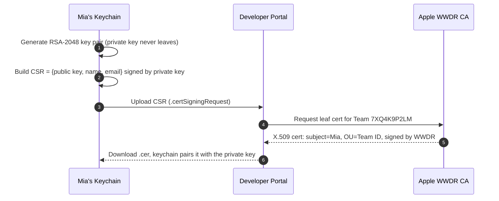
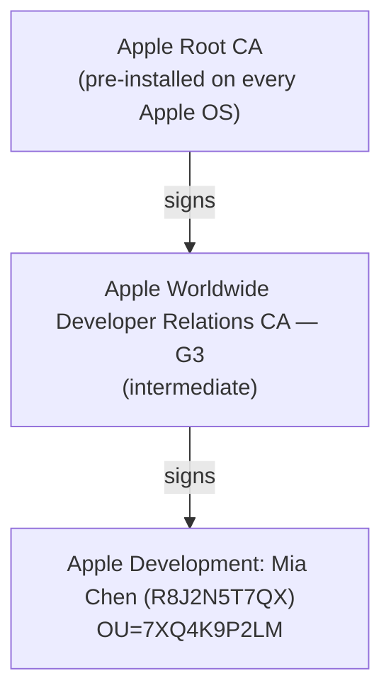

# 5.2 — Signing Certificates & Private Keys

> **Where you are:** second deep dive, the heart of "who built this?".
> **What you'll know after this file:** how a CSR becomes a certificate, why the private key is the actual secret, what the certificate chain looks like, which certificate types exist, and how expiry and revocation behave.

## Role recap
**Owns:** binding a public key to a Team, attested by Apple, so a device can check authorship (Q1) and Apple can revoke it (Q5). **Appears in PawPal steps:** 2, 8, 10, 11.

## Internal design

### The single most important fact
> **A certificate is public. The private key is the secret.** "Having the certificate" means nothing unless the matching private key is in your keychain. Most "missing signing identity" errors come down to this.

A **signing identity** = certificate + its matching private key, both present in a keychain. `codesign` and Xcode can only use identities, never bare certificates.

### From CSR to certificate

*How does a key pair on Mia's Mac turn into an Apple-issued certificate?*



The CSR is signed with the private key to prove *possession*: you can't request a certificate for someone else's public key. Apple only ever sees the **public** key.

With automatic signing, Xcode does all of this silently, which is convenient. It also explains why a teammate's new Mac "has the cert in the portal" but can't sign: the private key was generated on someone else's machine.

### Anatomy of the certificate

```bash
security find-certificate -c "Apple Development: Mia Chen" -p | openssl x509 -noout -text
```

Relevant fields (simplified):
```
Subject: UID=R8J2N5T7QX, CN=Apple Development: Mia Chen (R8J2N5T7QX),
         OU=7XQ4K9P2LM, O=Mia Chen, C=US
Issuer:  CN=Apple Worldwide Developer Relations Certification Authority, OU=G3, O=Apple Inc.
Validity: Not Before: Nov  1 2025, Not After: Nov  1 2026
X509v3 Extended Key Usage: Code Signing
1.2.840.113635.100.6.1.12: (Apple marker extension: development)
```

- **OU = Team ID.** This is how the device and the profile tie the cert to the team.
- **Apple-specific extension OIDs** (`1.2.840.113635.100.6.1.x`) mark the certificate *type*: development, distribution, Developer ID, and so on. Policy checks look at these, not at the name.
- **Validity:** typically **1 year** for Apple Development/Distribution certs, longer for Developer ID.

### The chain of trust

*Why does the iPhone trust Mia's certificate without ever having heard of her?*



On the Mac, the WWDR intermediate must be in the keychain or Xcode shows the cert as *"not trusted"* / *"issuer is invalid"*. A common cause is a stale intermediate after Apple rotated to a new generation (G3, G4…). The fix is to install the current one from Apple's PKI page.

### Certificate types

| Type | Used for | Who typically holds it |
|---|---|---|
| **Apple Development** | Debug builds on registered devices, all Apple platforms | Each developer, personally |
| **Apple Distribution** | Ad Hoc, App Store/TestFlight builds, all platforms | A small, guarded set; team-limited count |
| *iOS App Development / iOS Distribution* | Legacy platform-specific equivalents of the above | Older setups |
| **Developer ID Application** | macOS apps distributed **outside** the Mac App Store (notarized) | Account Holder (creation is restricted) |
| **Developer ID Installer** | Signing `.pkg` installers outside the store | Account Holder |
| **Mac Installer Distribution** | `.pkg` for Mac App Store submission | Distribution owners |
| **Enterprise (In-House) Distribution** | Enterprise Program internal apps | Enterprise teams only |
| *Apple Push Notification service SSL* | **Not code signing**: authenticates your server to APNs (now mostly replaced by `.p8` APNs keys) | Server team |

### Moving identities between machines: `.p12`
To use the same distribution identity on another Mac or on CI, export **certificate + private key** as a password-protected PKCS#12 file:

```bash
# Export (on the original Mac): Keychain Access → right-click identity → Export → .p12
# Import (on CI) into a throwaway keychain:
security create-keychain -p "$KC_PASS" build.keychain
security unlock-keychain -p "$KC_PASS" build.keychain
security set-keychain-settings -lut 21600 build.keychain
security import dist.p12 -k build.keychain -P "$P12_PASS" -T /usr/bin/codesign
security set-key-partition-list -S apple-tool:,apple: -s -k "$KC_PASS" build.keychain
security list-keychains -d user -s build.keychain login.keychain
security find-identity -v -p codesigning build.keychain
```

The `set-key-partition-list` line matters: without it, `codesign` can't use the key without a GUI prompt, and in headless CI that surfaces as **`errSecInternalComponent`**.

### Cloud-managed certificates
Recent Xcode versions can sign distribution builds with **cloud-managed certificates**: the distribution private key lives in Apple's infrastructure, and Xcode (authenticated with your account or an API key) asks Apple to perform the signature. This removes the "pass the `.p12` around" problem for teams that accept the trade-off.

## Interactions
- **← Team:** the cert's `OU` is the Team ID; only permitted roles can mint distribution certs.
- **→ Provisioning profile:** the profile lists the *exact certificates* (DER bytes) allowed to sign. A new cert means the profile has to be regenerated.
- **→ codesign:** the private key signs the CodeDirectory hash; the cert chain is embedded in the signature's CMS blob.

## ⚓ Back to the example
- **Step 2.** Xcode generates an RSA key in Mia's login keychain, sends a CSR, and receives `Apple Development: Mia Chen (R8J2N5T7QX)` with `OU=7XQ4K9P2LM`. `security find-identity -v -p codesigning` now lists one valid identity.
- **Step 8.** For Leo's Ad Hoc build she needs a **distribution** identity, so Xcode creates an `Apple Distribution: Mia Chen (7XQ4K9P2LM)` cert. The Ad Hoc profile must list *this* cert, not her development one.
- **Step 10.** CI has the profile but not the private key, so: *"No signing certificate 'Apple Distribution' found"*. Importing the `.p12` (above) or switching to cloud-managed signing fixes it.
- **Step 11.** After a year the distribution cert expires. New builds need a new cert, and every profile containing the old one has to be regenerated.

## Failure behavior
| Situation | Effect |
|---|---|
| **Private key lost** (Mac wiped, no backup) | The cert can't be used. Create a new cert (and regenerate profiles). App Store apps are unaffected. |
| **Cert expires** | Can't sign new builds with it. **App Store apps keep working** (Apple re-signed them). Development and Ad Hoc builds signed with it stop launching once their profile also stops being valid. |
| **Cert revoked** | Profiles containing it become invalid. **Enterprise**-signed apps stop launching on devices once they learn of the revocation (OCSP). Development and Ad Hoc builds are also affected. App Store apps are not. |
| **Too many distribution certs** | Portal refuses to create more until you revoke one. Coordinate in teams, or use cloud-managed certs. |
| **Missing WWDR intermediate** | Mac shows "certificate not trusted"; codesign may fail to build the chain. |

---
← [5.1 — Developer Account & Team](01-developer-account-and-team.md) · Next → [5.3 — App IDs & Entitlements](03-app-ids-and-entitlements.md) · [Concept map](../03-concept-map.md)
