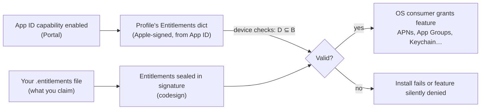

# 5.3 — App IDs, Capabilities & Entitlements

> **Where you are:** third deep dive, "what is this app and what may it do?".
> **What you'll know after this file:** how App IDs namespace apps, how a portal *capability* becomes a signed *entitlement*, and the three-way agreement (App ID ↔ profile ↔ signature) every entitlement must satisfy.

## Role recap
**Owns:** the app's registered identity and its approved powers (Q3). **Appears in PawPal steps:** 3 (register, enable capabilities), 6 (entitlements sealed at signing), 7 (OS enforces them).

## Internal design

### App ID = prefix + bundle ID
```
7XQ4K9P2LM . com.miachen.pawpal
└─ App ID Prefix ─┘ └── Bundle ID (CFBundleIdentifier) ──┘
   (normally the Team ID)
```

| Kind | Example | Capabilities | Used for |
|---|---|---|---|
| **Explicit** | `7XQ4K9P2LM.com.miachen.pawpal` | All, including push, App Groups, iCloud, HealthKit, Sign in with Apple… | Any real app |
| **Wildcard** | `7XQ4K9P2LM.com.miachen.*` or `7XQ4K9P2LM.*` | Only a basic set; no push, no App Groups, etc. | Quick prototypes, generic test profiles |

Every **target that produces a separate binary** needs its own App ID: the app, the widget extension, a notification service extension, a watch app. Each is signed separately.

### Capability → entitlement: a three-way agreement

A **capability** is a switch on the App ID in the Portal (or in Xcode's *Signing & Capabilities* tab, which flips it for you).
An **entitlement** is a key/value pair in the *signed* binary that the OS reads at runtime.

*What has to line up for an entitlement to actually work?*



The rule: **what you sign (D) must be allowed by the profile (B), and the profile can only allow what the App ID has enabled (A).** You can *claim* anything in your `.entitlements` file, but only Apple, through the profile, can *authorize* it.

### Common entitlements

| Entitlement key | Example value | Comes from | Notes |
|---|---|---|---|
| `application-identifier` | `7XQ4K9P2LM.com.miachen.pawpal` | Always | Must match the App ID |
| `com.apple.developer.team-identifier` | `7XQ4K9P2LM` | Always | |
| `get-task-allow` | `true` (dev) / `false` (dist) | Profile type | Lets a debugger attach. **Never true in App Store builds** |
| `keychain-access-groups` | `["7XQ4K9P2LM.*"]` | Always (prefix-scoped) | Sharing keychain items between your apps |
| `aps-environment` | `development` / `production` | Push capability | Chooses sandbox vs production APNs |
| `com.apple.security.application-groups` | `["group.com.miachen.pawpal"]` | App Groups capability | Shared container between app and extensions |
| `com.apple.developer.icloud-container-identifiers` | `["iCloud.com.miachen.pawpal"]` | iCloud | |
| `com.apple.developer.associated-domains` | `["applinks:pawpal.app"]` | Associated Domains | Universal links, webcredentials |
| `beta-reports-active` | `true` | App Store profiles | TestFlight |

Some entitlements are **managed / restricted** (e.g. certain networking, CarPlay, critical alerts). Apple has to approve them for your team, and only then do they appear as options on the App ID or profile.

### Note on `$(AppIdentifierPrefix)` and variables
Your `.entitlements` file usually contains build-setting variables:
```xml
<key>keychain-access-groups</key>
<array><string>$(AppIdentifierPrefix)com.miachen.pawpal</string></array>
```
Xcode expands them at build time and *merges* in profile-derived keys (`application-identifier`, `get-task-allow`, `aps-environment` value) to produce the final entitlements that `codesign` seals.

## Interactions
- **← Team:** the App ID prefix is the Team ID; App IDs can't be shared across teams.
- **→ Provisioning profile:** the profile copies the App ID's allowed entitlements (with wildcards in places like `keychain-access-groups`).
- **→ codesign:** the final entitlements plist (and a DER-encoded copy) is hashed into the CodeDirectory's special slots, so changing entitlements after signing breaks the signature.
- **→ OS consumers:** `apsd` (push), `securityd` (keychain), `containermanagerd` (app groups) read the *signed* entitlements of the calling process.

## ⚓ Back to the example
- **Step 3.** Mia registers `7XQ4K9P2LM.com.miachen.pawpal` **and** `7XQ4K9P2LM.com.miachen.pawpal.widget`, enables *Push Notifications* on the app and *App Groups* (`group.com.miachen.pawpal`) on both. Her `PawPal.entitlements`:
  ```xml
  <dict>
    <key>aps-environment</key><string>development</string>
    <key>com.apple.security.application-groups</key>
    <array><string>group.com.miachen.pawpal</string></array>
  </dict>
  ```
- **Step 6.** At signing, Xcode produces the final entitlements and `codesign` seals them. Check:
  ```bash
  codesign -d --entitlements - --xml PawPal.app | plutil -p -
  # "application-identifier" => "7XQ4K9P2LM.com.miachen.pawpal"
  # "aps-environment" => "development"
  # "get-task-allow" => 1
  # "com.apple.security.application-groups" => [ "group.com.miachen.pawpal" ]
  ```
- **Step 7.** On launch, PawPal calls `registerForRemoteNotifications()`. `apsd` reads `aps-environment = development` and issues a **sandbox** device token. If Mia's server sends to the *production* APNs endpoint, delivery fails, a classic "push works in TestFlight but not in debug" mix-up (or the reverse).
- **Variation: what if** she forgets App Groups on the widget's App ID? The widget's profile lacks the group, the widget's signed entitlements claim it, and on install `installd` rejects with an entitlement mismatch, or Xcode refuses earlier with *"Provisioning profile doesn't include the com.apple.security.application-groups entitlement."*

## Failure behavior
| Situation | Effect |
|---|---|
| Entitlement in `.entitlements` but not in profile | Xcode signing error; or install rejected (*"entitlements … not valid"*) |
| Capability enabled after profile was made | Profile is now stale. Regenerate it (automatic signing does this) |
| `aps-environment` mismatch vs server endpoint | `BadDeviceToken` from APNs |
| Bundle ID in Info.plist ≠ App ID in profile | *"Provisioning profile doesn't match bundle identifier"* |
| Re-signing someone else's app with your profile | `application-identifier`, team ID, and keychain groups all change, so the app loses access to its old keychain items and containers |

---
← [5.2 — Signing Certificates](02-signing-certificates.md) · Next → [5.4 — Devices](04-devices.md) · [Concept map](../03-concept-map.md)
