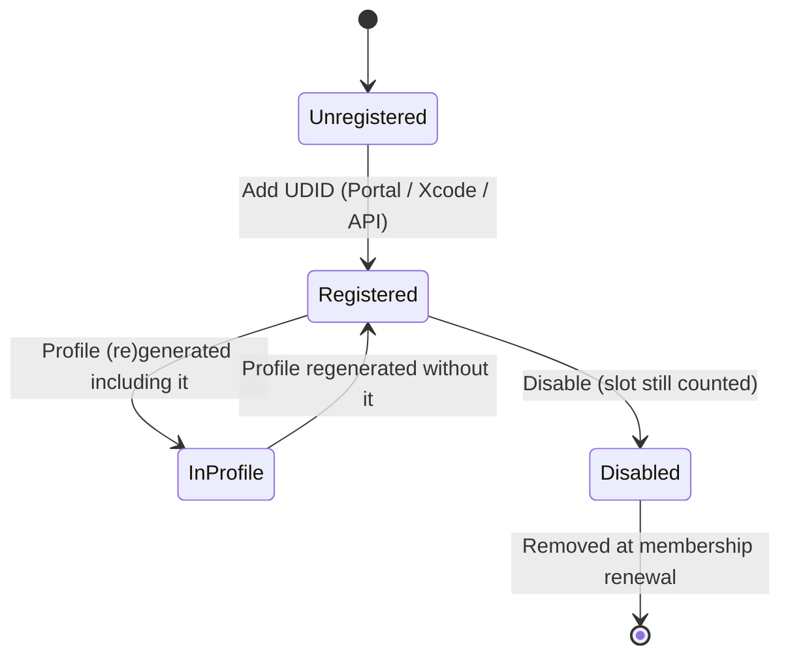

# 5.4 — Registered Devices

> **Where you are:** fourth deep dive, a short one. "Where may this non-store build run?"
> **What you'll know after this file:** what a UDID is, why device registration is capped, and how it fences development and Ad Hoc builds.

## Role recap
**Owns:** the allow-list of physical devices for non-App-Store builds (Q4). **Appears in PawPal steps:** 4 (Mia's iPhone), 8 (Leo's iPhone, the first failure).

## Internal design

### UDID
The **Unique Device Identifier** is a hardware-derived ID per device. Modern format: `00008110-001A2B3C4D5E801E` (chip ID + ECID). Apps can't read it at runtime; it's only exposed to trusted tools:

- Xcode → Window → Devices and Simulators
- Finder (click the serial number under the device name until it shows UDID)
- `xcrun devicectl list devices` (Xcode 15+), or `idevice_id -l` (libimobiledevice)
- For remote testers: a configuration-profile-based UDID capture page, or TestFlight (which avoids UDIDs entirely)

### Why a cap?
Without a cap, a "development" build plus unlimited device registration would be a private App Store that skips App Review. So Apple limits it to:

- **100 devices per device family** (iPhone, iPad, Apple Watch, Apple TV, Apple Vision Pro, Mac) **per membership year**.
- Deleting a device does **not** free its slot until the membership renews, when you get a one-time chance to clean up the list.

### Device lifecycle


*A device only matters once it's inside a profile. Registering alone changes nothing on existing builds.*

### Which profiles care about devices?

| Profile type | Device list? |
|---|---|
| Development | ✅ `ProvisionedDevices` |
| Ad Hoc | ✅ `ProvisionedDevices` |
| App Store / TestFlight | ❌ none (Apple re-signs) |
| Enterprise In-House | ❌ `ProvisionsAllDevices = true` |
| Developer ID (macOS) | ❌ |

## Interactions
- **→ Provisioning profile:** UDIDs are copied into `ProvisionedDevices`. **Adding a device never updates existing profiles.** They must be regenerated, and the app re-signed with the new profile.
- **→ installd:** on install, the device compares its own UDID against the list in `embedded.mobileprovision`.

## ⚓ Back to the example
- **Step 4.** Mia connects her iPhone; Xcode registers `00008110-001A2B3C4D5E801E` and (with automatic signing) regenerates the dev profile.
- **Step 8, the failure.** The Ad Hoc profile was generated *before* Leo's phone was known. AirDropping the `.ipa` to Leo's iPhone `00008120-000F1E2D3C4B5A6E` gives *"Unable to Install 'PawPal'"*. The device log shows something like:
  ```
  installd: ... Failed to verify code signature ... The executable was signed with invalid entitlements
  or: ... 0xe8008012 (A valid provisioning profile for this executable was not found.)
  ```
  The fix: register Leo's UDID → regenerate the Ad Hoc profile → re-export the archive with it → reinstall. Check before sending:
  ```bash
  security cms -D -i PawPal.app/embedded.mobileprovision | plutil -extract ProvisionedDevices xml1 -o - -
  ```

## Failure behavior
| Situation | Effect |
|---|---|
| Device not in profile | Install rejected |
| Device limit reached | Can't register more until renewal. Use TestFlight for broad testing |
| New device for a tester | Rebuild/re-export needed; old `.ipa` stays unusable on it |
| iOS 16+ device without **Developer Mode** | Development-signed builds won't launch until the user enables Settings → Privacy & Security → Developer Mode (Ad Hoc / TestFlight / App Store builds don't need it) |

---
← [5.3 — App IDs & Entitlements](03-app-ids-and-entitlements.md) · Next → [5.5 — Provisioning Profiles](05-provisioning-profiles.md) · [Concept map](../03-concept-map.md)
