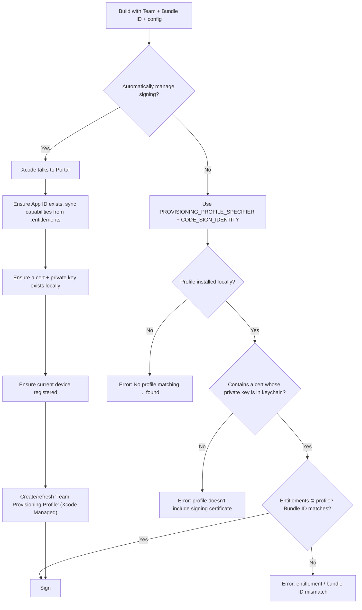

# 5.5 — Provisioning Profiles

> **Where you are:** fifth deep dive, the keystone. Everything before this was an ingredient; the profile is where they're bound together.
> **What you'll know after this file:** what's physically inside a `.mobileprovision`, the profile types, how Xcode picks one, where they live, and how to inspect and debug them.

## Role recap
**Owns:** Apple's signed statement that *these certificates* may sign *this App ID* with *these entitlements* for *these devices* until *this date*. It answers Q1, Q3, Q4, and Q5 offline. **Appears in PawPal steps:** 5, 8, 9, 11.

## Internal design

### It's a signed plist
A `.mobileprovision` file is a **CMS (PKCS#7) SignedData** envelope. The payload is an XML plist, and the signer is Apple. Decode it:

```bash
security cms -D -i ~/Downloads/PawPal_Dev.mobileprovision > profile.plist
# or: openssl smime -inform der -verify -noverify -in PawPal_Dev.mobileprovision
```

Trimmed result for PawPal's development profile:

```xml
<dict>
  <key>AppIDName</key>                 <string>PawPal</string>
  <key>ApplicationIdentifierPrefix</key><array><string>7XQ4K9P2LM</string></array>
  <key>TeamIdentifier</key>            <array><string>7XQ4K9P2LM</string></array>
  <key>TeamName</key>                  <string>Mia Chen</string>
  <key>Name</key>                      <string>iOS Team Provisioning Profile: com.miachen.pawpal</string>
  <key>UUID</key>                      <string>3f1c9a2e-6b7d-4e8a-9c01-2d5f8e7b6a43</string>
  <key>Platform</key>                  <array><string>iOS</string></array>
  <key>CreationDate</key>              <date>2025-11-01T10:12:00Z</date>
  <key>ExpirationDate</key>            <date>2026-11-01T10:12:00Z</date>

  <key>DeveloperCertificates</key>     <!-- the exact certs allowed to sign -->
  <array><data>MIIFxjCCBK6gAwIBAgIQ...</data></array>

  <key>Entitlements</key>              <!-- the MAXIMUM the app may claim -->
  <dict>
    <key>application-identifier</key>  <string>7XQ4K9P2LM.com.miachen.pawpal</string>
    <key>com.apple.developer.team-identifier</key><string>7XQ4K9P2LM</string>
    <key>get-task-allow</key>          <true/>
    <key>aps-environment</key>         <string>development</string>
    <key>com.apple.security.application-groups</key>
    <array><string>group.com.miachen.pawpal</string></array>
    <key>keychain-access-groups</key>  <array><string>7XQ4K9P2LM.*</string><string>com.apple.token</string></array>
  </dict>

  <key>ProvisionedDevices</key>        <!-- where it may run -->
  <array><string>00008110-001A2B3C4D5E801E</string></array>
</dict>
```

Each block answers one question:

| Profile key | Question |
|---|---|
| `TeamIdentifier`, `DeveloperCertificates` | **Who** may sign (Q1) |
| `Entitlements` | **What** it may do (Q3) |
| `ProvisionedDevices` / `ProvisionsAllDevices` | **Where** (Q4) |
| `ExpirationDate` + Apple's signature | **Until when / revocable** (Q5) |

### Profile types

| Type | Cert type inside | Devices | `get-task-allow` | `aps-environment` | Typical validity |
|---|---|---|---|---|---|
| **iOS App Development** | Apple Development (one or many devs) | Listed | `true` | `development` | ~1 year (7 days on free teams) |
| **Ad Hoc** | Apple Distribution | Listed | `false` | `production` | ~1 year, capped by cert expiry |
| **App Store Connect** | Apple Distribution | None | `false` | `production` | ~1 year (only matters at upload time) |
| **In-House** (Enterprise) | Enterprise Distribution | All (`ProvisionsAllDevices`) | `false` | `production` | ~1 year |
| **Developer ID** (macOS) | Developer ID Application | None | `false` | n/a | longer |
| **Mac Development / Mac App Store** | Apple Development / Distribution | Macs listed (dev) / none | | | |

A profile **can never outlive the certificates inside it** in a useful way. When a cert expires, profiles containing it become invalid.

### Automatic vs. manual signing

*How does Xcode end up with the right profile?*



- **Automatic:** best for solo developers and dev builds. Xcode-managed profiles are regenerated as needed (you'll see names like *"iOS Team Provisioning Profile: …"*).
- **Manual:** best for distribution on CI and for teams that want deterministic, shared assets (often with *fastlane match*, which stores encrypted certs and profiles in a git repo or bucket).

### Where profiles live
- On the Mac (current Xcode): `~/Library/Developer/Xcode/UserData/Provisioning Profiles/` (older Xcode versions used `~/Library/MobileDevice/Provisioning Profiles/`). Files are named `<UUID>.mobileprovision`.
- **Inside the app:** `PawPal.app/embedded.mobileprovision` (iOS) or `PawPal.app/Contents/embedded.provisionprofile` (macOS). Each extension has its own.
- On the device: installed profiles are stored by the system. Settings → General → VPN & Device Management shows Enterprise profiles.

### Inspecting a built app

```bash
# Which profile is embedded?
security cms -D -i PawPal.app/embedded.mobileprovision | plutil -p - | egrep 'Name|UUID|ExpirationDate|aps-environment|get-task-allow'

# Which cert signed the binary, and is it one of the profile's DeveloperCertificates?
codesign -dvv PawPal.app 2>&1 | grep Authority
security cms -D -i PawPal.app/embedded.mobileprovision \
  | plutil -extract DeveloperCertificates.0 raw -o - - | base64 -d \
  | openssl x509 -inform der -noout -subject -enddate
```

## Interactions
- **← Portal:** generated from Team + Certificates + App ID (capabilities) + Devices, then signed by Apple.
- **→ Xcode/codesign:** embedded into the bundle; its `Entitlements` dict is the allow-list for what Xcode puts in the signature.
- **→ installd:** the primary input to install-time checks (5.7).
- **Not used by** App Store end-user devices for store builds: after re-signing, Apple's own signature takes over (5.8).

## ⚓ Back to the example
- **Step 5.** Xcode (automatic signing) creates the dev profile above: Mia's dev cert, the App ID, `get-task-allow = true`, `aps-environment = development`, App Group, her UDID. A separate profile is created for `com.miachen.pawpal.widget`.
- **Step 8.** For Leo, Xcode's *Distribute App → Ad Hoc* uses an **Ad Hoc profile**: Apple Distribution cert, `get-task-allow = false`, `aps-environment = production`, and `ProvisionedDevices` = **only Mia's phone** at first. That's why Leo's install failed. Regenerated with both UDIDs, it works.
- **Step 9.** For the App Store, the **App Store Connect profile** has *no* device list. It's used only to make a valid upload; once Apple re-signs, nobody's phone will look at it.
- **Step 11.** A year on, the Ad Hoc profile's `ExpirationDate` passes and Leo's PawPal won't launch. The App Store build is unaffected.

## Failure behavior
| Situation | Typical message | Fix |
|---|---|---|
| Profile expired | *"Profile has expired"*; app on device won't launch | Regenerate, re-sign, reinstall |
| Cert in profile ≠ local identity | *"Provisioning profile 'X' doesn't include signing certificate 'Y'"* | Regenerate the profile with your cert, or import the right `.p12` |
| No profile for bundle ID | *"No profiles for 'com.miachen.pawpal' were found"* | Create one or enable automatic signing / `-allowProvisioningUpdates` |
| Capability added later | *"Provisioning profile doesn't support the Push Notifications capability"* | Regenerate after enabling it on the App ID |
| Two profiles match, wrong one picked | Weird entitlement errors | Delete stale profiles in the folder above; specify the profile by name/UUID |
| Wrong profile type | e.g. dev profile used for App Store upload | Upload validation error: *"Invalid Provisioning Profile"* |

---
← [5.4 — Devices](04-devices.md) · Next → [5.6 — codesign & the Signature](06-codesign-and-the-signature.md) · [Concept map](../03-concept-map.md)
