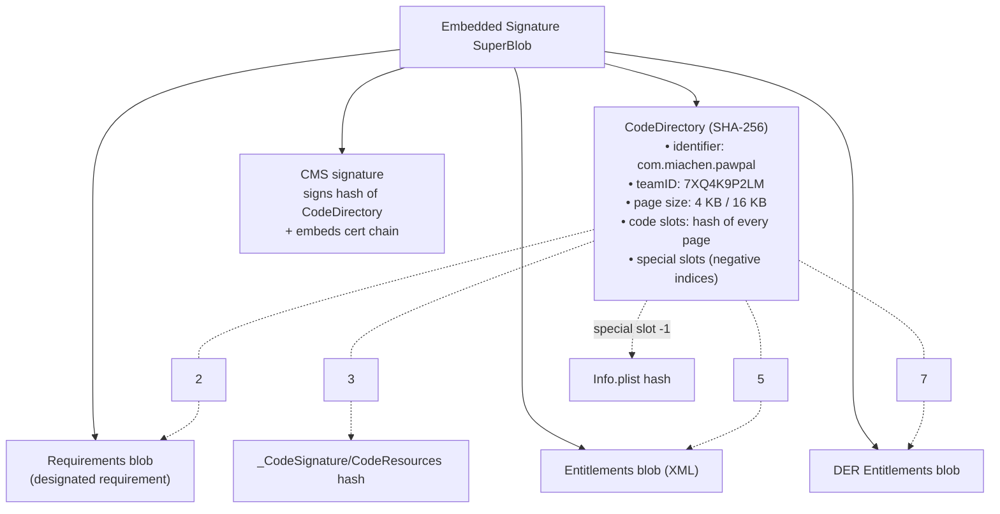

# 5.6 — `codesign` & the Signature Inside Your App

> **Where you are:** sixth deep dive, the cryptographic core. How the "unmodified" claim (Q2) is physically built.
> **What you'll know after this file:** the structure of an Apple code signature (SuperBlob, CodeDirectory, special slots, CMS blob), what a cdhash is, how resources are sealed, signing order for nested code, and how to inspect it all.

## Role recap
**Owns:** turning a built bundle plus a signing identity plus a profile into a tamper-evident, Apple-verifiable object. **Appears in PawPal step:** 6.

## Internal design

### Where the signature lives
For a Mach-O executable, the signature is appended to the end of the `__LINKEDIT` segment and referenced by the `LC_CODE_SIGNATURE` load command:

```bash
otool -l PawPal.app/PawPal | grep -A4 LC_CODE_SIGNATURE
#      cmd LC_CODE_SIGNATURE
#  cmdsize 16
#  dataoff 1843200
# datasize 39872
```

Non-code files (images, storyboards, plists) are sealed separately in `PawPal.app/_CodeSignature/CodeResources`.

### Structure: the SuperBlob

*What's inside the signature blob?*



The key design point:

1. **Code slots**: the binary is split into pages; each page's hash goes into the CodeDirectory. This allows *lazy* verification: the kernel checks a page only when it's paged in (constraint 3 from Part 1).
2. **Special slots**: hashes of Info.plist, the requirements, the resource seal, and the entitlements. Changing *any* of them changes the CodeDirectory.
3. **CMS signature**: the private key signs **only the CodeDirectory's hash**, not the whole binary. One signature transitively covers every page, every resource, and the entitlements.

### The cdhash
The **cdhash** is the hash of the CodeDirectory. It's the app's cryptographic fingerprint, and it's what the kernel caches, what trust caches list, and what notarization tickets reference.

```bash
codesign -dvvv PawPal.app 2>&1 | egrep 'Identifier|TeamIdentifier|CDHash|Authority|Hash type|Signed Time'
# Identifier=com.miachen.pawpal
# Hash type=sha256 size=32
# CDHash=4b6f0e1d2c3a...
# Authority=Apple Development: Mia Chen (R8J2N5T7QX)
# Authority=Apple Worldwide Developer Relations Certification Authority
# Authority=Apple Root CA
# TeamIdentifier=7XQ4K9P2LM
```

### Resource sealing (`CodeResources`)
A plist mapping each bundle file to its hash, plus rules for what's sealed, omitted, or nested:
```xml
<key>files2</key>
<dict>
  <key>Assets.car</key>          <dict><key>hash2</key><data>…</data></dict>
  <key>embedded.mobileprovision</key><dict><key>hash2</key><data>…</data></dict>
  <key>PlugIns/PawPalWidget.appex</key>
      <dict><key>cdhash</key><data>…</data><key>requirement</key><string>…</string></dict>
</dict>
```
So the **embedded profile is itself sealed**: you can't swap the profile without re-signing. And **nested code** (extensions, frameworks) is referenced by *its own* cdhash.

### Signing order: inside out
Because the outer seal records the inner cdhashes, signing must go **from the innermost code outward**:

```
1. Frameworks/*.framework (and dylibs)
2. PlugIns/PawPalWidget.appex   (with its own profile + entitlements)
3. PawPal.app                    (last; seals everything above)
```
Xcode does this automatically. Manual re-signing scripts that sign the outer app first, or use `--deep` naively, produce broken or wrongly entitled nested code. (`--deep` is discouraged for signing; it's fine for *verification*.)

### The designated requirement
A small expression, compiled into the Requirements blob, that says *"what future versions of this code must satisfy to count as the same app"*:
```bash
codesign -d -r- PawPal.app
# designated => identifier "com.miachen.pawpal" and anchor apple generic
#   and certificate leaf[subject.CN] = "Apple Development: Mia Chen (R8J2N5T7QX)"
#   and certificate 1[field.1.2.840.113635.100.6.2.1] /* exists */
```
On macOS especially, keychain ACLs and TCC permissions are tied to this. That's why changing signing identity on a Mac app can make it "forget" granted permissions.

### What `codesign` actually runs (from Xcode's build log)
```bash
/usr/bin/codesign --force --sign 9F3A...C1 \
  --entitlements /…/PawPal.app.xcent \
  --timestamp=none --generate-entitlement-der \
  /…/Build/Products/Debug-iphoneos/PawPal.app
```
- `--sign` takes the identity's SHA-1 (from `security find-identity`).
- `.xcent` = the final merged entitlements (5.3).
- `--timestamp` (secure timestamp from Apple's TSA) is used for distribution and Developer ID signatures; it proves *when* signing happened, so the signature stays valid after the cert expires.

## Interactions
- **← Keychain:** private key performs the CMS signature (may prompt for access, or fail headless with `errSecInternalComponent`).
- **← Profile:** embedded, sealed via `CodeResources`; its `DeveloperCertificates` must include the signing cert.
- **← Entitlements:** sealed in special slots; must be ⊆ profile.
- **→ installd / AMFI:** they verify the CMS signature, the chain, and the CodeDirectory, then pages lazily.

## ⚓ Back to the example
**Step 6 in full:**
1. Xcode compiles `PawPalWidget.appex`, copies `PawPalWidget_Dev.mobileprovision` into it as `embedded.mobileprovision`, writes the widget's `.xcent` (with the App Group), and runs `codesign` on it, producing cdhash `W`.
2. It copies PawPal's dev profile to `PawPal.app/embedded.mobileprovision`, generates `CodeResources` (which records `PlugIns/PawPalWidget.appex → cdhash W` and the profile's hash), builds the CodeDirectory for the `PawPal` executable (page hashes + special slots), and signs its hash with Mia's private key.
3. `codesign --verify --deep --strict --verbose=2 PawPal.app` → `valid on disk / satisfies its Designated Requirement`.

Tamper test: change one byte of `Assets.car` and run verify again → `a sealed resource is missing or invalid`. Change one byte of code → the page hash mismatches and the kernel kills the process when that page is loaded on device.

## Failure behavior
| Situation | Effect |
|---|---|
| File modified after signing | `codesign --verify` fails; device refuses install or kills on page fault |
| Nested code signed after the outer bundle | Outer seal has stale cdhash → invalid |
| Extended attributes / resource forks on files | `resource fork, Finder information, or similar detritus not allowed`; fix with `xattr -cr` |
| Keychain locked or key ACL denies codesign | `errSecInternalComponent` (CI) |
| Wrong identity hash/name | `no identity found` |

---
← [5.5 — Provisioning Profiles](05-provisioning-profiles.md) · Next → [5.7 — On-Device Verification](07-on-device-verification.md) · [Concept map](../03-concept-map.md)
