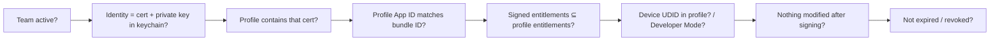

# Part 7 — Troubleshooting, CI Recipes & Next Steps

> **Where you are:** the practical appendix.
> **What you'll know after this file:** how to debug any signing error from first principles, a CI checklist, hands-on exercises, and where to read further.

## 1. The universal debugging method

Every signing error is a failure of one link in this chain. Find the broken link:



### The five commands that answer almost everything
```bash
# 1. Which identities can I actually sign with?
security find-identity -v -p codesigning

# 2. What's in this profile?
security cms -D -i path/to/embedded.mobileprovision | plutil -p -

# 3. Who signed this app, and how?
codesign -dvvv PawPal.app

# 4. What entitlements are sealed in it?
codesign -d --entitlements - --xml PawPal.app | plutil -p -

# 5. Is the signature intact?
codesign --verify --deep --strict --verbose=4 PawPal.app
```

## 2. Error → cause → fix

| Error (Xcode / device / CI) | Broken link | Fix |
|---|---|---|
| *No signing certificate "iOS Development" found* | B | Create a cert, or import the `.p12` with the private key |
| *Provisioning profile "X" doesn't include signing certificate "Y"* | C | Regenerate the profile including your cert, or use the matching identity |
| *No profiles for 'com.x.y' were found* | D | Create the App ID and profile; enable automatic signing or `-allowProvisioningUpdates` |
| *Provisioning profile doesn't include the aps-environment entitlement* | E | Enable the capability on the App ID → regenerate profile |
| *Unable to install … integrity could not be verified* | F / E | Add UDID, regenerate, re-export; check widget/extension profiles too |
| Dev build won't open on iOS 16+ | F | Turn on Developer Mode |
| *errSecInternalComponent* (CI) | B | Unlock the keychain; `security set-key-partition-list -S apple-tool:,apple: …` |
| *a sealed resource is missing or invalid* | G | Something touched the bundle after signing; re-sign, or stop post-build scripts from modifying it |
| *resource fork, Finder information, or similar detritus not allowed* | G | `xattr -cr PawPal.app` before signing |
| Certificate shows "not trusted" on Mac | B (chain) | Install the current Apple WWDR intermediate |
| Push works in debug, not TestFlight (or vice versa) | E | Server is using the wrong APNs environment for `aps-environment` |
| Enterprise app: *Untrusted Developer* | F | Trust it in Settings → General → VPN & Device Management |
| Ad Hoc app suddenly won't launch after a year | H | Profile/cert expired; regenerate and redistribute |

## 3. CI checklist

- [ ] Use an **App Store Connect API key** (`.p8`, Key ID, Issuer ID) stored as a CI secret. Never a personal Apple ID.
- [ ] Pick one strategy and stick to it:
  - **Automatic + API key + cloud-managed certs:** `xcodebuild -allowProvisioningUpdates -authenticationKey…`. Least to maintain.
  - **Manual with shared assets** (e.g. *fastlane match*): encrypted certs and profiles in a private repo or bucket, read-only on CI. Deterministic, and works well for teams.
- [ ] If you import a `.p12`: create a **temporary keychain**, unlock it, set a timeout, `set-key-partition-list`, add it to the search list, and **delete it after the build**.
- [ ] Pin profiles per bundle ID in `ExportOptions.plist`, including every extension.
- [ ] Track expiry: alert 30 days before distribution certs and Ad Hoc/Enterprise profiles expire.
- [ ] Never commit `.p12`, `.p8`, or `.mobileprovision` files unencrypted.

## 4. Exercises

1. **Dissect a profile.** Decode one from `~/Library/Developer/Xcode/UserData/Provisioning Profiles/`, extract `DeveloperCertificates.0`, and match its SHA-1 against `security find-identity`.
2. **Break a signature on purpose.** Build PawPal for a device, edit a PNG inside the `.app`, and run `codesign --verify`. Then re-sign with `codesign --force --sign <identity> --entitlements …` and verify again.
3. **Entitlement subset test.** Add an entitlement to `.entitlements` that the App ID doesn't have. Note the exact Xcode error and which link (E) failed.
4. **Ad Hoc device test.** Export an Ad Hoc build, inspect `ProvisionedDevices`, and predict which devices can install it before trying.
5. **Compare Authority chains.** Run `codesign -dvv` on your dev build and on an App Store app copied from a Mac (`/Applications/*.app` from the Mac App Store), and compare the `Authority=` lines.
6. **macOS notarization.** Sign a tiny Mac app with Developer ID + `--options runtime`, notarize with `notarytool`, staple it, and check with `spctl -a -vv`.

## 5. Further reading

- Apple: *Code Signing Guide* (archive), *TN3125: Inside Code Signing: Provisioning Profiles*, *TN3126: Inside Code Signing: Hashes*, *TN3127: Inside Code Signing: Requirements*, *TN2206: macOS Code Signing In Depth*.
- Apple Platform Security Guide: sections on *App code signing process*, *Runtime process security*.
- Apple Developer documentation: *Distributing your app for beta testing and releases*, *Notarizing macOS software before distribution*, *Enabling Developer Mode on a device*.
- App Store Connect API: *Provisioning* endpoints (Certificates, Profiles, Devices, Bundle IDs).
- Apple Developer Forums, Code Signing tag. Apple DTS engineers post detailed explanations there.

---
← [06 — Walkthrough](06-walkthrough.md) · [00 — Overview](00-overview.md) · [Concept map](03-concept-map.md)
