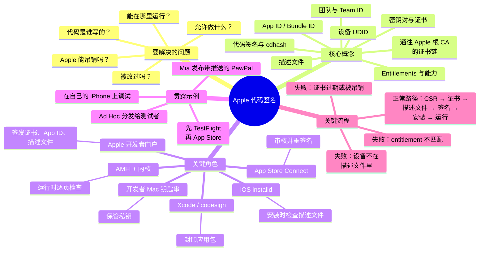

# 00 · Apple 代码签名深度解析：系列导读

> 英文原文：[Apple Code Signing, In Depth — A Series](../00-overview.md)
>
> **你在哪里：**这是一个系列的入口，讲 Apple 开发者计划、签名证书和描述文件（provisioning profile）如何拼在一起。
> **读完本篇你会知道：**全景地图、阅读顺序，以及贯穿所有文章的那个故事（PawPal）。

## 缩写对照表

| 缩写 | 英文全称 | 中文 |
|---|---|---|
| CA | Certificate Authority | 证书颁发机构 |
| CSR | Certificate Signing Request | 证书签名请求 |
| UDID | Unique Device Identifier | 设备唯一标识 |
| AMFI | Apple Mobile File Integrity | Apple 移动文件完整性（内核扩展） |
| CI | Continuous Integration | 持续集成 |
| cdhash | Code Directory Hash | 代码目录哈希 |
| plist | Property List | 属性列表文件 |

大多数开发者第一次接触 Apple 代码签名，是在 Xcode 里看到一片红色报错：*「No profiles for 'com.x.y' were found」*、*「Provisioning profile doesn't include signing certificate」*、*「errSecInternalComponent」*。点一下 **Automatically manage signing**，问题消失了，于是这套系统一直是个黑盒，直到某天凌晨两点在 CI（Continuous Integration，持续集成）上崩掉。

这个系列就是要打开这个黑盒。它不从菜单讲起，而是从 Apple 必须解决的安全问题出发，一步步往前推，让每个部件看起来都像是你自己也会被迫发明出来的东西。

## 系列目录

| # | 文章 | 回答的问题 |
|---|---|---|
| 1 | [为什么需要代码签名](01-why.md) | 没有它会出什么问题？ |
| 2 | [Apple 代码签名是什么，不是什么（英文）](../02-what.md) | 这套系统究竟是什么，边界在哪里？ |
| 3 | [概念地图（英文）](../03-concept-map.md) | 有哪些部件，各自负责什么？ |
| 4 | [贯穿示例：发布 PawPal（英文）](../04-running-example.md) | 一个真实应用的完整旅程是什么样的？ |
| 5.1 | [开发者账号与团队（英文）](../05-deep-dives/01-developer-account-and-team.md) | 身份的根在哪里？ |
| 5.2 | [签名证书与私钥（英文）](../05-deep-dives/02-signing-certificates.md) | Apple 如何为*你*背书？ |
| 5.3 | [App ID、能力与 entitlements（英文）](../05-deep-dives/03-app-ids-and-entitlements.md) | Apple 如何为*你的应用能做什么*背书？ |
| 5.4 | [注册设备（英文）](../05-deep-dives/04-devices.md) | Apple 如何限制非商店版本能在*哪里*运行？ |
| 5.5 | [描述文件（英文）](../05-deep-dives/05-provisioning-profiles.md) | 谁、做什么、在哪里，如何被绑进一张签过名的许可单？ |
| 5.6 | [codesign 与应用内的签名（英文）](../05-deep-dives/06-codesign-and-the-signature.md) | 签名在二进制里实际长什么样？ |
| 5.7 | [设备端校验：installd、AMFI 与内核（英文）](../05-deep-dives/07-on-device-verification.md) | iPhone 如何决定是否运行你的代码？ |
| 5.8 | [分发与 Apple 重签名（英文）](../05-deep-dives/08-distribution-and-resigning.md) | TestFlight、App Store、Ad Hoc、企业分发和 macOS 各有什么不同？ |
| 6 | [完整演练：PawPal 从头到尾（英文）](../06-walkthrough.md) | 把每一步以完整深度再走一遍 |
| 7 | [故障排查、CI 与下一步（英文）](../07-next-steps.md) | 出问题时怎么修？ |

阅读顺序：第一次读，按 1 → 6 顺序读下来。每篇深入专题（5.x）也可以单独阅读，因为它们都会先回顾自己的定位，并回扣 PawPal 示例。

## 一张图看全貌

*这套体系有哪些概念和组件，又怎么分组？*

## 一段话讲清核心思想

一个签过名的 iOS 应用提出了**三项声明**，并由**一张许可单**为它们作保。三项声明是：*「我由这个团队构建」*（证书），*「我出厂后没被改过」*（代码签名中的哈希），以及*「我可以使用这些能力」*（entitlements）。那张许可单就是**描述文件（provisioning profile）**：一个由 Apple 签名的 plist（Property List，属性列表文件），上面写着*「这个团队的证书可以为这个 App ID 签名，带着这些 entitlements，在这些设备上运行，有效期到这一天」*。设备只信任 Apple 的根密钥，别的一概不信。所以每一项声明，最终都必须追溯到某个由 Apple 签过名的东西。

---
下一篇 → [01 · 为什么需要代码签名](01-why.md)
