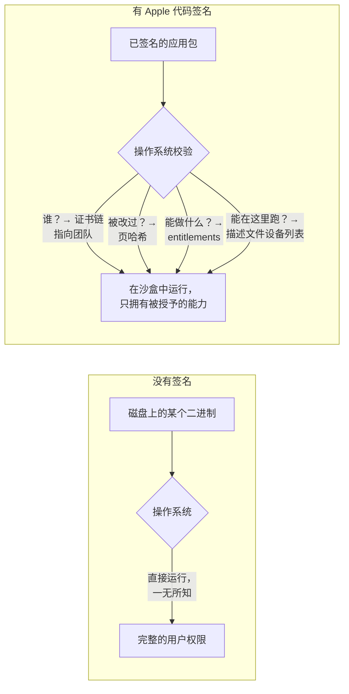

# 01 · 为什么需要代码签名

> 英文原文：[Part 1 — Why Code Signing Exists](../01-why.md)
>
> **你在哪里：**第一阶段，问题本身。
> **读完本篇你会知道：**Apple 面对的具体威胁、为什么现成的工具解决不了，以及塑造了整个设计的约束条件。读到最后，你应该能大致*预测出*证书和描述文件必须承担什么职责。

## 缩写对照表

| 缩写 | 英文全称 | 中文 |
|---|---|---|
| OS | Operating System | 操作系统 |
| MD5 | Message-Digest Algorithm 5 | 消息摘要算法第 5 版 |
| CA | Certificate Authority | 证书颁发机构 |
| UDID | Unique Device Identifier | 设备唯一标识 |
| App ID | Application Identifier | 应用标识符 |

## 1. 没有签名的世界

设想一部没有代码签名的手机，大致就是 2000 年代初的桌面电脑：

- **谁都能运行任何东西。** 一个下载链接、一个邮件附件、一个被攻陷的网站，都能丢下一个原生可执行文件，而操作系统照单全收。
- **代码可以被悄悄修改。** 恶意软件能在磁盘上给合法应用（比如银行应用）打补丁，用户毫无察觉。
- **没有问责。** 发现恶意代码时，没人能说清是*谁*写的，也没有办法在所有设备上一次性关掉它。
- **权限要么全有要么全无。** 一个应用只要能运行，通常就能碰到用户能碰到的一切：通讯录、钥匙串、网络、其他应用的文件。

这在 PC 上还能忍，因为用户习惯自己管理风险。但对 iPhone 来说不可接受：它装着你的身份、支付、位置和私人对话，用它的人也从来不会去读安全提示框。

### 签名前后的对比

*签名如何改变操作系统对一个二进制文件的了解？*

## 2. Apple 必须回答的五个问题

本系列里的每一项安全特性，都是为了回答下面某一个问题，而且要*在设备上、离线、几毫秒内*回答：

| # | 问题 | 回答不了会怎样 |
|---|---|---|
| Q1 | 这段代码是**谁**产出的？ | 没有问责，也没法封禁作恶者 |
| Q2 | 它之后被**改过**吗？ | 恶意软件可以篡改受信任的应用 |
| Q3 | 它**被允许做什么**？ | 每个应用都拿到全部权限 |
| Q4 | 它被允许在**哪里**运行？ | 「测试版」变成绕过 App Review 的旁门 |
| Q5 | Apple 之后能**吊销**它吗？ | 泄露的密钥或作恶的开发者永远是隐患 |

## 3. 为什么现有方案不够

**单纯的哈希或校验和（下载链接旁边放个 MD5）。** 只能回答 Q2，而且前提是校验和本身来自可信的地方。能改二进制的攻击者，同样能改校验和。

**经典的 Authenticode 式签名（Windows）。** 能回答 Q1 和 Q2：由证书颁发机构（CA，Certificate Authority）认证发布者的公钥，发布者再给文件签名。但是：
- 很多商业 CA 都能签发证书，信任被分散了，吊销起来很难。
- 签名对 Q3（权限）和 Q4（能在哪些机器上运行）只字不提。
- 没签名的代码在弹个警告之后照样能跑。签名只是建议性的。

**「全都走 App Store 不就行了。」** 让 Apple 审核每个二进制确实解决了很多问题，但开发者仍然需要：
- 每天几十次在自己的手机上运行未经审核的调试版本；
- 把预发布版本交给少数几个测试者；
- 让大公司在不经过公开审核的情况下，把内部应用部署给成千上万名员工。

这些都是「只有审核过的代码才能运行」这条规则上的缺口。系统需要一种方式，允许**范围很窄、可问责、可吊销的例外**。

## 4. 塑造设计的约束条件

1. **Apple 是唯一的信任根。** 设备出厂就带着 Apple 的根证书，每一个判断都必须能追溯到它，不接受第三方 CA。
2. **校验必须能离线完成。** 飞机上的手机也得能打开应用，所以校验所需的一切都必须**嵌在应用包里**。
3. **运行时校验必须够便宜。** 每次启动都对一个 200 MB 的二进制做哈希太慢了，所以哈希必须**按页计算**，在内存加载时按需检查。
4. **私钥必须留在开发者手里。** Apple 负责认证密钥，但绝不能持有你的签名私钥（至少对开发版本是这样）。
5. **例外必须有边界。** 调试和测试版本受**设备列表**、**时间**和**数量**的限制，这样它们才不会变成一个非官方的应用商店。
6. **能力必须显式声明。** 敏感能力（推送、iCloud、HealthKit、钥匙串共享）必须**声明、针对 App ID 获批，并封印进签名**。

## 5. 预测一下解决方案

从这些约束出发，你自己就能画出设计草图：

- Apple 需要**认证开发者的公钥** → 由 Apple 自己的 CA 签发的**签名证书**（Q1、Q5）。
- 开发者需要用这把密钥**封印应用的每一个字节** → 带按页哈希的**代码签名**（Q2）。
- 应用的权限必须**声明并获批** → **entitlements**，绑定在一个注册过的 **App ID**（Application Identifier，应用标识符）上（Q3）。
- 非商店版本必须**绑定到具体的手机** → 注册过的**设备 UDID**（Unique Device Identifier，设备唯一标识）（Q4）。
- 必须有一个由 Apple 签名的东西**把以上所有绑在一起**，并随应用一起分发，让手机能离线检查 → **描述文件（provisioning profile）**（Q1、Q3、Q4、Q5）。
- 对 App Store 版本，Apple 可以在审核后**直接自己给应用重签名**，这样终端用户的手机就根本不需要一个列出它们的描述文件。

剩下的都是细节。本系列的其余部分，讲的就是这些细节。

---
← [00 · 系列导读](00-overview.md) · 下一篇 → [02 · 它是什么（英文）](../02-what.md) · [概念地图（英文）](../03-concept-map.md)
