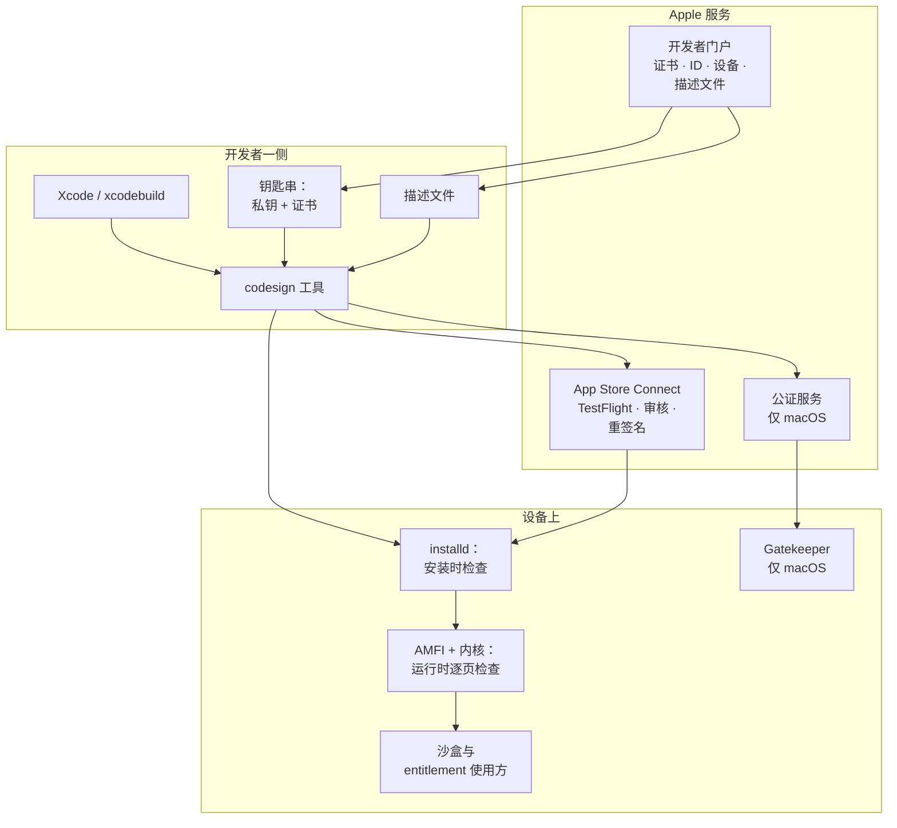

# 02 · Apple 代码签名是什么，又不是什么

> 英文原文：[Part 2 — What Apple Code Signing Is (and Isn't)](../02-what.md)
>
> **你在哪里：**第二阶段，定义与边界。
> **读完本篇你会知道：**一句话定义，这套系统刻意*不做*哪些事，以及它和 Gatekeeper、公证（notarization）、App Review 这些邻居的位置关系。

## 缩写对照表

| 缩写 | 英文全称 | 中文 |
|---|---|---|
| CA | Certificate Authority | 证书颁发机构 |
| DRM | Digital Rights Management | 数字版权管理 |
| OS | Operating System | 操作系统 |
| AMFI | Apple Mobile File Integrity | Apple 移动文件完整性（内核扩展） |
| TLS / HTTPS | Transport Layer Security / HTTP Secure | 传输层安全协议 / 安全超文本传输协议 |
| X.509 | ITU-T X.509 standard | 公钥证书格式标准 |
| CMS | Cryptographic Message Syntax | 密码消息语法 |
| PKI | Public Key Infrastructure | 公钥基础设施 |
| cdhash | Code Directory Hash | 代码目录哈希 |
| Mach-O | Mach Object file format | Apple 平台的可执行文件格式 |

## 1. 一句话定义

> **Apple 代码签名是一套以 Apple 证书颁发机构为唯一信任根的公钥体系：它把开发者的签名与嵌在应用里、由 Apple 签名的描述文件相互核对，让设备能离线确认这段代码是谁构建的、有没有被改过、允许做什么，以及能在哪里运行。**

句子里的每一部分，都对应第 1 篇里的一个问题：

| 句中成分 | 回答的问题 |
|---|---|
| 「以 Apple CA 为唯一信任根」 | Q5（可吊销）、Q1（信任链） |
| 「是谁构建的」 | Q1 |
| 「有没有被改过」 | Q2 |
| 「允许做什么」 | Q3（entitlements） |
| 「能在哪里运行」 | Q4（设备列表） |
| 「嵌在应用里、由 Apple 签名的描述文件」 | 离线校验 |

## 2. 边界：它**不是**什么

- **不是恶意软件扫描器。** 签名证明的是*来源和完整性*，不是*动机良善*。一个签名完全合法的应用照样可能是恶意的。真正起威慑作用的是问责和吊销，内容检查则由 App Review 和公证另行负责。
- **不是加密。** 签名不会把你的代码藏起来。（App Store 上的应用*确实*还会用 FairPlay DRM 加密，但那是 Apple 在分发时另加的一层。）
- **不是沙盒。** entitlements 是沙盒和其他操作系统策略的*输入*，真正的执行在内核和各个守护进程里。
- **不代表用户身份。** 证书标识的是一个**团队（Team）**，也就是一个法律意义上的开发者实体，而不是终端用户或设备所有者。
- **在 iOS 上不是可选项。** 在 macOS 上，没签名或只做了 ad-hoc 签名的代码在很多情况下仍能运行；而在 iOS、iPadOS、watchOS、tvOS 和 visionOS 上，**所有第三方代码都必须有合法签名**，否则内核拒绝运行。
- **不是永久的。** 证书和描述文件都会过期，很多「上个月还好好的」的事故就是这么来的。

## 3. 在生态中的位置

*代码签名和 Apple 其他安全层是什么关系？*

*代码签名是贯穿每一个方框的那条线。其他各层要么为签名提供输入，要么消费签名所证明的事实。*

### 一句话说清每个邻居

| 邻居 | 和代码签名的区别 |
|---|---|
| **App Review** | *人工加自动的内容审核*。签名证明「谁」和「什么」，审核判断它能不能被接受。 |
| **公证**（macOS） | Apple 对用 Developer ID 签名的应用做恶意软件*扫描*，并签发一张票据。它建立在签名之上，并不取代签名。 |
| **Gatekeeper**（macOS） | 决定下载来的 Mac 软件能否启动的*策略引擎*，它读取签名和公证票据。 |
| **沙盒** | 执行*运行时隔离*，它的例外规则来自签过名的 entitlements。 |
| **FairPlay** | 对 App Store 二进制施加的 *DRM（Digital Rights Management，数字版权管理）加密*，和证明作者身份无关。 |
| **TLS/HTTPS 证书** | 同样是 X.509 格式，但信任库和用途都不同。你的网站证书不能给应用签名，反之亦然。 |

## 4. 你会听到的两套词汇

Apple 的文档和 Xcode 界面里混着两类词，要把它们分开：

- **密码学对象：**密钥对、证书、证书链、CMS（Cryptographic Message Syntax，密码消息语法）签名、CodeDirectory、cdhash。这些都是标准的 PKI（Public Key Infrastructure，公钥基础设施）和 Mach-O 概念。
- **Apple 策略对象：**团队、App ID、能力（capability）、entitlement、注册设备、描述文件。这些是 Apple 关于*谁可以签什么*的规则。

代码签名就是两者交汇的地方：密码学负责证明事实，策略对象负责规定哪些事实是可以接受的。

---
← [01 · 为什么需要代码签名](01-why.md) · 下一篇 → [03 · 概念地图（英文）](../03-concept-map.md)
