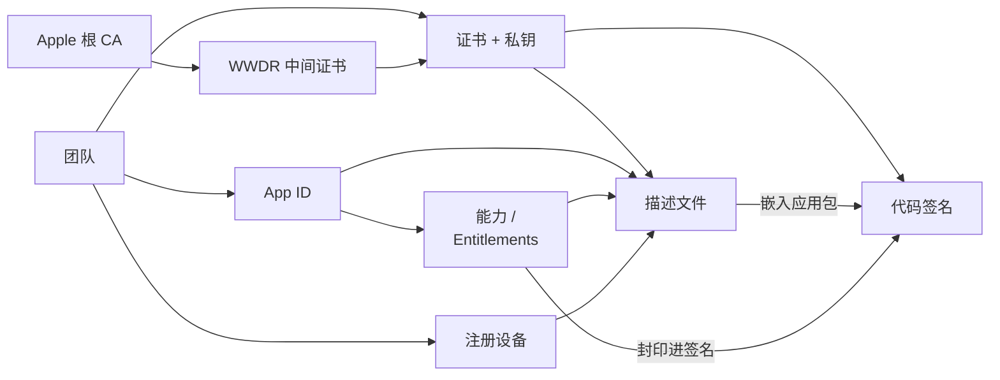
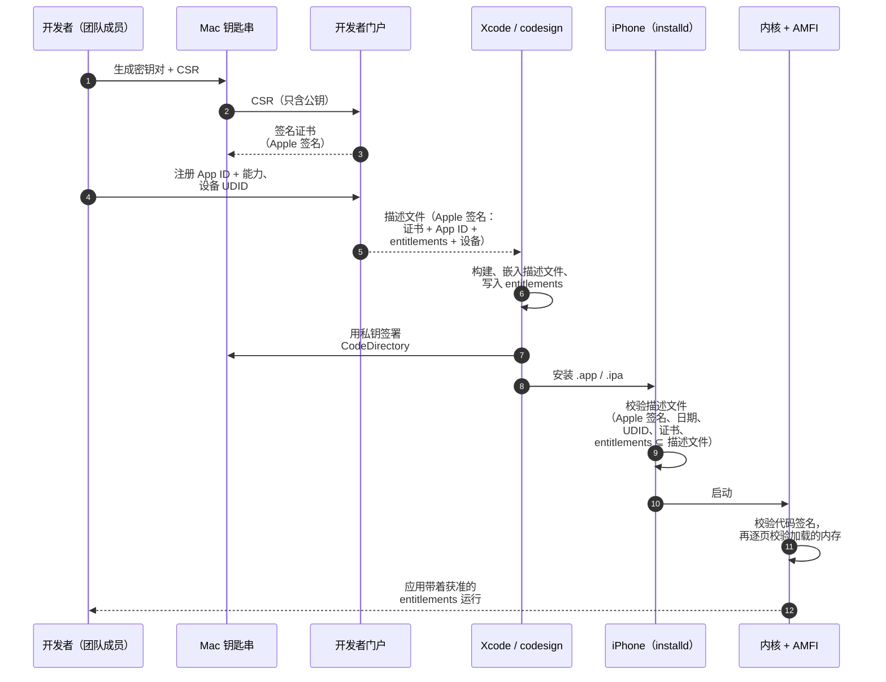

# 03 · 概念全景图

> 英文原文：[Part 3 — The Concept Map](../03-concept-map.md)
>
> **你在哪里：**第三阶段，从浅层鸟瞰整个领域。
> **读完本篇你会知道：**按依赖顺序排列的 8 个核心概念，7 个关键角色各自*负责什么 / 知道什么 / 不做什么*，以及一张图看完的端到端正常流程。这里先不讲内部机制，那些留给深入专题。

## 缩写对照表

| 缩写 | 英文全称 | 中文 |
|---|---|---|
| CA | Certificate Authority | 证书颁发机构 |
| WWDR | Apple Worldwide Developer Relations | Apple 全球开发者关系（其中间证书） |
| X.509 | ITU-T X.509 standard | 公钥证书格式标准 |
| UDID | Unique Device Identifier | 设备唯一标识 |
| CMS | Cryptographic Message Syntax | 密码消息语法 |
| cdhash | Code Directory Hash | 代码目录哈希 |
| CSR | Certificate Signing Request | 证书签名请求 |
| AMFI | Apple Mobile File Integrity | Apple 移动文件完整性（内核扩展） |
| API | Application Programming Interface | 应用程序编程接口 |
| plist | Property List | 属性列表文件 |

## 3.1 领域映射：从问题到概念

每个概念都排在它所依赖的概念之后。

| # | 现实问题中的要素 | Apple 的概念 | 一句话定义 | 为什么这样抽象 |
|---|---|---|---|---|
| 1 | 「一个在法律上可问责的开发者」 | **团队（Team）**（Team ID，如 `A1B2C3D4E5`） | Apple 开发者计划里的账号实体，下面的一切都归它所有 | 一个可以封禁、可以签合同的身份，不管是个人还是公司 |
| 2 | 「证明某把密钥属于这个开发者」 | **签名证书** + **私钥** | 由 Apple WWDR CA 签发、把公钥绑定到团队的 X.509 证书；对应的私钥只在开发者手里 | 设备不用联系开发者就能核实作者身份 |
| 3 | 「相信证书本身是真的」 | **证书链** | 叶子证书 → Apple WWDR 中间证书 → Apple 根 CA（每台设备出厂预装） | 只有一个由 Apple 掌控的根，吊销也只在一处 |
| 4 | 「这是哪个应用？」 | **App ID**（`TEAMID.com.example.app`） | 一个注册过的标识符：Team ID 前缀 + bundle ID | 按团队划分应用的命名空间，也是能力的挂靠点 |
| 5 | 「应用可以使用哪些能力？」 | **能力（Capabilities）→ Entitlements** | 能力在门户里针对 App ID 开启；entitlements 是封印进签名的键值声明（`aps-environment`、`keychain-access-groups`……） | 最小权限，显式声明且经过批准 |
| 6 | 「哪些手机能跑测试版？」 | **注册设备**（UDID） | 注册到团队名下的设备唯一 ID，每类设备每年最多 100 台 | 防止测试版变成一个影子 App Store |
| 7 | 「一张由 Apple 批准、把 1–6 绑在一起的许可单」 | **描述文件（Provisioning profile）** | 一个由 Apple 签名的 plist：*这些证书*可以为*这个 App ID* 签名，带着*这些 entitlements*，在*这些设备*上运行，直到*这一天* | 设备只靠 Apple 的根就能离线检查一切 |
| 8 | 「证明字节没被改过」 | **代码签名**（CodeDirectory、cdhash、CMS 数据块） | 二进制的逐页哈希，加上资源、Info.plist 和 entitlements 的哈希，再用私钥签名 | 廉价、惰性、能发现篡改的校验 |

**衍生概念**（后面会出现，建立在上面 8 个之上）：分发方式（Development / Ad Hoc / App Store / Enterprise / Developer ID）、`get-task-allow`、designated requirement、`embedded.mobileprovision`、`.p12`、CSR、App Store Connect API 密钥、开发者模式（Developer Mode）、公证票据。

*这些概念之间如何相互依赖？*

## 3.2 关键角色：从概念到组件

这七个组件各有一篇深入专题（5.1–5.8；5.4 和 5.5 都在门户里）。

| 组件 | 负责什么 | 知道什么 | **不**做什么 |
|---|---|---|---|
| **Apple 开发者账号 / 团队**（[5.1，英文](../05-deep-dives/01-developer-account-and-team.md)） | 法律身份与会员资格；团队里谁能做什么（角色） | Team ID、成员、角色、会员到期日、计划类型 | 自己从不签代码，也不持有任何私钥 |
| **Apple 开发者门户**（Certificates, Identifiers & Profiles）（[5.2](../05-deep-dives/02-signing-certificates.md)–[5.5，英文](../05-deep-dives/05-provisioning-profiles.md)） | 签发和吊销证书；注册 App ID 和设备；生成并签署描述文件 | 团队的所有证书、App ID、设备 UDID 和描述文件 | 从来看不到你的私钥，也从不检查你的代码 |
| **开发者 Mac 的钥匙串**（[5.2，英文](../05-deep-dives/02-signing-certificates.md)） | 生成并保存**私钥**；把它和签发的证书配对成*签名身份（signing identity）* | 私钥、证书、Apple 中间证书 | 不决定*什么*可以签名，那是描述文件的事 |
| **Xcode / `codesign`**（[5.6，英文](../05-deep-dives/06-codesign-and-the-signature.md)） | 组装应用包、嵌入描述文件、写入 entitlements、生成签名 | 构建设置：团队、bundle ID、签名身份、描述文件 | 不授予能力，只能声明描述文件允许的 entitlements |
| **iOS `installd` + MobileInstallation**（[5.7，英文](../05-deep-dives/07-on-device-verification.md)） | 安装时检查：描述文件对这台设备、这个签名者、这些 entitlements 是否有效？ | 已安装的描述文件、设备 UDID、当前日期 | 运行时不会逐页检查 |
| **AMFI + 内核**（[5.7，英文](../05-deep-dives/07-on-device-verification.md)） | 运行时检查：每个可执行页都必须和某个可信签名里的哈希一致；把 entitlements 交给操作系统 | 信任缓存、已验证的 cdhash | 不管 App Store 政策，只管密码学上是否有效、是否满足描述文件约束 |
| **App Store Connect / Apple 分发**（[5.8，英文](../05-deep-dives/08-distribution-and-resigning.md)） | 接收上传、TestFlight、审核，然后用 Apple 自己的密钥**重签名**并做 FairPlay 加密 | 你上传的构建、它的 entitlements、审核状态 | 不需要你用户的 UDID；上架后也不需要你的证书继续有效 |

## 3.3 协作一览

*从一台全新的 Mac 到 iPhone 上运行的应用，这些角色是怎么配合的？*

**要记住的两种失败流程**（在深入专题里展开）：
- **设备不在描述文件里** → `installd` 在安装时拒绝：*「The app cannot be installed because its integrity could not be verified」* / *「A valid provisioning profile for this executable was not found.」*（5.4、5.7）
- **声明了描述文件里没有的 entitlement** → 安装失败，或者操作系统悄悄拒绝这项功能（比如拿不到推送令牌）。（5.3、5.7）

---
← [02 · 它是什么，又不是什么](02-what.md) · 下一篇 → [04 · 贯穿示例](04-running-example.md)
