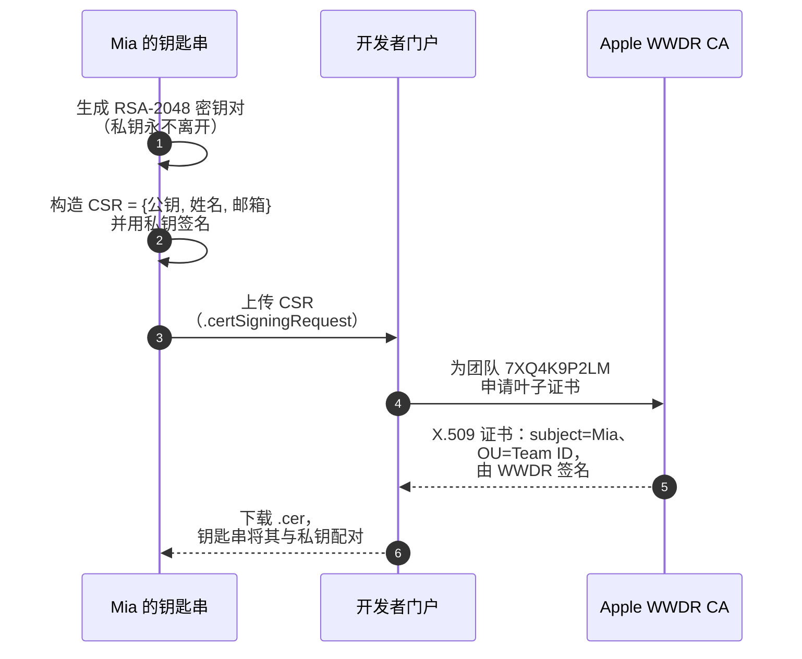
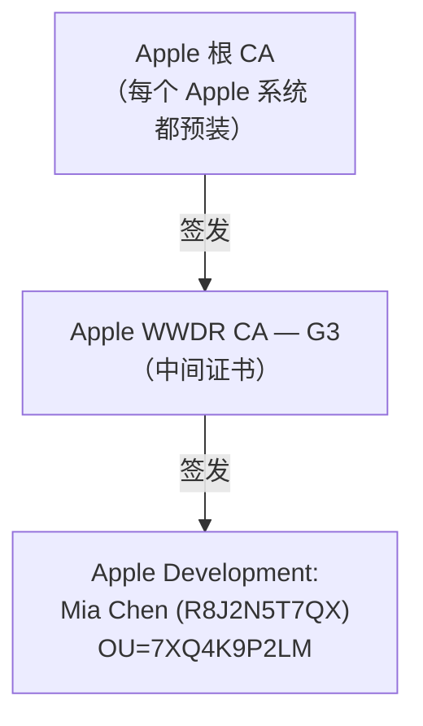

# 05.2 · 签名证书与私钥

> 英文原文：[5.2 — Signing Certificates & Private Keys](../../05-deep-dives/02-signing-certificates.md)
>
> **你在哪里：**第二篇深入专题，「这是谁构建的？」的核心。
> **读完本篇你会知道：**CSR 如何变成证书，为什么真正的秘密是私钥，证书链长什么样，有哪些证书类型，以及证书过期和吊销时会发生什么。

## 缩写对照表

| 缩写 | 英文全称 | 中文 |
|---|---|---|
| CSR | Certificate Signing Request | 证书签名请求 |
| CA | Certificate Authority | 证书颁发机构 |
| WWDR | Apple Worldwide Developer Relations | Apple 全球开发者关系（其中间证书） |
| RSA | Rivest–Shamir–Adleman | 一种公钥加密算法 |
| X.509 | ITU-T X.509 standard | 公钥证书格式标准 |
| OID | Object Identifier | 对象标识符 |
| PKI | Public Key Infrastructure | 公钥基础设施 |
| PKCS#12 | Public-Key Cryptography Standards #12 | 公钥密码学标准第 12 号（.p12 格式） |
| DER | Distinguished Encoding Rules | 可辨别编码规则 |
| CMS | Cryptographic Message Syntax | 密码消息语法 |
| OCSP | Online Certificate Status Protocol | 在线证书状态协议 |
| APNs | Apple Push Notification service | Apple 推送通知服务 |
| CI | Continuous Integration | 持续集成 |

## 角色回顾
**负责：**把一把公钥绑定到一个团队，由 Apple 作证，让设备能核实作者身份（Q1），也让 Apple 能吊销它（Q5）。**出现在 PawPal 的哪些步骤：**2、8、10、11。

## 内部设计

### 最重要的一个事实
> **证书是公开的，私钥才是秘密。**钥匙串里如果没有配对的私钥，「有证书」就毫无意义。绝大多数「找不到签名身份」的错误，根源都在这里。

**签名身份（signing identity）** = 证书 + 与之配对的私钥，两者都在钥匙串里。`codesign` 和 Xcode 只能使用签名身份，单独一张证书是用不了的。

### 从 CSR 到证书

*Mia Mac 上的一对密钥，是怎么变成一张 Apple 签发的证书的？*



CSR 用私钥签名，是为了证明你*持有*这把私钥：你没法拿别人的公钥去申请证书。Apple 自始至终只看得到**公钥**。

开启自动签名后，Xcode 会悄悄把这些全做完，很方便。这也解释了为什么同事的新 Mac 上「门户里明明有证书」却签不了名：私钥是在别人的机器上生成的。

### 证书的结构

```bash
security find-certificate -c "Apple Development: Mia Chen" -p | openssl x509 -noout -text
```

相关字段（简化版）：
```
Subject: UID=R8J2N5T7QX, CN=Apple Development: Mia Chen (R8J2N5T7QX),
         OU=7XQ4K9P2LM, O=Mia Chen, C=US
Issuer:  CN=Apple Worldwide Developer Relations Certification Authority, OU=G3, O=Apple Inc.
Validity: Not Before: Nov  1 2025, Not After: Nov  1 2026
X509v3 Extended Key Usage: Code Signing
1.2.840.113635.100.6.1.12: (Apple marker extension: development)
```

- **OU = Team ID。** 设备和描述文件就是靠它把证书和团队对应起来的。
- **Apple 专用的扩展 OID**（Object Identifier，对象标识符）`1.2.840.113635.100.6.1.x` 标明了证书*类型*：开发、分发、Developer ID 等等。策略检查看的是这些扩展，而不是证书名称。
- **有效期：**Apple Development / Distribution 证书通常是 **1 年**，Developer ID 证书更长。

### 信任链

*iPhone 从没听说过 Mia，为什么会信任她的证书？*



在 Mac 上，钥匙串里必须有 WWDR 中间证书，否则 Xcode 会把证书显示为 *「not trusted」* / *「issuer is invalid」*。常见原因是 Apple 换了新一代中间证书（G3、G4……），而本机上的还是旧的。解决办法是从 Apple 的 PKI 页面安装当前版本。

### 证书类型

| 类型 | 用途 | 通常由谁持有 |
|---|---|---|
| **Apple Development** | 在注册设备上运行调试版本，适用于所有 Apple 平台 | 每个开发者各自持有 |
| **Apple Distribution** | Ad Hoc、App Store/TestFlight 版本，适用于所有平台 | 一小撮严加看管的人；团队内数量有限 |
| *iOS App Development / iOS Distribution* | 上面两种证书过去按平台区分的旧版本 | 老项目 |
| **Developer ID Application** | 在 Mac App Store **之外**分发的 macOS 应用（需要公证） | 账号持有人（创建受限） |
| **Developer ID Installer** | 为商店之外分发的 `.pkg` 安装包签名 | 账号持有人 |
| **Mac Installer Distribution** | 提交到 Mac App Store 的 `.pkg` | 负责分发的人 |
| **Enterprise (In-House) Distribution** | 企业计划的内部应用 | 仅限企业团队 |
| *Apple Push Notification service SSL* | **不是代码签名**：用来让你的服务器向 APNs 证明身份（现在大多已被 `.p8` APNs 密钥取代） | 服务端团队 |

### 在机器之间迁移签名身份：`.p12`
要在另一台 Mac 或 CI 上使用同一个分发身份，就把**证书 + 私钥**导出成一个带密码保护的 PKCS#12 文件：

```bash
# Export (on the original Mac): Keychain Access → right-click identity → Export → .p12
# Import (on CI) into a throwaway keychain:
security create-keychain -p "$KC_PASS" build.keychain
security unlock-keychain -p "$KC_PASS" build.keychain
security set-keychain-settings -lut 21600 build.keychain
security import dist.p12 -k build.keychain -P "$P12_PASS" -T /usr/bin/codesign
security set-key-partition-list -S apple-tool:,apple: -s -k "$KC_PASS" build.keychain
security list-keychains -d user -s build.keychain login.keychain
security find-identity -v -p codesigning build.keychain
```

`set-key-partition-list` 这一行很关键：少了它，`codesign` 每次用这把私钥都要弹图形界面确认；在无界面的 CI 上，这就表现为 **`errSecInternalComponent`**。

### 云端托管证书
较新版本的 Xcode 可以用**云端托管证书**为分发版本签名：分发私钥保存在 Apple 的基础设施里，Xcode（用你的账号或 API 密钥认证后）请 Apple 代为完成签名。对于能接受这种取舍的团队，这就省掉了「到处传 `.p12`」的麻烦。

## 与其他部件的交互
- **← 团队：**证书的 `OU` 就是 Team ID；只有获得许可的角色才能签发分发证书。
- **→ 描述文件：**描述文件里列出了允许签名的*具体证书*（DER 字节）。换了新证书，描述文件就得重新生成。
- **→ codesign：**私钥对 CodeDirectory 的哈希签名，证书链嵌在签名的 CMS 数据块里。

## ⚓ 回到示例
- **第 2 步。** Xcode 在 Mia 的登录钥匙串里生成一把 RSA 私钥，发出 CSR，拿回 `Apple Development: Mia Chen (R8J2N5T7QX)`，其中 `OU=7XQ4K9P2LM`。这时 `security find-identity -v -p codesigning` 会列出一个有效的签名身份。
- **第 8 步。** 给 Leo 的 Ad Hoc 版本需要一个**分发**身份，于是 Xcode 创建了一张 `Apple Distribution: Mia Chen (7XQ4K9P2LM)` 证书。Ad Hoc 描述文件里列的必须是*这张*证书，而不是她的开发证书。
- **第 10 步。** CI 上有描述文件却没有私钥，于是报 *「No signing certificate 'Apple Distribution' found」*。按上面的方法导入 `.p12`，或者改用云端托管签名，问题就解决了。
- **第 11 步。** 一年后分发证书过期。新的构建需要一张新证书，所有包含旧证书的描述文件也都要重新生成。

## 失败时的表现
| 情况 | 后果 |
|---|---|
| **私钥丢失**（Mac 被抹掉且没有备份） | 证书没法用了。创建一张新证书（并重新生成描述文件）。App Store 上的应用不受影响 |
| **证书过期** | 不能再用它为新构建签名。**App Store 上的应用照常可用**（Apple 已经重签过名）。用它签名的开发版和 Ad Hoc 版本，等到描述文件也失效时就无法启动 |
| **证书被吊销** | 包含它的描述文件全部失效。设备一旦通过 OCSP（Online Certificate Status Protocol，在线证书状态协议）得知吊销，**企业版**签名的应用就无法启动。开发版和 Ad Hoc 版本也会受影响，App Store 上的应用不受影响 |
| **分发证书数量太多** | 门户拒绝再创建，直到你吊销其中一张。团队内要协调好，或者改用云端托管证书 |
| **缺少 WWDR 中间证书** | Mac 上显示「证书不受信任」；codesign 可能无法构建证书链 |

---
← [05.1 · 开发者账号与团队](01-developer-account-and-team.md) · 下一篇 → [05.3 · App ID 与 entitlements（英文）](../../05-deep-dives/03-app-ids-and-entitlements.md) · [概念全景图](../03-concept-map.md)
