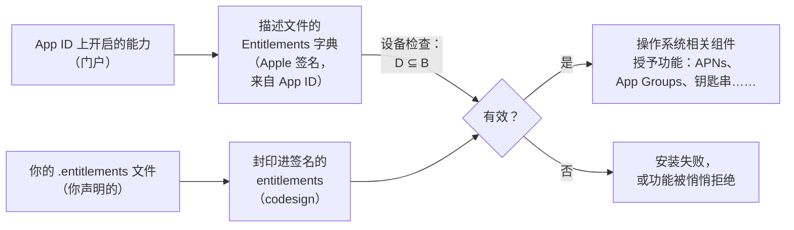

# 05.3 · App ID、能力与 Entitlements

> 英文原文：[5.3 — App IDs, Capabilities & Entitlements](../../05-deep-dives/03-app-ids-and-entitlements.md)
>
> **你在哪里：**第三篇深入专题，「这是什么应用，它能做什么？」
> **读完本篇你会知道：**App ID 如何为应用划分命名空间，门户里的*能力（capability）*如何变成签过名的 *entitlement*，以及每个 entitlement 都必须满足的三方一致（App ID ↔ 描述文件 ↔ 签名）。

## 缩写对照表

| 缩写 | 英文全称 | 中文 |
|---|---|---|
| APNs | Apple Push Notification service | Apple 推送通知服务 |
| DER | Distinguished Encoding Rules | 可辨别编码规则 |
| OS | Operating System | 操作系统 |
| plist | Property List | 属性列表文件 |
| XML | Extensible Markup Language | 可扩展标记语言 |

## 角色回顾
**负责：**应用的注册身份，以及它获批的能力（Q3）。**出现在 PawPal 的哪些步骤：**3（注册、开启能力）、6（签名时封印 entitlements）、7（操作系统执行它们）。

## 内部设计

### App ID = 前缀 + bundle ID
```
7XQ4K9P2LM . com.miachen.pawpal
└─ App ID Prefix ─┘ └── Bundle ID (CFBundleIdentifier) ──┘
   (normally the Team ID)
```

| 类型 | 例子 | 可用能力 | 用途 |
|---|---|---|---|
| **显式（Explicit）** | `7XQ4K9P2LM.com.miachen.pawpal` | 全部，包括推送、App Groups、iCloud、HealthKit、Sign in with Apple…… | 所有正式应用 |
| **通配（Wildcard）** | `7XQ4K9P2LM.com.miachen.*` 或 `7XQ4K9P2LM.*` | 只有基础的一组；没有推送、没有 App Groups 等 | 快速原型、通用的测试描述文件 |

每个**会产出独立二进制的 target** 都需要自己的 App ID：主应用、小组件扩展、通知服务扩展、手表应用。它们各自单独签名。

### 能力 → entitlement：三方一致

**能力（capability）**是门户里 App ID 上的一个开关（或者 Xcode 的 *Signing & Capabilities* 标签页，它会替你拨这个开关）。
**entitlement** 是*签过名的*二进制里的一个键值对，由操作系统在运行时读取。

*一个 entitlement 要真正生效，需要哪些东西对得上？*



规则是：**你签进去的（D）必须是描述文件允许的（B），而描述文件只能允许 App ID 上开启了的（A）。**你可以在 `.entitlements` 文件里*声明*任何东西，但只有 Apple 能通过描述文件*授权*它。

### 常见的 entitlements

| Entitlement 键 | 示例值 | 来源 | 说明 |
|---|---|---|---|
| `application-identifier` | `7XQ4K9P2LM.com.miachen.pawpal` | 始终存在 | 必须和 App ID 一致 |
| `com.apple.developer.team-identifier` | `7XQ4K9P2LM` | 始终存在 | |
| `get-task-allow` | `true`（开发）/ `false`（分发） | 描述文件类型 | 允许调试器附加。**App Store 版本里永远不为 true** |
| `keychain-access-groups` | `["7XQ4K9P2LM.*"]` | 始终存在（按前缀限定） | 在你的多个应用之间共享钥匙串条目 |
| `aps-environment` | `development` / `production` | 推送能力 | 选择 sandbox 还是 production 的 APNs |
| `com.apple.security.application-groups` | `["group.com.miachen.pawpal"]` | App Groups 能力 | 主应用和扩展之间的共享容器 |
| `com.apple.developer.icloud-container-identifiers` | `["iCloud.com.miachen.pawpal"]` | iCloud | |
| `com.apple.developer.associated-domains` | `["applinks:pawpal.app"]` | Associated Domains | 通用链接、webcredentials |
| `beta-reports-active` | `true` | App Store 描述文件 | TestFlight |

有些 entitlements 属于**受管控 / 受限**的（比如某些网络能力、CarPlay、紧急提醒）。必须先由 Apple 批准给你的团队，它们才会作为选项出现在 App ID 或描述文件里。

### 关于 `$(AppIdentifierPrefix)` 和变量
你的 `.entitlements` 文件里通常会有构建设置变量：
```xml
<key>keychain-access-groups</key>
<array><string>$(AppIdentifierPrefix)com.miachen.pawpal</string></array>
```
Xcode 在构建时展开这些变量，并*合并*进从描述文件来的键（`application-identifier`、`get-task-allow`、`aps-environment` 的值），生成最终由 `codesign` 封印的 entitlements。

## 与其他部件的交互
- **← 团队：**App ID 的前缀就是 Team ID；App ID 不能跨团队共享。
- **→ 描述文件：**描述文件会复制 App ID 允许的 entitlements（`keychain-access-groups` 这类地方会带通配符）。
- **→ codesign：**最终的 entitlements plist（以及一份 DER 编码的副本）会被哈希进 CodeDirectory 的特殊槽位，所以签名之后再改 entitlements 会破坏签名。
- **→ 操作系统的相关组件：**`apsd`（推送）、`securityd`（钥匙串）、`containermanagerd`（App Groups）读取的是调用进程*签过名的* entitlements。

## ⚓ 回到示例
- **第 3 步。** Mia 注册了 `7XQ4K9P2LM.com.miachen.pawpal` **和** `7XQ4K9P2LM.com.miachen.pawpal.widget`，在主应用上开启 *Push Notifications*，在两个 App ID 上都开启 *App Groups*（`group.com.miachen.pawpal`）。她的 `PawPal.entitlements`：
  ```xml
  <dict>
    <key>aps-environment</key><string>development</string>
    <key>com.apple.security.application-groups</key>
    <array><string>group.com.miachen.pawpal</string></array>
  </dict>
  ```
- **第 6 步。** 签名时，Xcode 生成最终的 entitlements，由 `codesign` 封印。检查一下：
  ```bash
  codesign -d --entitlements - --xml PawPal.app | plutil -p -
  # "application-identifier" => "7XQ4K9P2LM.com.miachen.pawpal"
  # "aps-environment" => "development"
  # "get-task-allow" => 1
  # "com.apple.security.application-groups" => [ "group.com.miachen.pawpal" ]
  ```
- **第 7 步。** 启动时，PawPal 调用 `registerForRemoteNotifications()`。`apsd` 读到 `aps-environment = development`，签发一个 **sandbox** 环境的设备令牌。如果 Mia 的服务器往 *production* 的 APNs 端点发推送，就会投递失败。这就是经典的「TestFlight 里推送正常、调试版里不行」（或者反过来）的混淆。
- **变体：假如**她忘了在小组件的 App ID 上开启 App Groups 会怎样？小组件的描述文件里没有这个组，小组件签名的 entitlements 里却声明了它，安装时 `installd` 会以 entitlement 不匹配为由拒绝；或者更早一步，Xcode 直接报错 *「Provisioning profile doesn't include the com.apple.security.application-groups entitlement.」*

## 失败时的表现
| 情况 | 后果 |
|---|---|
| `.entitlements` 里有、描述文件里没有的 entitlement | Xcode 签名报错；或安装被拒（*「entitlements … not valid」*） |
| 生成描述文件之后才开启能力 | 描述文件已经过时，需要重新生成（自动签名会替你做） |
| `aps-environment` 与服务器端点不一致 | APNs 返回 `BadDeviceToken` |
| Info.plist 里的 bundle ID ≠ 描述文件里的 App ID | *「Provisioning profile doesn't match bundle identifier」* |
| 用你的描述文件给别人的应用重签名 | `application-identifier`、Team ID 和钥匙串组全都变了，应用会失去对原来钥匙串条目和容器的访问 |

---
← [05.2 · 签名证书与私钥](02-signing-certificates.md) · 下一篇 → [05.4 · 注册设备](04-devices.md) · [概念全景图](../03-concept-map.md)
