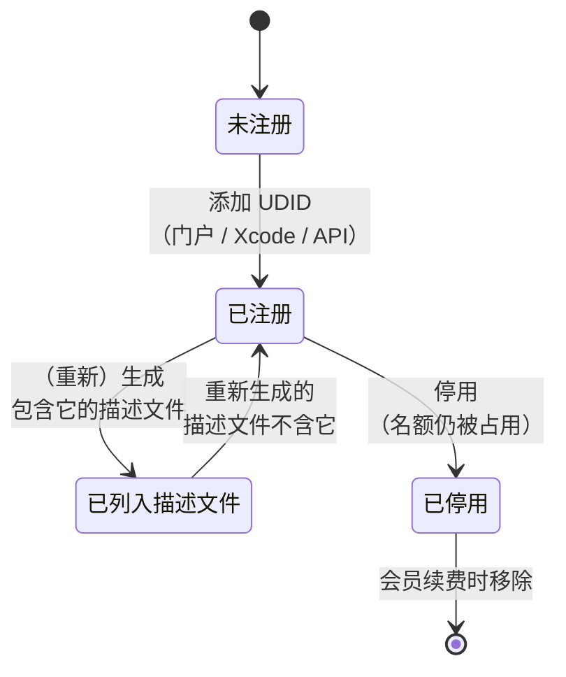

# 05.4 · 注册设备

> 英文原文：[5.4 — Registered Devices](../../05-deep-dives/04-devices.md)
>
> **你在哪里：**第四篇深入专题，篇幅较短。「非商店版本能在哪里运行？」
> **读完本篇你会知道：**UDID 是什么，为什么设备注册有数量上限，以及它如何把开发版和 Ad Hoc 版本圈定在特定设备上。

## 缩写对照表

| 缩写 | 英文全称 | 中文 |
|---|---|---|
| UDID | Unique Device Identifier | 设备唯一标识 |
| ECID | Exclusive Chip Identification | 芯片唯一标识 |
| API | Application Programming Interface | 应用程序编程接口 |
| IPA | iOS App Store Package | iOS 安装包 |

## 角色回顾
**负责：**非 App Store 版本可以运行的物理设备白名单（Q4）。**出现在 PawPal 的哪些步骤：**4（Mia 的 iPhone）、8（Leo 的 iPhone，第一次失败）。

## 内部设计

### UDID
**UDID（Unique Device Identifier，设备唯一标识）**是每台设备由硬件派生出的 ID。新格式形如 `00008110-001A2B3C4D5E801E`（芯片 ID + ECID，即芯片唯一标识）。应用在运行时读不到它，只有受信任的工具能看到：

- Xcode → Window → Devices and Simulators
- 访达（Finder）：点击设备名称下方的序列号，直到它切换成 UDID
- `xcrun devicectl list devices`（Xcode 15+），或 `idevice_id -l`（libimobiledevice）
- 远程测试者：用一个基于配置描述文件的 UDID 采集页面，或者直接用 TestFlight（完全不需要 UDID）

### 为什么要设上限？
如果没有上限，「开发版」加上不限量的设备注册，就等于一个绕过 App Review 的私人 App Store。所以 Apple 规定：

- **每类设备**（iPhone、iPad、Apple Watch、Apple TV、Apple Vision Pro、Mac）**每个会员年度最多 100 台**。
- 删除一台设备**不会**立刻释放它占的名额，要等到会员续费时，你才有一次清理列表的机会。

### 设备的生命周期


*一台设备只有进了描述文件才有意义。单纯注册，对已有的构建没有任何影响。*

### 哪些描述文件关心设备？

| 描述文件类型 | 有设备列表吗？ |
|---|---|
| Development | ✅ `ProvisionedDevices` |
| Ad Hoc | ✅ `ProvisionedDevices` |
| App Store / TestFlight | ❌ 没有（Apple 会重签名） |
| Enterprise In-House | ❌ `ProvisionsAllDevices = true` |
| Developer ID（macOS） | ❌ |

## 与其他部件的交互
- **→ 描述文件：**UDID 会被复制进 `ProvisionedDevices`。**添加设备永远不会更新已有的描述文件。**必须重新生成描述文件，并用新的描述文件给应用重签名。
- **→ installd：**安装时，设备会拿自己的 UDID 去比对 `embedded.mobileprovision` 里的列表。

## ⚓ 回到示例
- **第 4 步。** Mia 连上她的 iPhone，Xcode 注册了 `00008110-001A2B3C4D5E801E`，并（在自动签名下）重新生成开发描述文件。
- **第 8 步，失败。** Ad Hoc 描述文件是在 Leo 的手机注册*之前*生成的。把 `.ipa`（iOS 安装包）通过 AirDrop 发到 Leo 的 iPhone `00008120-000F1E2D3C4B5A6E` 上，会提示 *「Unable to Install 'PawPal'」*。设备日志里大致是这样：
  ```
  installd: ... Failed to verify code signature ... The executable was signed with invalid entitlements
  or: ... 0xe8008012 (A valid provisioning profile for this executable was not found.)
  ```
  解决办法：注册 Leo 的 UDID → 重新生成 Ad Hoc 描述文件 → 用它重新导出归档 → 重新安装。发出去之前先检查一下：
  ```bash
  security cms -D -i PawPal.app/embedded.mobileprovision | plutil -extract ProvisionedDevices xml1 -o - -
  ```

## 失败时的表现
| 情况 | 后果 |
|---|---|
| 设备不在描述文件里 | 安装被拒 |
| 设备数量已达上限 | 续费前都不能再注册。大范围测试请用 TestFlight |
| 测试者换了新设备 | 需要重新构建/导出；旧的 `.ipa` 在新设备上一直装不上 |
| iOS 16+ 设备未开启**开发者模式** | 开发签名的版本无法启动，直到用户在 设置 → 隐私与安全性 → 开发者模式 里打开它（Ad Hoc / TestFlight / App Store 版本不需要） |

---
← [05.3 · App ID 与 entitlements](03-app-ids-and-entitlements.md) · 下一篇 → [05.5 · 描述文件（英文）](../../05-deep-dives/05-provisioning-profiles.md) · [概念全景图](../03-concept-map.md)
