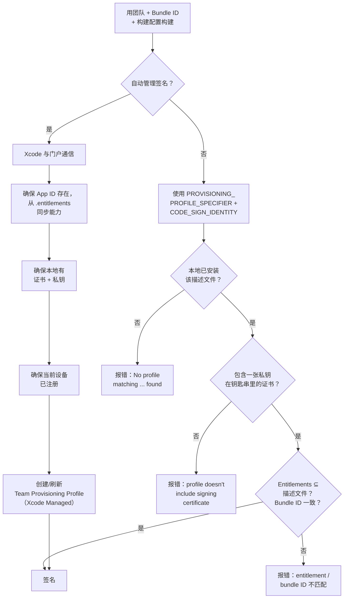

# 05.5 · 描述文件

> 英文原文：[5.5 — Provisioning Profiles](../../05-deep-dives/05-provisioning-profiles.md)
>
> **你在哪里：**第五篇深入专题，整个体系的拱心石。前面讲的都是原料，描述文件是把它们绑在一起的地方。
> **读完本篇你会知道：**一个 `.mobileprovision` 文件里实际装着什么，有哪几类描述文件，Xcode 如何挑选描述文件，它们存放在哪里，以及如何查看和排查它们。

## 缩写对照表

| 缩写 | 英文全称 | 中文 |
|---|---|---|
| CMS | Cryptographic Message Syntax | 密码消息语法 |
| PKCS#7 | Public-Key Cryptography Standards #7 | 公钥密码学标准第 7 号 |
| XML | Extensible Markup Language | 可扩展标记语言 |
| plist | Property List | 属性列表文件 |
| UUID | Universally Unique Identifier | 通用唯一标识符 |
| UDID | Unique Device Identifier | 设备唯一标识 |
| CI | Continuous Integration | 持续集成 |

## 角色回顾
**负责：**Apple 签过名的一份声明：*这些证书*可以为*这个 App ID* 签名，带着*这些 entitlements*，在*这些设备*上运行，直到*这一天*。它离线回答了 Q1、Q3、Q4 和 Q5。**出现在 PawPal 的哪些步骤：**5、8、9、11。

## 内部设计

### 它是一个签过名的 plist
`.mobileprovision` 文件是一个 **CMS（PKCS#7）SignedData** 信封，里面的载荷是一个 XML plist，签名者是 Apple。解码它：

```bash
security cms -D -i ~/Downloads/PawPal_Dev.mobileprovision > profile.plist
# or: openssl smime -inform der -verify -noverify -in PawPal_Dev.mobileprovision
```

PawPal 开发描述文件解码后的结果（有删减）：

```xml
<dict>
  <key>AppIDName</key>                 <string>PawPal</string>
  <key>ApplicationIdentifierPrefix</key><array><string>7XQ4K9P2LM</string></array>
  <key>TeamIdentifier</key>            <array><string>7XQ4K9P2LM</string></array>
  <key>TeamName</key>                  <string>Mia Chen</string>
  <key>Name</key>                      <string>iOS Team Provisioning Profile: com.miachen.pawpal</string>
  <key>UUID</key>                      <string>3f1c9a2e-6b7d-4e8a-9c01-2d5f8e7b6a43</string>
  <key>Platform</key>                  <array><string>iOS</string></array>
  <key>CreationDate</key>              <date>2025-11-01T10:12:00Z</date>
  <key>ExpirationDate</key>            <date>2026-11-01T10:12:00Z</date>

  <key>DeveloperCertificates</key>     <!-- the exact certs allowed to sign -->
  <array><data>MIIFxjCCBK6gAwIBAgIQ...</data></array>

  <key>Entitlements</key>              <!-- the MAXIMUM the app may claim -->
  <dict>
    <key>application-identifier</key>  <string>7XQ4K9P2LM.com.miachen.pawpal</string>
    <key>com.apple.developer.team-identifier</key><string>7XQ4K9P2LM</string>
    <key>get-task-allow</key>          <true/>
    <key>aps-environment</key>         <string>development</string>
    <key>com.apple.security.application-groups</key>
    <array><string>group.com.miachen.pawpal</string></array>
    <key>keychain-access-groups</key>  <array><string>7XQ4K9P2LM.*</string><string>com.apple.token</string></array>
  </dict>

  <key>ProvisionedDevices</key>        <!-- where it may run -->
  <array><string>00008110-001A2B3C4D5E801E</string></array>
</dict>
```

每一块回答一个问题：

| 描述文件里的键 | 回答的问题 |
|---|---|
| `TeamIdentifier`、`DeveloperCertificates` | **谁**可以签名（Q1） |
| `Entitlements` | 能**做什么**（Q3） |
| `ProvisionedDevices` / `ProvisionsAllDevices` | 能在**哪里**运行（Q4） |
| `ExpirationDate` + Apple 的签名 | **有效到何时 / 可否吊销**（Q5） |

### 描述文件的类型

| 类型 | 内含的证书类型 | 设备 | `get-task-allow` | `aps-environment` | 典型有效期 |
|---|---|---|---|---|---|
| **iOS App Development** | Apple Development（一个或多个开发者） | 列出 | `true` | `development` | 约 1 年（免费团队为 7 天） |
| **Ad Hoc** | Apple Distribution | 列出 | `false` | `production` | 约 1 年，且不超过证书有效期 |
| **App Store Connect** | Apple Distribution | 无 | `false` | `production` | 约 1 年（只在上传时起作用） |
| **In-House**（企业） | Enterprise Distribution | 全部（`ProvisionsAllDevices`） | `false` | `production` | 约 1 年 |
| **Developer ID**（macOS） | Developer ID Application | 无 | `false` | 不适用 | 更长 |
| **Mac Development / Mac App Store** | Apple Development / Distribution | 列出 Mac（开发）/ 无 | | | |

描述文件**在实际意义上永远不可能比它里面的证书活得更久**。证书一过期，包含它的描述文件也就失效了。

### 自动签名与手动签名

*Xcode 是怎么拿到正确的描述文件的？*



- **自动签名：**最适合独立开发者和开发版本。Xcode 托管的描述文件会按需重新生成（名字类似 *「iOS Team Provisioning Profile: …」*）。
- **手动签名：**最适合 CI 上的分发构建，以及希望签名资产确定、可共享的团队（常配合 *fastlane match*，它把加密后的证书和描述文件存在一个 git 仓库或存储桶里）。

### 描述文件存放在哪里
- 在 Mac 上（当前版本的 Xcode）：`~/Library/Developer/Xcode/UserData/Provisioning Profiles/`（旧版 Xcode 用的是 `~/Library/MobileDevice/Provisioning Profiles/`），文件名是 `<UUID>.mobileprovision`。
- **在应用里：**`PawPal.app/embedded.mobileprovision`（iOS）或 `PawPal.app/Contents/embedded.provisionprofile`（macOS）。每个扩展都有自己的一份。
- 在设备上：已安装的描述文件由系统保存。设置 → 通用 → VPN 与设备管理里能看到企业描述文件。

### 检查一个构建好的应用

```bash
# Which profile is embedded?
security cms -D -i PawPal.app/embedded.mobileprovision | plutil -p - | egrep 'Name|UUID|ExpirationDate|aps-environment|get-task-allow'

# Which cert signed the binary, and is it one of the profile's DeveloperCertificates?
codesign -dvv PawPal.app 2>&1 | grep Authority
security cms -D -i PawPal.app/embedded.mobileprovision \
  | plutil -extract DeveloperCertificates.0 raw -o - - | base64 -d \
  | openssl x509 -inform der -noout -subject -enddate
```

## 与其他部件的交互
- **← 门户：**由团队 + 证书 + App ID（能力）+ 设备生成，再由 Apple 签名。
- **→ Xcode/codesign：**被嵌入应用包；它的 `Entitlements` 字典就是 Xcode 往签名里写什么的白名单。
- **→ installd：**安装时检查的主要输入（见 [05.7，英文](../../05-deep-dives/07-on-device-verification.md)）。
- **不被**终端用户设备上的 App Store 版本**使用**：重签名之后，接管的是 Apple 自己的签名（见 [05.8，英文](../../05-deep-dives/08-distribution-and-resigning.md)）。

## ⚓ 回到示例
- **第 5 步。** Xcode（自动签名）生成了上面那份开发描述文件：Mia 的开发证书、App ID、`get-task-allow = true`、`aps-environment = development`、App Group，以及她的 UDID。`com.miachen.pawpal.widget` 另有一份单独的描述文件。
- **第 8 步。** 给 Leo 打包时，Xcode 的 *Distribute App → Ad Hoc* 用的是一份 **Ad Hoc 描述文件**：Apple Distribution 证书、`get-task-allow = false`、`aps-environment = production`，而 `ProvisionedDevices` 一开始**只有 Mia 的手机**。所以 Leo 装不上。带上两个 UDID 重新生成后，就能装了。
- **第 9 步。** 上架 App Store 用的 **App Store Connect 描述文件***没有*设备列表，它只是用来让上传合法。Apple 重签名之后，再也不会有哪台手机去看它。
- **第 11 步。** 一年以后，Ad Hoc 描述文件的 `ExpirationDate` 到期，Leo 手上的 PawPal 打不开了；App Store 版本不受影响。

## 失败时的表现
| 情况 | 典型报错 | 解决办法 |
|---|---|---|
| 描述文件过期 | *「Profile has expired」*；设备上的应用无法启动 | 重新生成、重签名、重新安装 |
| 描述文件里的证书 ≠ 本地签名身份 | *「Provisioning profile 'X' doesn't include signing certificate 'Y'」* | 用你的证书重新生成描述文件，或导入正确的 `.p12` |
| 没有对应 bundle ID 的描述文件 | *「No profiles for 'com.miachen.pawpal' were found」* | 新建一份，或开启自动签名 / `-allowProvisioningUpdates` |
| 后来才加的能力 | *「Provisioning profile doesn't support the Push Notifications capability」* | 在 App ID 上开启后重新生成 |
| 两份描述文件都匹配，选错了 | 奇怪的 entitlement 报错 | 删掉上面那个目录里过时的描述文件；按名称或 UUID 指定描述文件 |
| 描述文件类型用错 | 比如用开发描述文件上传 App Store | 上传校验报错：*「Invalid Provisioning Profile」* |

---
← [05.4 · 注册设备](04-devices.md) · 下一篇 → [05.6 · codesign 与应用内的签名](06-codesign-and-the-signature.md) · [概念全景图](../03-concept-map.md)
