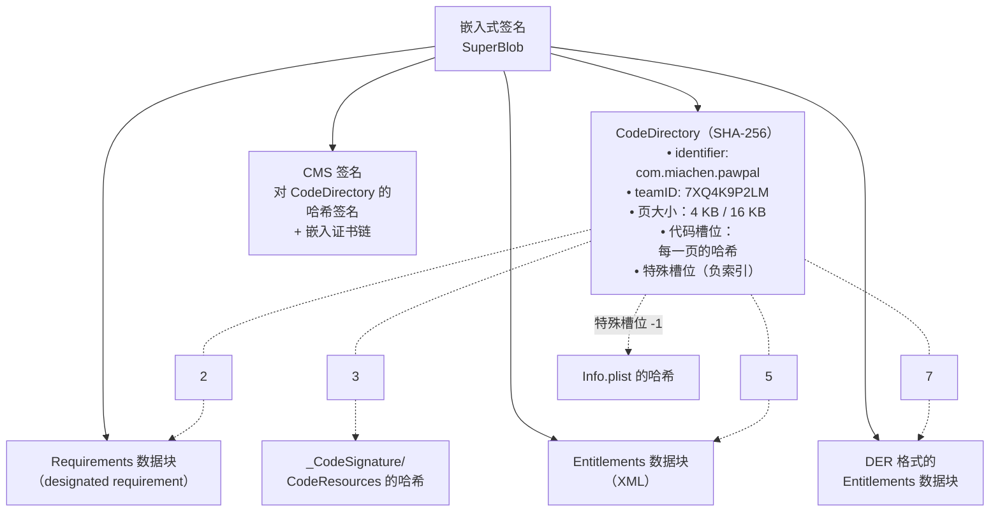

# 05.6 · codesign 与应用内的签名

> 英文原文：[5.6 — `codesign` & the Signature Inside Your App](../../05-deep-dives/06-codesign-and-the-signature.md)
>
> **你在哪里：**第六篇深入专题，密码学的核心。「没被改过」这项声明（Q2）在物理上是怎么构建出来的。
> **读完本篇你会知道：**Apple 代码签名的结构（SuperBlob、CodeDirectory、特殊槽位、CMS 数据块），cdhash 是什么，资源是怎么被封印的，嵌套代码的签名顺序，以及如何把这一切查看清楚。

## 缩写对照表

| 缩写 | 英文全称 | 中文 |
|---|---|---|
| CMS | Cryptographic Message Syntax | 密码消息语法 |
| cdhash | Code Directory Hash | 代码目录哈希 |
| Mach-O | Mach Object file format | Apple 平台的可执行文件格式 |
| SHA | Secure Hash Algorithm | 安全哈希算法 |
| DER | Distinguished Encoding Rules | 可辨别编码规则 |
| XML | Extensible Markup Language | 可扩展标记语言 |
| ACL | Access Control List | 访问控制列表 |
| TCC | Transparency, Consent, and Control | 透明度、同意与控制（macOS 隐私权限框架） |
| TSA | Time Stamping Authority | 时间戳机构 |
| AMFI | Apple Mobile File Integrity | Apple 移动文件完整性（内核扩展） |
| CI | Continuous Integration | 持续集成 |

## 角色回顾
**负责：**把构建好的应用包、一个签名身份和一份描述文件，变成一个能发现篡改、可由 Apple 体系校验的对象。**出现在 PawPal 的哪个步骤：**6。

## 内部设计

### 签名放在哪里
对一个 Mach-O 可执行文件来说，签名追加在 `__LINKEDIT` 段的末尾，由 `LC_CODE_SIGNATURE` 加载命令引用：

```bash
otool -l PawPal.app/PawPal | grep -A4 LC_CODE_SIGNATURE
#      cmd LC_CODE_SIGNATURE
#  cmdsize 16
#  dataoff 1843200
# datasize 39872
```

非代码文件（图片、storyboard、plist）则单独封印在 `PawPal.app/_CodeSignature/CodeResources` 里。

### 结构：SuperBlob

*签名数据块里装着什么？*



关键的设计点：

1. **代码槽位**：二进制被切成一页一页，每一页的哈希都写进 CodeDirectory。这样就能做*惰性*校验：内核只在某一页被换入内存时才检查它（第 1 篇里的约束 3）。
2. **特殊槽位**：Info.plist、requirements、资源封印和 entitlements 的哈希。改动其中*任何一项*，CodeDirectory 都会随之改变。
3. **CMS 签名**：私钥签的**只是 CodeDirectory 的哈希**，而不是整个二进制。一个签名就间接覆盖了每一页、每一个资源，以及 entitlements。

### cdhash
**cdhash** 是 CodeDirectory 的哈希，也就是应用的密码学指纹。内核缓存的是它，信任缓存（trust cache）列的是它，公证票据引用的也是它。

```bash
codesign -dvvv PawPal.app 2>&1 | egrep 'Identifier|TeamIdentifier|CDHash|Authority|Hash type|Signed Time'
# Identifier=com.miachen.pawpal
# Hash type=sha256 size=32
# CDHash=4b6f0e1d2c3a...
# Authority=Apple Development: Mia Chen (R8J2N5T7QX)
# Authority=Apple Worldwide Developer Relations Certification Authority
# Authority=Apple Root CA
# TeamIdentifier=7XQ4K9P2LM
```

### 资源封印（`CodeResources`）
一个 plist，把应用包里的每个文件映射到它的哈希，另外还有规则说明哪些要封印、哪些忽略、哪些是嵌套代码：
```xml
<key>files2</key>
<dict>
  <key>Assets.car</key>          <dict><key>hash2</key><data>…</data></dict>
  <key>embedded.mobileprovision</key><dict><key>hash2</key><data>…</data></dict>
  <key>PlugIns/PawPalWidget.appex</key>
      <dict><key>cdhash</key><data>…</data><key>requirement</key><string>…</string></dict>
</dict>
```
所以**嵌入的描述文件本身也被封印了**：不重签名就没法换掉它。而**嵌套代码**（扩展、framework）是通过*它自己的* cdhash 被引用的。

### 签名顺序：由内而外
因为外层的封印记录了内层的 cdhash，签名必须**从最里层的代码开始，一层层往外**：

```
1. Frameworks/*.framework (and dylibs)
2. PlugIns/PawPalWidget.appex   (with its own profile + entitlements)
3. PawPal.app                    (last; seals everything above)
```
Xcode 会自动按这个顺序来。手写的重签名脚本如果先签外层应用，或者想当然地用 `--deep`，就会得到损坏的、或者 entitlements 不对的嵌套代码。（签名时不建议用 `--deep`；用于*校验*时没问题。）

### designated requirement
一个编译进 Requirements 数据块的小表达式，说明*「这段代码将来的版本要满足什么条件，才算同一个应用」*：
```bash
codesign -d -r- PawPal.app
# designated => identifier "com.miachen.pawpal" and anchor apple generic
#   and certificate leaf[subject.CN] = "Apple Development: Mia Chen (R8J2N5T7QX)"
#   and certificate 1[field.1.2.840.113635.100.6.2.1] /* exists */
```
尤其在 macOS 上，钥匙串的 ACL（Access Control List，访问控制列表）和 TCC（Transparency, Consent, and Control，隐私权限框架）权限都和它绑定。这就是为什么 Mac 应用换了签名身份后，可能会「忘掉」之前授予过的权限。

### `codesign` 实际执行的命令（来自 Xcode 构建日志）
```bash
/usr/bin/codesign --force --sign 9F3A...C1 \
  --entitlements /…/PawPal.app.xcent \
  --timestamp=none --generate-entitlement-der \
  /…/Build/Products/Debug-iphoneos/PawPal.app
```
- `--sign` 接收签名身份的 SHA-1（来自 `security find-identity`）。
- `.xcent` = 最终合并后的 entitlements（见 [05.3](03-app-ids-and-entitlements.md)）。
- `--timestamp`（来自 Apple TSA，即时间戳机构的安全时间戳）用于分发和 Developer ID 签名；它证明签名是*何时*发生的，所以证书过期后签名依然有效。

## 与其他部件的交互
- **← 钥匙串：**由私钥完成 CMS 签名（可能弹窗请求访问；在无界面环境下会以 `errSecInternalComponent` 失败）。
- **← 描述文件：**被嵌入并通过 `CodeResources` 封印；它的 `DeveloperCertificates` 必须包含签名证书。
- **← Entitlements：**封印在特殊槽位里；必须 ⊆ 描述文件。
- **→ installd / AMFI：**它们校验 CMS 签名、证书链和 CodeDirectory，然后再惰性地逐页校验。

## ⚓ 回到示例
**第 6 步完整过程：**
1. Xcode 编译 `PawPalWidget.appex`，把 `PawPalWidget_Dev.mobileprovision` 复制进去，命名为 `embedded.mobileprovision`，写出小组件的 `.xcent`（带 App Group），然后对它运行 `codesign`，得到 cdhash `W`。
2. 把 PawPal 的开发描述文件复制到 `PawPal.app/embedded.mobileprovision`，生成 `CodeResources`（其中记录了 `PlugIns/PawPalWidget.appex → cdhash W` 和描述文件的哈希），为 `PawPal` 可执行文件构建 CodeDirectory（页哈希 + 特殊槽位），再用 Mia 的私钥对它的哈希签名。
3. `codesign --verify --deep --strict --verbose=2 PawPal.app` → `valid on disk / satisfies its Designated Requirement`。

篡改测试：改动 `Assets.car` 的一个字节，再校验一次 → `a sealed resource is missing or invalid`。改动代码的一个字节 → 页哈希对不上，设备上这一页被加载时，内核会直接杀掉进程。

## 失败时的表现
| 情况 | 后果 |
|---|---|
| 签名后又修改了文件 | `codesign --verify` 失败；设备拒绝安装，或在缺页时杀掉进程 |
| 嵌套代码在外层应用包之后才签名 | 外层封印记录的是过时的 cdhash → 无效 |
| 文件带有扩展属性 / 资源分支 | `resource fork, Finder information, or similar detritus not allowed`；用 `xattr -cr` 修复 |
| 钥匙串被锁，或私钥的 ACL 拒绝 codesign | `errSecInternalComponent`（CI 上） |
| 签名身份的哈希或名称写错 | `no identity found` |

---
← [05.5 · 描述文件](05-provisioning-profiles.md) · 下一篇 → [05.7 · 设备端校验（英文）](../../05-deep-dives/07-on-device-verification.md) · [概念全景图](../03-concept-map.md)
