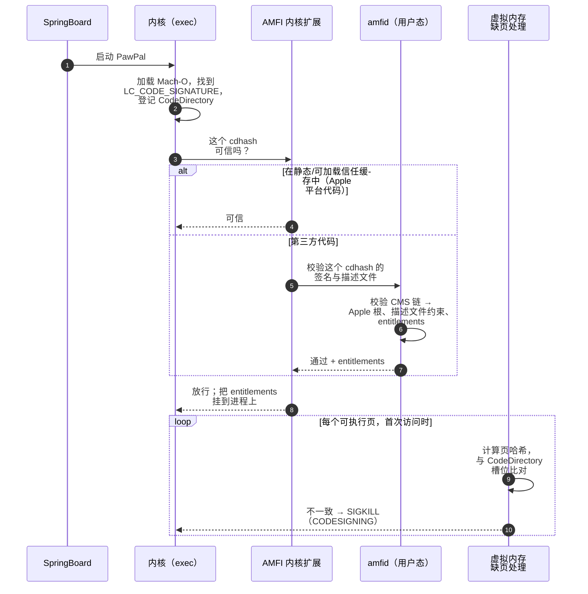

# 05.7 · 设备端校验：installd、AMFI 与内核

> 英文原文：[5.7 — On-Device Verification: installd, AMFI & the Kernel](../../05-deep-dives/07-on-device-verification.md)
>
> **你在哪里：**第七篇深入专题，执行的一方。前面所有环节都在*产出*声明，这里是 iPhone *检查*它们的地方。
> **读完本篇你会知道：**两道关卡（安装时和运行时）各自校验什么，描述文件和信任信息如何缓存在设备上，开发者模式、企业版信任，以及吊销。

## 缩写对照表

| 缩写 | 英文全称 | 中文 |
|---|---|---|
| AMFI | Apple Mobile File Integrity | Apple 移动文件完整性（内核扩展） |
| CMS | Cryptographic Message Syntax | 密码消息语法 |
| CA | Certificate Authority | 证书颁发机构 |
| UDID | Unique Device Identifier | 设备唯一标识 |
| MDM | Mobile Device Management | 移动设备管理 |
| VM | Virtual Memory | 虚拟内存 |
| JIT | Just-In-Time compilation | 即时编译 |
| OCSP | Online Certificate Status Protocol | 在线证书状态协议 |
| cdhash | Code Directory Hash | 代码目录哈希 |
| kext | Kernel Extension | 内核扩展 |

## 角色回顾
**负责：**离线、快速地判断一段代码能否被安装和执行，以及带着哪些 entitlements 执行。**出现在 PawPal 的哪些步骤：**7（她的手机）、8（Leo 那边被拒）、11（过期）。

## 内部设计

### 关卡 1：安装时（`installd` / MobileInstallation）
当一个 `.app`/`.ipa` 到达设备（通过 Xcode、AirDrop、MDM、TestFlight、App Store），安装守护进程会检查：

| # | 检查项 | 依据 |
|---|---|---|
| 1 | 描述文件的 CMS 签名能追溯到 **Apple 根 CA** | 内置的根证书 |
| 2 | 描述文件没过期；平台一致 | `ExpirationDate`、`Platform` |
| 3 | 本机 UDID ∈ `ProvisionedDevices`（或 `ProvisionsAllDevices`） | 设备身份 |
| 4 | 二进制的签名证书 ∈ 描述文件的 `DeveloperCertificates` | CMS 数据块 vs 描述文件 |
| 5 | 应用的 `application-identifier` 与描述文件里的一致（允许通配） | Entitlements |
| 6 | 每一个签进去的 entitlement 都在描述文件的 `Entitlements` 允许范围内 | 子集检查 |
| 7 | 代码签名本身格式正确且有效；嵌套代码也一样 | CodeDirectory、CodeResources |

App Store 和 TestFlight 版本不会走通常形式的第 2–6 项描述文件检查，因为它们到达时已经**由 Apple 签名**（见 [05.8](08-distribution-and-resigning.md)）。

### 关卡 2：运行时（内核 + AMFI）
**AMFI**（Apple Mobile File Integrity，Apple 移动文件完整性）由一个内核扩展和一个用户态辅助守护进程（`amfid`）组成。

*从点下 PawPal 图标，到第一条指令执行，中间发生了什么？*

要点：
- **惰性的逐页校验**正是按页哈希带来的回报：一个 200 MB 的应用启动时，不需要先把 200 MB 全部哈希一遍。
- **不存在未签名的可执行内存。** iOS 不允许第三方应用把可写的内存页变成可执行（没有特殊 entitlement 就没有 JIT，即即时编译），所以你没法下载一段代码再运行它。
- **Entitlements 变成了进程属性。** `apsd`、`securityd` 这类守护进程会向内核查询调用者*签过名的* entitlements，应用内部根本没有办法伪造。
- **崩溃特征。** 因代码签名被杀的进程，在崩溃日志里表现为 `Termination Reason: CODESIGNING` / `EXC_BAD_ACCESS (Code Signature Invalid)`。

### 开发者模式（iOS/iPadOS 16+、watchOS 9+）
开发签名的应用（带 `get-task-allow`、调试用描述文件）无法启动，直到用户在 **设置 → 隐私与安全性 → 开发者模式** 里打开它并重启设备。这能挡住那种哄骗用户安装「开发版」的社会工程攻击。Ad Hoc、TestFlight、App Store 和企业版不需要开发者模式。

### 企业版信任
对内部（In-House）版本，第一次启动会被拦下，直到用户在 **设置 → 通用 → VPN 与设备管理** 里明确信任这个开发者（通过 MDM 安装的应用可以预先被信任）。设备还会定期在线（OCSP，在线证书状态协议）检查企业证书的吊销状态。企业证书一旦被吊销，所有设备上用它签名的应用会全部失效。

### 吊销与过期一览

| 版本类型 | 描述文件过期 | 证书过期 | 证书被吊销 |
|---|---|---|---|
| Development | 无法启动 | 无法启动（描述文件失效） | 无法启动 |
| Ad Hoc | 无法启动 | 无法启动（描述文件失效） | 无法启动 |
| Enterprise | 无法启动 | 无法启动 | **所有设备都无法启动**（OCSP） |
| App Store / TestFlight | 不适用（Apple 签名） | **不受影响** | **不受影响** |

（TestFlight 版本有它自己的规则，90 天后过期。）

## 与其他部件的交互
- **← codesign：**消费 CodeDirectory、CMS 数据块、entitlements 和嵌入的描述文件。
- **← 门户（间接）：**通过 Apple 签名的描述文件，以及用于吊销检查的 OCSP。
- **→ 操作系统服务：**把校验过的 entitlements 交给沙盒、`apsd`、钥匙串、容器管理器。

## ⚓ 回到示例
- **第 7 步。** Mia 点下 Run。Xcode 通过 USB/Wi-Fi 安装应用；`installd` 检查第 1–7 项：描述文件由 Apple 签名 ✔，到期日 2026-11-01 ✔，UDID `…801E` 在列 ✔，签名证书在列 ✔，`application-identifier` 一致 ✔，entitlements（`aps-environment=development`、App Group、`get-task-allow`）⊆ 描述文件 ✔。她开着开发者模式。启动时，`amfid` 校验 cdhash，内核把 entitlements 挂到进程上。因为 `get-task-allow = true`，调试器可以附加。
- **第 8 步。** 在 Leo 的手机上，第 3 项没通过：`00008120-…5A6E` 不在 `ProvisionedDevices` 里，所以在任何代码运行之前，安装就被拒了。Ad Hoc 版本不需要 Leo 开启开发者模式。
- **第 11 步。** 一年以后，Leo 点开 PawPal，Ad Hoc 描述文件已经过期，应用打不开。与此同时，数以百万计的 App Store 安装照常运行，因为它们的签名是 Apple 的。

## 失败时的表现
| 现象 | 可能的原因 |
|---|---|
| *「Unable to Install … integrity could not be verified」* | 描述文件/设备/证书/entitlement 不匹配（第 3–6 项） |
| 应用一打开就立刻消失，崩溃日志显示 `CODESIGNING` | 签名后二进制被修改，或某个嵌套 framework 没签名或签错了 |
| 弹出 *「Untrusted Developer」* | 企业版还没在设置里被信任 |
| 开发版在 iOS 16+ 上无法启动 | 开发者模式没开 |
| 一直拿不到推送令牌 | 签过名的 entitlements 里缺少 `aps-environment` |

---
← [05.6 · codesign 与应用内的签名](06-codesign-and-the-signature.md) · 下一篇 → [05.8 · 分发与 Apple 重签名](08-distribution-and-resigning.md) · [概念全景图](../03-concept-map.md)
