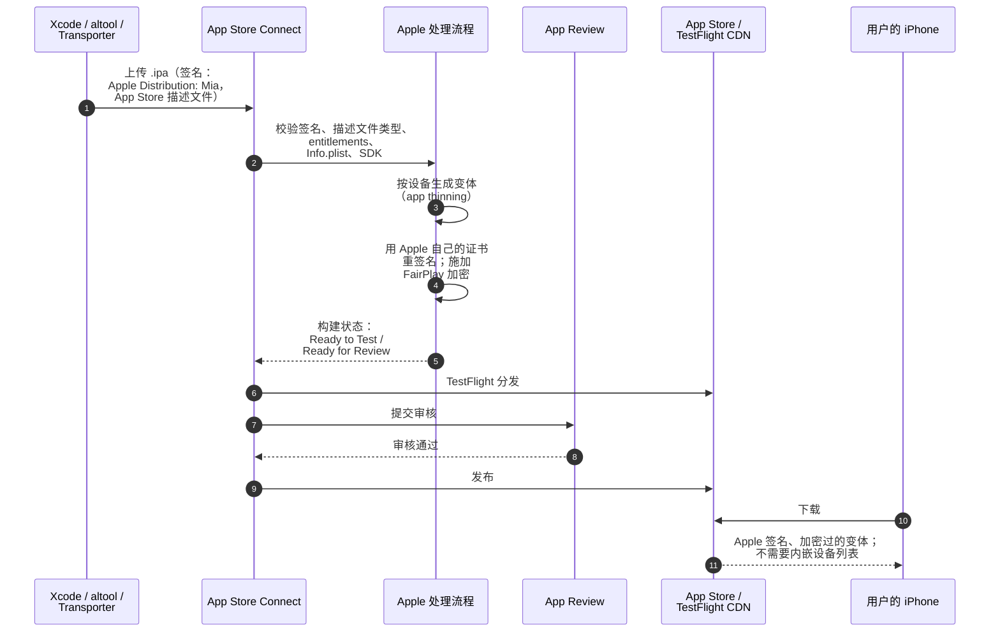

# 05.8 · 分发与 Apple 重签名

> 英文原文：[5.8 — Distribution & Apple Re-signing](../../05-deep-dives/08-distribution-and-resigning.md)
>
> **你在哪里：**最后一篇深入专题。同样这些积木，在应用触达用户的每一种方式里是怎么不同地组合起来的，也包括 macOS。
> **读完本篇你会知道：**各种分发方式的横向对比，App Store Connect 对你的二进制做了什么，为什么商店里的应用不怕证书过期，以及 macOS 的 Developer ID + 公证如何融入这套体系。

## 缩写对照表

| 缩写 | 英文全称 | 中文 |
|---|---|---|
| UDID | Unique Device Identifier | 设备唯一标识 |
| CDN | Content Delivery Network | 内容分发网络 |
| SDK | Software Development Kit | 软件开发工具包 |
| DRM | Digital Rights Management | 数字版权管理 |
| APNs | Apple Push Notification service | Apple 推送通知服务 |
| IPA | iOS App Store Package | iOS 安装包 |
| cdhash | Code Directory Hash | 代码目录哈希 |

## 角色回顾
**负责：**把签好名的构建从开发者手里规模化地送到用户手里；对 App Store 来说，还要用 Apple 的签名*替换*掉开发者的签名。**出现在 PawPal 的哪些步骤：**8（Ad Hoc）、9（TestFlight 与 App Store）、11（长期表现）。

## 内部设计

### 各种分发方式对比

| 方式 | 证书 | 描述文件 | 谁能安装 | 审核 | 用户设备看到的签名 |
|---|---|---|---|---|---|
| **Development** | Apple Development | Development（带 UDID） | 已注册设备，需开启开发者模式 | 无 | 开发者的 |
| **Ad Hoc** | Apple Distribution | Ad Hoc（带 UDID） | 每类设备最多 100 台已注册设备 | 无 | 开发者的 |
| **TestFlight** | Apple Distribution | App Store Connect | 内部（团队成员）+ 最多 10,000 名外部测试者 | 外部测试需 Beta 审核 | **Apple 的** |
| **App Store** | Apple Distribution | App Store Connect | 所有人 | 完整的 App Review | **Apple 的** |
| **企业内部分发（In-House）** | Enterprise Distribution | In-House（所有设备） | 本组织员工 | 无（受政策约束） | 开发者的 |
| **定制应用 / Apple Business Manager** | Apple Distribution | App Store Connect | 指定的组织 | App Review | **Apple 的** |
| **macOS Developer ID** | Developer ID Application | 可选（仅在使用受限 entitlements 时需要） | 任何人，通过直接下载 | 公证（自动扫描） | 开发者的 + 公证票据 |

### 上传之后发生了什么

*Mia 签好名的归档，是怎么变成用户下载到的那个构建的？*



上传时的签名虽然最终会被替换，但它依然重要：
- 它**为这次上传做了身份认证**，证明确实来自团队 `7XQ4K9P2LM`。
- 它的 **entitlements 就是 Apple 在重签名后的构建里会保留的那些**，前提是检查过它们对这个 App ID 是允许的。所以 `aps-environment` 必须已经是 `production`，`get-task-allow` 必须是 `false`。
- App Store 描述文件的*类型*告诉 Apple，这个构建是要上商店的。

重签名为什么这么有用：
- 用户的设备不需要出现在任何设备列表里。
- **你的证书过期或被吊销，不会影响已经在 App Store 上安装的应用。**
- Apple 可以集中施加 FairPlay DRM（Digital Rights Management，数字版权管理）和按设备的瘦身。

### 导出：`xcodebuild -exportArchive`
同一个 `.xcarchive` 可以按不同方式导出，由 `ExportOptions.plist` 决定：

```xml
<dict>
  <key>method</key>          <string>app-store-connect</string>  <!-- or release-testing (ad hoc), debugging, enterprise, developer-id -->
  <key>teamID</key>          <string>7XQ4K9P2LM</string>
  <key>signingStyle</key>    <string>manual</string>
  <key>provisioningProfiles</key>
  <dict>
    <key>com.miachen.pawpal</key>        <string>PawPal AppStore</string>
    <key>com.miachen.pawpal.widget</key> <string>PawPal Widget AppStore</string>
  </dict>
</dict>
```
（旧版 Xcode 的方式名是 `app-store` 和 `ad-hoc`。）导出时会用选定的分发身份和描述文件给归档里的应用**重新签名**。所以同一个归档，既能变成一个 Ad Hoc 的 `.ipa`，也能变成一次 App Store 上传。

### macOS：Developer ID + Hardened Runtime + 公证
在 Mac App Store 之外，没有 Apple 重签名这一步，所以：
1. 用 **Developer ID Application** 签名，开启 **Hardened Runtime**（`--options runtime`），并带上安全时间戳。
2. 提交给**公证服务**（`xcrun notarytool submit PawPal.zip --wait`）。Apple 会扫描它，并记录它的 cdhash。
3. **钉上（staple）**票据（`xcrun stapler staple PawPal.app`），让 Gatekeeper 能离线校验。
4. 首次启动时，**Gatekeeper** 检查：有效的 Developer ID 签名 + 公证票据（钉在应用上的，或在线获取的）→ 放行。

吊销 Developer ID 证书，或针对特定 cdhash 吊销公证，能让 Apple 在事后禁用已知的恶意软件。

## 与其他部件的交互
- **← codesign（[05.6](06-codesign-and-the-signature.md)）：**产出开发者签名的上传包 / Ad Hoc / 企业版 `.ipa`。
- **← 描述文件（[05.5](05-provisioning-profiles.md)）：**导出方式 ⇒ 描述文件类型。
- **→ 设备端校验（[05.7](07-on-device-verification.md)）：**商店版本，设备校验的是 **Apple 的**签名；其他版本，校验的是开发者的签名 + 嵌入的描述文件。

## ⚓ 回到示例
- **第 8 步（Ad Hoc）。** `Distribute App → Release Testing` 用 *Apple Distribution: Mia Chen* 和 Ad Hoc 描述文件给归档重签名。这个 `.ipa` 保留的是*她的*签名，所以 Leo 的手机要自己完成 05.7 里的全部描述文件检查，于是就有了 UDID 那次失败。
- **第 9 步（TestFlight → App Store）。** `Distribute App → App Store Connect` 用 App Store 描述文件（`aps-environment = production`、`beta-reports-active = true`）重签名，然后上传、处理，再由 Apple 重签名。TestFlight 测试者和之后的 App Store 用户运行的构建，`Authority` 链是 Apple 的，不是 Mia 的。推送令牌现在来自 **production** 环境的 APNs，所以她的服务器必须改用 production 端点。
- **第 11 步。** Mia 的分发证书过期了，App Store 上的用户毫无察觉。她只需要在下一次上传前新建一张证书（或者依赖云端托管签名）。

## 失败时的表现
| 情况 | 后果 |
|---|---|
| 用开发描述文件签名后上传 | 校验报错：描述文件无效 / 缺少 beta entitlement |
| 上传包里 `get-task-allow = true` | 校验时被拒 |
| 某个 entitlement 对该 App ID 不被允许 | 上传时出现 `ITMS-90xxx` 这类校验错误 |
| 企业证书被吊销 | 所有已安装的企业应用都无法启动 |
| Mac 应用没有公证 | Gatekeeper 拦截：*「cannot be opened because Apple cannot check it for malicious software」* |

---
← [05.7 · 设备端校验](07-on-device-verification.md) · 下一篇 → [06 · 完整演练（英文）](../../06-walkthrough.md) · [概念全景图](../03-concept-map.md)
