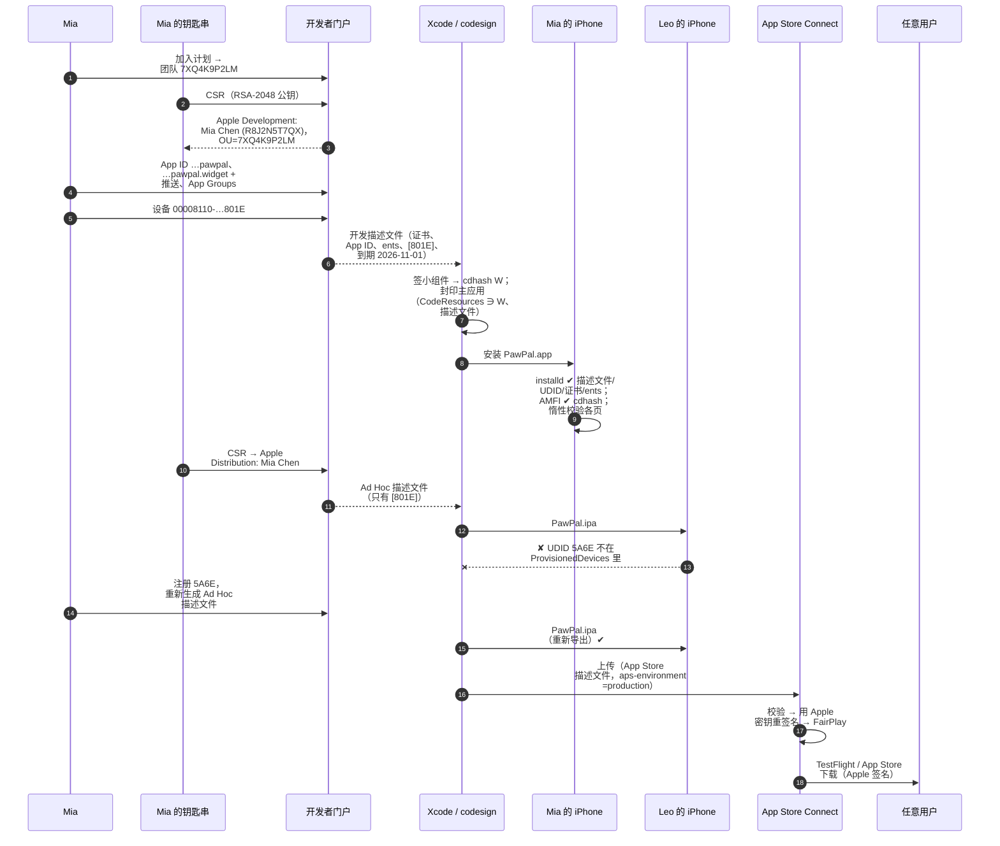

# 06 · 完整演练：PawPal 从头到尾

> 英文原文：[Part 6 — Full Walkthrough: PawPal End to End](../06-walkthrough.md)
>
> **你在哪里：**第六阶段。把第 4 篇的贯穿示例按完整深度重放一遍，并把八篇深入专题串在一起。
> **读完本篇你会知道：**从「Mia 加入开发者计划」到「一个陌生人下载 PawPal」的每一跳，每一跳跨越边界时携带的具体数据，以及亲手查看它们的命令。

## 缩写对照表

| 缩写 | 英文全称 | 中文 |
|---|---|---|
| CSR | Certificate Signing Request | 证书签名请求 |
| RSA | Rivest–Shamir–Adleman | 一种公钥加密算法 |
| WWDR | Apple Worldwide Developer Relations | Apple 全球开发者关系（其中间证书） |
| OID | Object Identifier | 对象标识符 |
| UDID | Unique Device Identifier | 设备唯一标识 |
| CMS | Cryptographic Message Syntax | 密码消息语法 |
| DER | Distinguished Encoding Rules | 可辨别编码规则 |
| AMFI | Apple Mobile File Integrity | Apple 移动文件完整性（内核扩展） |
| APNs | Apple Push Notification service | Apple 推送通知服务 |
| CI | Continuous Integration | 持续集成 |
| API | Application Programming Interface | 应用程序编程接口 |
| IPA | iOS App Store Package | iOS 安装包 |

## 带注解的全景图

*还是第 3 篇那张协作图，只是现在每一跳都带着 PawPal 的真实数据。*



## 逐步展开，完整深度

### 1. 身份诞生（→ [05.1](05-deep-dives/01-developer-account-and-team.md)）
Mia 以个人身份加入计划。Apple 创建了团队 `7XQ4K9P2LM`，这个字符串将出现在她证书的 `OU`、每一个 App ID 前缀、`com.apple.developer.team-identifier` 以及她的钥匙串访问组里。她是账号持有人，所以能创建任何类型的证书。

### 2. 一对密钥变成签名身份（→ [05.2](05-deep-dives/02-signing-certificates.md)）
开启自动签名并在 Xcode 里登录后：
1. 钥匙串在 `login.keychain-db` 里生成一对 RSA-2048 密钥。私钥永远不离开这台 Mac。
2. 一个 CSR（公钥 + 主题信息，由私钥自签名）被发往门户。
3. Apple 的 WWDR G3 CA 签发 `Apple Development: Mia Chen (R8J2N5T7QX)`，`OU=7XQ4K9P2LM`，有效期一年，带着表示开发证书的标记 OID。
4. 钥匙串把证书和私钥配对成一个签名身份：
```bash
security find-identity -v -p codesigning
#  1) 9F3A…C1 "Apple Development: Mia Chen (R8J2N5T7QX)"
```
设备之后要检查的证书链是：叶子证书 → WWDR G3 → Apple 根 CA。

### 3. 应用有了名字和能力（→ [05.3](05-deep-dives/03-app-ids-and-entitlements.md)）
注册了 App ID `7XQ4K9P2LM.com.miachen.pawpal` 和 `7XQ4K9P2LM.com.miachen.pawpal.widget`。主应用开启 *Push Notifications*，两者都开启 *App Groups*（`group.com.miachen.pawpal`）。门户上的这些开关意味着，从现在起生成的描述文件会*允许* `aps-environment` 和 App Group 这项 entitlement。Mia 的 `.entitlements` 文件则*声明*了它们。

### 4. 一台设备获得许可（→ [05.4](05-deep-dives/04-devices.md)）
插上她的 iPhone，就注册了 UDID `00008110-001A2B3C4D5E801E`（占用本会员年度 100 个 iPhone 名额中的 1 个）。她在手机上开启了开发者模式。

### 5. Apple 签发许可单（→ [05.5](05-deep-dives/05-provisioning-profiles.md)）
门户生成两份开发描述文件，每个 App ID 一份。PawPal 那一份以 Apple 签名的形式写明：
- **谁：**`DeveloperCertificates = [Mia 的开发证书]`，`TeamIdentifier = 7XQ4K9P2LM`
- **能做什么：**`application-identifier = 7XQ4K9P2LM.com.miachen.pawpal`、`aps-environment = development`、`get-task-allow = true`、App Group、`keychain-access-groups = 7XQ4K9P2LM.*`
- **在哪里：**`ProvisionedDevices = [00008110-…801E]`
- **到何时：**`ExpirationDate = 2026-11-01`

### 6. 应用包被封印（→ [05.6](05-deep-dives/06-codesign-and-the-signature.md)）
由内而外：
1. **小组件：**描述文件被复制到 `PawPalWidget.appex/embedded.mobileprovision`；最终的 entitlements 写入 `.xcent`；执行 `codesign --force --sign 9F3A…C1 --entitlements PawPalWidget.appex.xcent PawPalWidget.appex`。CodeDirectory = 页哈希 + 特殊槽位（Info.plist、CodeResources、XML 和 DER 两种格式的 entitlements）。CMS 数据块 = Mia 的私钥对 CodeDirectory 哈希的签名，外加证书链。结果：cdhash **W**。
2. **主应用：**描述文件被复制到 `PawPal.app/embedded.mobileprovision`；`_CodeSignature/CodeResources` 记录了每个资源、描述文件的哈希，以及 `PlugIns/PawPalWidget.appex → cdhash W`。`PawPal` 可执行文件的 CodeDirectory 通过特殊槽位覆盖了这一切。签名。结果：cdhash **A**。
```bash
codesign --verify --deep --strict --verbose=2 PawPal.app
# PawPal.app: valid on disk
# PawPal.app: satisfies its Designated Requirement
```

### 7. iPhone 做出判断（→ [05.7](05-deep-dives/07-on-device-verification.md)）
- **installd** 校验描述文件的 Apple 签名、日期、UDID `…801E` ∈ 列表、签名证书 ∈ `DeveloperCertificates`、`application-identifier` 一致、签进去的 entitlements ⊆ 描述文件的 entitlements，主应用*和*小组件都要过一遍。
- **启动：**内核登记 cdhash A；AMFI/amfid 校验通往 Apple 根的 CMS 证书链和描述文件的约束；entitlements 被挂到进程上。各页在缺页时被换入，每一页都要哈希比对。`apsd` 看到 `aps-environment = development` → 签发 sandbox 推送令牌。因为有 `get-task-allow`，调试器可以附加。

### 8. 给 Leo 的 Ad Hoc：先坏后好（→ [05.2](05-deep-dives/02-signing-certificates.md)、[05.4](05-deep-dives/04-devices.md)、[05.5](05-deep-dives/05-provisioning-profiles.md)、[05.7](05-deep-dives/07-on-device-verification.md)、[05.8](05-deep-dives/08-distribution-and-resigning.md)）
- 归档（`Product → Archive`）→ `Distribute App → Release Testing`。Xcode 需要一个**分发**身份，于是通过第二个 CSR 创建了 `Apple Distribution: Mia Chen`，另外生成一份 **Ad Hoc 描述文件**（`get-task-allow = false`、`aps-environment = production`，设备 = `[…801E]`）。
- 导出时用这个身份和描述文件给归档重签名，然后打包成 `PawPal.ipa`。
- 在 Leo 的手机上，installd 的 UDID 检查没通过 → 安装被拒。
- 解决：注册 `00008120-000F1E2D3C4B5A6E` → 重新生成 Ad Hoc 描述文件（现在有两个 UDID）→ 重新导出 → 安装 ✔。Leo 不需要开启开发者模式，因为这不是开发签名的版本。

### 9. 走向全世界（→ [05.5](05-deep-dives/05-provisioning-profiles.md)、[05.8](05-deep-dives/08-distribution-and-resigning.md)）
- 以 `app-store-connect` 方式导出 → 用 App Store 描述文件（没有设备、`beta-reports-active = true`）重签名 → 上传。
- App Store Connect 检查上传包的签名能追溯到团队 `7XQ4K9P2LM`、描述文件类型是 App Store、entitlements 都在允许范围内。然后处理构建、做瘦身、**用 Apple 的密钥重签名**，并施加 FairPlay 加密。
- TestFlight 测试者，以及通过审核后的 App Store 用户，安装到的构建签名机构是 Apple。他们的手机没有任何设备列表需要比对。推送现在走 production 环境的 APNs。

### 10. CI（→ [05.1](05-deep-dives/01-developer-account-and-team.md)、[05.2](05-deep-dives/02-signing-certificates.md)、[05.6](05-deep-dives/06-codesign-and-the-signature.md)）
CI 用的 Mac 需要以下二者之一：
- **手动管理的资产：**把分发用的 `.p12` 导入一个已解锁的临时钥匙串，并执行 `set-key-partition-list`（否则会报 `errSecInternalComponent`），同时安装好 App Store 描述文件。或者：
- **用 API 密钥自动处理：**`xcodebuild -allowProvisioningUpdates -authenticationKeyPath … -authenticationKeyID … -authenticationKeyIssuerID …`，让 Xcode 自己拉取描述文件，并使用云端托管的分发签名。

### 11. 一年以后（→ [05.2](05-deep-dives/02-signing-certificates.md)、[05.7](05-deep-dives/07-on-device-verification.md)、[05.8](05-deep-dives/08-distribution-and-resigning.md)）
- 开发证书和分发证书过期 → 新的构建需要新的证书和描述文件。
- Leo 手上的 Ad Hoc 安装无法再启动（描述文件过期）。
- App Store 上的安装照常可用：被检查的是 Apple 的签名，而不是 Mia 的。

## 回顾：问题已经解决
第 1 篇提出了每台设备都必须离线、在几毫秒内回答的五个问题。PawPal 的旅程把它们全都回答了：

| 问题 | 由什么回答 | 在 PawPal 里 |
|---|---|---|
| Q1 **是谁？** | 通往 Apple 根的证书链 + 描述文件的 `DeveloperCertificates` | Mia 的证书，`OU=7XQ4K9P2LM` |
| Q2 **被改过吗？** | CodeDirectory 页哈希 + CodeResources + CMS 签名 | cdhash W 和 A，逐页校验 |
| Q3 **允许做什么？** | 经 App ID → 描述文件批准、由 codesign 封印的 entitlements | 推送和 App Group 都生效了；缺了能力就会失败 |
| Q4 **能在哪里运行？** | 描述文件的 `ProvisionedDevices` | Leo 在被加进去之前一直被拒 |
| Q5 **能吊销吗？** | 证书/描述文件的过期与吊销；商店版本由 Apple 重签名 | Ad Hoc 版本过期了；App Store 版本继续运行 |

---
← [05.8 · 分发与 Apple 重签名](05-deep-dives/08-distribution-and-resigning.md) · 下一篇 → [07 · 故障排查、CI 实践与下一步](07-next-steps.md) · [概念全景图](03-concept-map.md)
