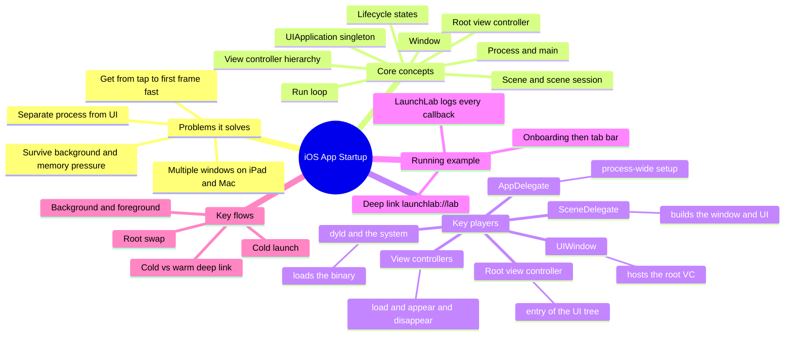

# iOS App Startup: An Introduction Series

> **Where you are:** the front door of a series on what happens between tapping an app icon and seeing its first screen, and on who owns what in a UIKit app.
> **What you'll know after this file:** the map of the whole territory, the reading order, and the sample app (LaunchLab) that every article refers back to.

When you create a new iOS project, Xcode hands you `AppDelegate.swift`, `SceneDelegate.swift`, `ViewController.swift`, and a storyboard, and most people start typing in `viewDidLoad`. That works until you have to answer questions like:

- *Where should my analytics SDK be initialised?*
- *Why doesn't `viewWillAppear` fire when the user returns to my app?*
- *Why does my deep link work when the app is running but not when it's closed?*
- *How do I show onboarding first, then the main UI?*
- *Why does `applicationDidBecomeActive` never get called?*

Each of these comes down to the same thing: **knowing which object owns which part of startup.** This series builds that picture step by step.

## The series

| # | Article | Question it answers |
|---|---|---|
| 1 | [Why the startup architecture looks like this](01-why.md) | What problems forced this design? |
| 2 | [What "app startup" is (and isn't)](02-what.md) | Where does it begin and end? |
| 3 | [The concept map](03-concept-map.md) | Who are the players, and who owns what? |
| 4 | [The running example: LaunchLab](04-running-example.md) | What does one real launch look like? |
| 5.1 | [Process launch & `main`](05-deep-dives/01-process-launch-and-main.md) | What happens before any of my code? |
| 5.2 | [UIApplication & AppDelegate](05-deep-dives/02-uiapplication-and-appdelegate.md) | What belongs at the process level? |
| 5.3 | [UIScene & SceneDelegate](05-deep-dives/03-scenes-and-scenedelegate.md) | What's a scene, and why are foreground/background events there? |
| 5.4 | [UIWindow & the Root View Controller](05-deep-dives/04-window-and-root-view-controller.md) | How does the first screen get chosen, and how do I swap it? |
| 5.5 | [The View Controller Lifecycle](05-deep-dives/05-view-controller-lifecycle.md) | `viewDidLoad`, `viewWillAppear`, … when exactly? |
| 6 | [Full walkthrough](06-walkthrough.md) | One launch, end to end, at full depth |
| 7 | [Pitfalls & next steps](07-next-steps.md) | Common mistakes, SwiftUI, launch performance |

**Interactive demo:** [`demo/launch-sequence.html`](demo/launch-sequence.html) steps through the launch sequence, background/foreground, deep links, root swaps, and navigation, lane by lane, with an iPhone mock that shows what's on screen at each step. Open it in a browser (download it first if you're on GitHub, which shows HTML as source).

**Sample app:** [`sample/`](sample/README.md) contains LaunchLab, a UIKit app that records every callback with millisecond timestamps.

## The whole territory, in one picture

*What are all the pieces of iOS app startup, and how do they group?*

## The core idea in one paragraph

An iOS app is **one process** that can show **many scenes** (windows). The **AppDelegate** speaks for the process: it is told when the process has launched and is asked how to configure new scenes. Each **SceneDelegate** speaks for one scene: it creates a **UIWindow**, gives it a **root view controller**, and is told when its scene enters the foreground or background. From the root view controller down, everything is a tree of **view controllers**, each with its own load, appear, and disappear lifecycle. Startup means walking from the process down to the first view controller's first frame, as fast as possible.

---
Next → [01 — Why](01-why.md)
