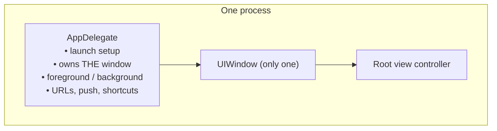

# Part 1 — Why the Startup Architecture Looks Like This

> **Where you are:** Stage 1, the problem.
> **What you'll know after this file:** the pressures that shaped UIKit startup, why the original "AppDelegate does everything" model broke, and roughly what the current design must look like.

## 1. What an app has to do at launch

At minimum, between the tap and the first frame:

1. The OS creates a process and loads your code.
2. Something has to own the connection to the system: events, URLs, notifications, state changes.
3. Something has to create a window and put a UI in it.
4. The first screen has to be built and drawn.

The user is watching the whole time. Apple's guidance is to **draw the first frame within about 400 ms**, and if launch takes too long (roughly 20 seconds) the system's watchdog kills the app. Every design choice below is also about *speed*.

## 2. The original model (iOS 2–12): one object did everything

*What did a classic UIKit app look like before iOS 13?*

The AppDelegate:
- set up services in `didFinishLaunchingWithOptions`,
- owned `var window: UIWindow?`,
- received `applicationDidBecomeActive`, `applicationDidEnterBackground`, and so on,
- handled URLs (`application(_:open:options:)`).

This worked because **one app = one process = one window = one UI.**

## 3. What broke it

| Pressure | Why "AppDelegate owns everything" fails |
|---|---|
| **iPad multitasking & multiple windows** (iPadOS 13) | Users can open *two* copies of your UI side by side, e.g. two documents. One `window` property can't hold that, and "the app became active" is ambiguous when only one window got focus. |
| **Mac Catalyst / visionOS / external displays** | Many windows, each with its own size, state, and lifecycle. |
| **Memory pressure** | The system wants to free the UI of a background window **without killing the process** and restore it later. That needs a unit smaller than "the app". |
| **State restoration** | Each window needs its *own* saved state (which document, which tab). |
| **Launch speed** | Mixing heavy process setup and UI construction in one method makes slow launches hard to diagnose. |

## 4. The constraints of the solution

1. **Split process concerns from UI concerns.** Things that exist once per process (services, push registration, global configuration) go one place. Things that exist once per window (window, root UI, foreground/background) go another.
2. **The UI unit must be creatable, destroyable, and restorable independently.** That unit is the *scene*.
3. **The system, not the app, decides when UI units come and go.** So the app must react to callbacks rather than assume "launch = one window shows up".
4. **Keep the UI a tree with one root per window.** Containers (navigation, tabs) and children all hang off one root view controller, so the system can lay out, rotate, restore, and dispose of a window's UI as a unit.
5. **Show something instantly.** A static launch screen is drawn by the system *before* your code runs, to hide the cost of loading.

## 5. Predict the design

From those constraints you could sketch it yourself:

- An object for the **process**: the *AppDelegate*, with launch and "configure a new scene" callbacks.
- An object for **each window's lifecycle**: the *SceneDelegate*, with connect/disconnect and foreground/background callbacks.
- The scene owns a **window**, the window owns **one root view controller**, and the root holds a tree of view controllers.
- View controllers get their own **load / appear / disappear** callbacks, because a screen can come and go many times within one scene.

That is exactly UIKit's structure since iOS 13. Apple has also announced that the scene-based lifecycle will be **required** for apps built with SDKs after iOS 26. The rest of the series explains it piece by piece.

---
← [00 — Overview](00-overview.md) · Next → [02 — What](02-what.md)
