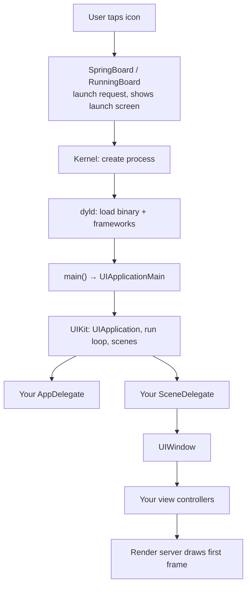

# Part 2 — What "App Startup" Is (and Isn't)

> **Where you are:** Stage 2, definition and boundaries.
> **What you'll know after this file:** a precise definition, the start and finish lines, the app's lifecycle states, and how UIKit startup relates to SwiftUI and the OS.

## 1. One-sentence definition

> **iOS app startup is the sequence in which the system creates your process, UIKit creates the `UIApplication` and your AppDelegate, connects a scene whose SceneDelegate builds a `UIWindow` with a root view controller, and the system draws that controller's first frame, splitting process-wide work from per-window work so the first frame appears quickly and each window can live and die on its own.**

## 2. Start line and finish line

| | Event | Who measures |
|---|---|---|
| **Start** | The user taps the icon (or a URL, notification, or widget launches the app) | System |
| **Finish** | The **first frame** of your UI is on screen and the app responds to touches | Xcode Organizer "Launch time", Instruments "App Launch" |

Everything between is "launch time", and all of it is on your budget, even the parts before `main`.

### Cold, warm, and resume

| Kind | Process exists? | What runs |
|---|---|---|
| **Cold launch** | No (first launch after boot, or after the process was killed) | Everything: dyld → `main` → AppDelegate → scene → window → VC |
| **Warm launch** | No, but parts of the app and libraries are still cached in memory | Same steps, faster loading |
| **Resume** | Yes, the app was in the background | Only scene foreground callbacks. **No** `didFinishLaunching`, and no `viewDidLoad` for screens that still exist |

(Since iOS 15 the system may also **prewarm** your app: run the pre-`main` part ahead of time so a later tap is faster. That's one reason not to rely on pre-`main` side effects.)

## 3. Lifecycle states

*What states can a scene be in, and which callbacks mark the transitions?*

```mermaid
stateDiagram-v2
  [*] --> Unattached
  Unattached --> ForegroundInactive: willConnectTo + sceneWillEnterForeground
  ForegroundInactive --> ForegroundActive: sceneDidBecomeActive
  ForegroundActive --> ForegroundInactive: sceneWillResignActive (call, Control Center, app switcher)
  ForegroundInactive --> Background: sceneDidEnterBackground
  Background --> ForegroundInactive: sceneWillEnterForeground
  Background --> Unattached: sceneDidDisconnect (system reclaims the scene's memory)
  Background --> Suspended: (no callback; code stops running)
  Suspended --> Background: system wakes app for a task
  Suspended --> [*]: process killed (no callback)
```

The **process** has states too (not running, background, suspended). The **scene** states above are what your UI code reacts to.

## 4. Boundaries: what this series is **not** about

- **Not SwiftUI's `App` protocol**, although it runs on the *same* machinery underneath (Part 7 shows the mapping).
- **Not code signing or installation.** Those happen before launch (see the [code signing series](../apple-code-signing-guide/00-overview.md)).
- **Not background execution** (background tasks, push wakes) beyond what's needed to understand the states.
- **Not Auto Layout or view drawing** in depth. We stop at "the first frame is rendered".

## 5. Position in the stack

*Where does your startup code sit relative to the system?*

Your code begins at `main` (usually generated for you). Everything above it is the system's work, but it still counts against your launch time.

---
← [01 — Why](01-why.md) · Next → [03 — Concept map](03-concept-map.md)
