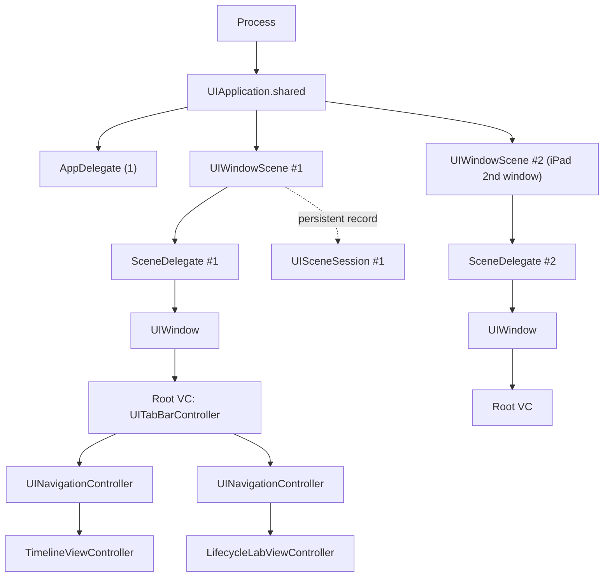
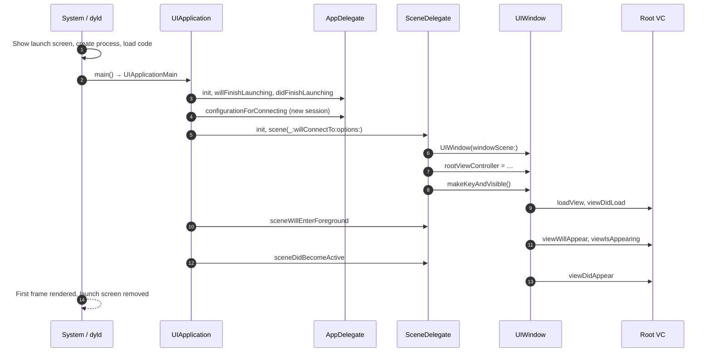

# Part 3 — The Concept Map

> **Where you are:** Stage 3, the whole territory at shallow depth.
> **What you'll know after this file:** the core concepts in dependency order, the key players and what each *owns / knows / does not do*, and the cold-launch flow in one diagram.

## 3.1 Domain mapping: from problem to concepts

| # | Problem element | UIKit concept | One-line definition | Why this abstraction |
|---|---|---|---|---|
| 1 | "A running copy of the app" | **Process & `main`** | The OS process; `main()` is the first function of your code that runs | One address space, one entry point |
| 2 | "The app's link to the system" | **`UIApplication`** (singleton) + **run loop** | The object that receives system events and runs the main event loop | Centralises event delivery on the main thread |
| 3 | "Process-wide decisions" | **AppDelegate** (`UIApplicationDelegate`) | Your object that receives *process*-level callbacks | Separates once-per-process setup |
| 4 | "One instance of the app's UI" | **Scene** (`UIWindowScene`) + **scene session** (`UISceneSession`) | A scene is a live UI instance; a session is its persistent record, which can outlive the scene | Lets windows be created, released, and restored independently |
| 5 | "Reacting to one UI instance's lifecycle" | **SceneDelegate** (`UIWindowSceneDelegate`) | Your object that receives *per-scene* callbacks and owns the window | Foreground/background is per window, not per process |
| 6 | "A surface on screen" | **`UIWindow`** | The top of the view hierarchy for one scene; routes touches; becomes *key* to receive input | One drawable, touchable root per scene |
| 7 | "The entry point of the UI" | **Root view controller** | `window.rootViewController`, the VC that owns the window's full content | A single owner for layout, rotation, safe areas, presentation |
| 8 | "One screen of content" | **View controller** + its **lifecycle** | Manages a view hierarchy; gets load / appear / layout / disappear callbacks | Screens come and go within one scene |

**Derived concepts:** container view controllers (`UINavigationController`, `UITabBarController`, `UISplitViewController`), modal presentation, the launch screen, `Info.plist` scene manifest, `connectionOptions`, state restoration.

*How do the concepts nest at runtime?*

*One process, one AppDelegate, N scenes, each with its own SceneDelegate, window, and VC tree.*

## 3.2 Key players

Each of these has its own deep dive.

| Player | Owns | Knows | Does **not** do |
|---|---|---|---|
| **System + dyld + `main`** ([5.1](05-deep-dives/01-process-launch-and-main.md)) | Creating the process, loading code, calling `UIApplicationMain` | Your binary, linked frameworks, static initialisers | Doesn't know about your UI or windows |
| **UIApplication + AppDelegate** ([5.2](05-deep-dives/02-uiapplication-and-appdelegate.md)) | Process-level lifecycle: launch finished, scene configuration, push registration, discarded sessions | Launch options, all connected scenes | **No window and no UI** in a scene-based app. Doesn't get foreground/background calls when scenes are used |
| **UIScene + SceneDelegate** ([5.3](05-deep-dives/03-scenes-and-scenedelegate.md)) | One window's lifecycle: connect, foreground, active, background, disconnect; URLs and activities for that window | Its session, connection options, its window | No process-wide setup; doesn't decide what's on each screen |
| **UIWindow + root VC** ([5.4](05-deep-dives/04-window-and-root-view-controller.md)) | Hosting the UI tree; key status; which VC is the root | Its scene, its root VC, the safe area | Doesn't decide app flow (a router or coordinator does) |
| **View controllers** ([5.5](05-deep-dives/05-view-controller-lifecycle.md)) | One screen: building views, reacting to appear/disappear, layout | Their view, children, presentation state | **Don't** get app or scene foreground/background events through their lifecycle methods |

## 3.3 Coordination at a glance: cold launch

*Who calls whom, in what order, from tap to first frame?*

> ⚠️ The **relative order** of scene callbacks (10, 12) and view-controller appearance callbacks (11, 13) is an implementation detail and has varied between iOS versions. Don't write code that depends on it. LaunchLab shows the real order on your device.

**Other flows you'll meet:**
- **Background → foreground:** only scene callbacks fire. The VC's `viewWillAppear` does **not**. (5.3, 5.5)
- **Cold vs warm deep link:** the URL arrives in `connectionOptions` (cold) or `scene(_:openURLContexts:)` (warm). (5.3)
- **Root swap:** replace `window.rootViewController` after onboarding or logout. (5.4)

---
← [02 — What](02-what.md) · Next → [04 — Running example](04-running-example.md)
