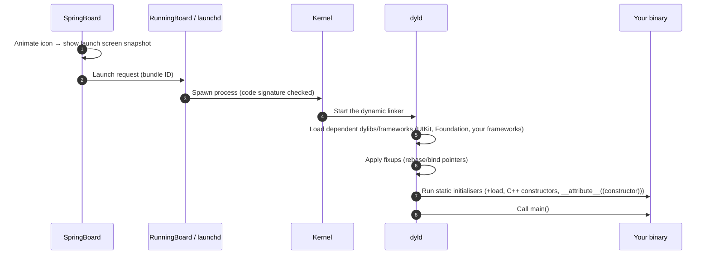

# 5.1 — Process Launch & `main`

> **Where you are:** first deep dive. Everything that happens before your first line of app code.
> **What you'll know after this file:** what the system and dyld do before `main`, what `@main` actually generates, what `UIApplicationMain` sets up, and how pre-`main` time affects launch.

## Role recap
**Owns:** turning a tap into a running process with your code loaded and UIKit's event loop started. **LaunchLab steps:** 1, 2.

## Internal design

### Before `main`: the system's part

*What happens between the tap and `main()`?*



- **Launch screen.** The storyboard or `UILaunchScreen` dictionary is drawn by the *system*, not by your code. It exists to hide this loading time. It can't run code or show dynamic content.
- **dyld.** Modern dyld caches a "launch closure", so repeat launches are faster. Every **dynamic framework** you add costs load time. Static linking (or mergeable libraries) reduces it.
- **Static initialisers.** Objective-C `+load`, C++ global constructors, and similar run *before* `main`, on the main thread, with no way for the user to see progress. Avoid heavy work there. Swift globals and `static let` are **lazy**, so they don't run here.

### `main`: the first line of your code

Most apps write `@main` on the AppDelegate:

```swift
@main
class AppDelegate: UIResponder, UIApplicationDelegate { … }
```

The compiler turns that into a `main` that is essentially:

```swift
UIApplicationMain(CommandLine.argc, CommandLine.unsafeArgv,
                  nil, NSStringFromClass(AppDelegate.self))
```

LaunchLab writes this by hand in `main.swift` so you can see it. (Older projects used `@UIApplicationMain`, which is now deprecated in favour of `@main`.)

### `UIApplicationMain`: the bridge into UIKit

| Argument | Meaning |
|---|---|
| `argc`, `argv` | Process arguments (e.g. launch arguments from the Xcode scheme) |
| `principalClassName` | Subclass of `UIApplication` to create; `nil` means `UIApplication` itself (rarely changed) |
| `delegateClassName` | Your AppDelegate class name. UIKit instantiates it |

What it does, in order:
1. Creates the `UIApplication` singleton (`UIApplication.shared`).
2. Creates your AppDelegate and assigns it as the delegate.
3. Loads Info.plist settings: scene manifest, main storyboard (for non-scene apps), URL types, and so on.
4. Starts the **main run loop** on the main thread. From here, everything is callbacks delivered by the run loop.
5. **Never returns.** The process ends when the system kills it.

## Interactions
- **→ UIApplication/AppDelegate (5.2):** the first callbacks are delivered on the newly started run loop.
- **← Code signing:** the kernel verifies your signature before running anything (see the code signing series, part 5.7).

## ⚓ Back to the example
- **Step 1.** Sam taps LaunchLab. The system shows a blank launch screen (Info.plist has an empty `UILaunchScreen` dict, so it's plain system background). dyld loads LaunchLab, UIKit, Foundation, and `os`.
- **Step 2.** `main.swift` runs:
  ```swift
  LaunchLog.shared.record(.process, "main() entered")
  _ = UIApplicationMain(CommandLine.argc, CommandLine.unsafeArgv, nil, NSStringFromClass(AppDelegate.self))
  ```
  `LaunchLog` asks the kernel (`sysctl` → `kp_proc.p_un.__p_starttime`) when the process was created. So the first Timeline row, e.g. `Process · +142.7 ms  main() entered`, shows **how long everything before `main` took**. Try adding a big dynamic framework and watch that number go up.

## Failure behavior
| Situation | Effect |
|---|---|
| Heavy work in `+load` / static constructors | Slow launch with a frozen launch screen. Visible as "pre-main" time in Instruments' App Launch template |
| Missing dylib / framework not embedded | Crash before `main`: `dyld: Library not loaded: @rpath/Foo.framework/Foo` |
| Wrong `delegateClassName` | Launches with no delegate: blank or black screen, nothing set up |
| Two `@main` (or `@main` + `main.swift`) | Compile error: *'main' attribute cannot be used in a module that contains top-level code* |

---
← [04 — Running example](../04-running-example.md) · Next → [5.2 — UIApplication & AppDelegate](02-uiapplication-and-appdelegate.md) · [Concept map](../03-concept-map.md)
