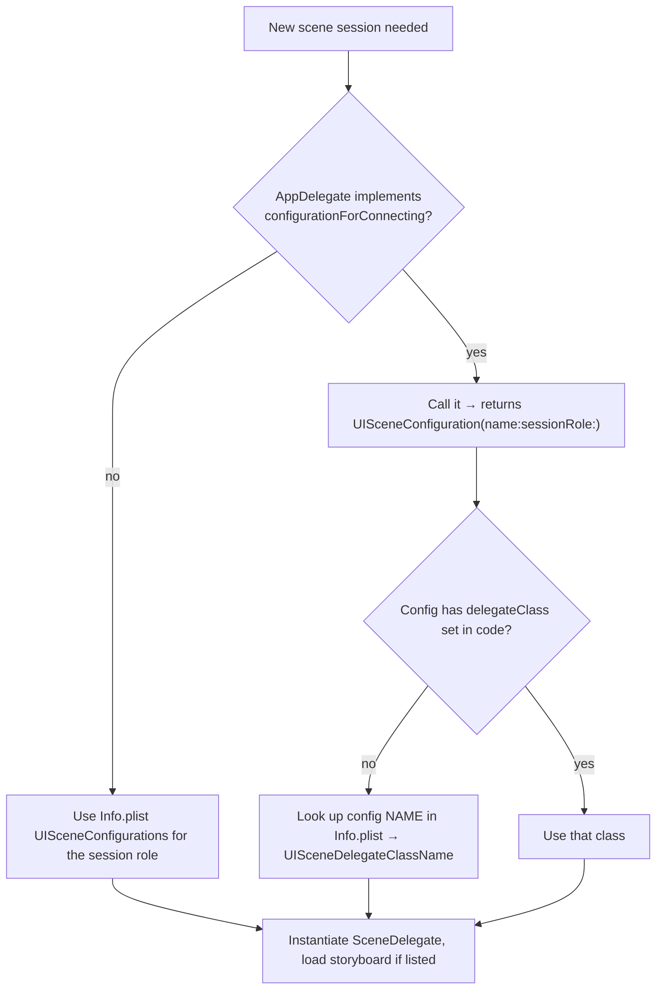

# 5.2 — UIApplication & AppDelegate

> **Where you are:** second deep dive. The process-level layer.
> **What you'll know after this file:** what `UIApplication` does, which AppDelegate callbacks exist in a scene-based app, what belongs in `didFinishLaunchingWithOptions` (and what doesn't), and how scene configuration is chosen.

## Role recap
**Owns:** process-wide lifecycle and decisions, exactly once per process. **LaunchLab steps:** 3, 4.

## Internal design

### UIApplication: the hub you rarely subclass
`UIApplication.shared` is the process's connection to the system:
- runs the main run loop and dispatches events (touches go via windows; remote-control and other system events come through here),
- lists the connected scenes (`connectedScenes`) and open sessions (`openSessions`),
- exposes app-wide facilities: `open(_:)` for URLs, `registerForRemoteNotifications()`, `applicationIconBadgeNumber` (deprecated in favour of `UNUserNotificationCenter`), `beginBackgroundTask`, `applicationState`.

It forwards *process-level* events to its **delegate**, your AppDelegate.

### AppDelegate callbacks in a scene-based app

| Callback | When | Use it for |
|---|---|---|
| `application(_:willFinishLaunchingWithOptions:)` | Very early, before state restoration | Rarely needed; things that must be ready before restoration |
| `application(_:didFinishLaunchingWithOptions:)` | Launch done, **before any scene connects** | Process-wide setup (below) |
| `application(_:configurationForConnecting:options:)` | A **new** scene session is being created | Choosing which scene configuration (delegate class) to use |
| `application(_:didDiscardSceneSessions:)` | User closed scenes (often reported on next launch) | Delete data you kept for those sessions |
| `application(_:didRegisterForRemoteNotificationsWithDeviceToken:)` | APNs token ready | Send the token to your server |
| `applicationWillTerminate(_:)` | Rare. Not called when a suspended app is killed | Last-chance cleanup (don't rely on it) |

**Not called when you use scenes:** `applicationDidBecomeActive`, `applicationWillResignActive`, `applicationDidEnterBackground`, `applicationWillEnterForeground`, and `application(_:open:options:)`. Their scene equivalents replace them (5.3). This is the #1 surprise when moving old code to scenes. (`UIApplication.didBecomeActiveNotification` and related notifications are still posted, but the per-scene notifications are more precise.)

### What belongs in `didFinishLaunchingWithOptions`

✅ **Yes:** once-per-process, needed early, cheap:
- crash reporting and logging (so they catch launch crashes),
- dependency container / service locator setup,
- `UNUserNotificationCenter.current().delegate = …` (must be set before launch finishes to receive notification responses),
- global `UIAppearance` configuration,
- registering background task identifiers (`BGTaskScheduler.register` must happen before launch finishes).

❌ **No:**
- creating a window or root VC: that's the SceneDelegate's job,
- network calls, database migrations, large file reads on the main thread: defer them or move them off the main thread,
- anything per-window.

Everything in this method sits **between the tap and the first frame**.

### Choosing a scene configuration

*How does UIKit decide which SceneDelegate class to instantiate?*



Use this to pick different delegates for different roles or activities, e.g. a separate "compose" window on iPad, or an external-display scene (`.windowExternalDisplayNonInteractive`).

## Interactions
- **← `UIApplicationMain` (5.1):** created by it; called on the main run loop.
- **→ Scenes (5.3):** provides the configuration; afterwards **the scene layer takes over all UI lifecycle**.
- **Not connected to** any window or view controller directly.

## ⚓ Back to the example
- **Step 3.** The Timeline shows:
  ```
  App · +165.2 ms   willFinishLaunchingWithOptions
  App · +165.9 ms   didFinishLaunchingWithOptions
  App · +166.8 ms   AppServices.configure() done
  ```
  `AppServices.configure()` stands in for real setup and just sets a global tint. If you put a `Thread.sleep(forTimeInterval: 1)` there, every later row moves by ~1000 ms and the launch screen stays up a second longer. That's the direct cost of work done here.
- **Step 4.** `App · configurationForConnecting (role: UIWindowSceneSessionRoleApplication)`. LaunchLab returns `UISceneConfiguration(name: "Default Configuration", sessionRole:)`. Info.plist maps that name to `$(PRODUCT_MODULE_NAME).SceneDelegate`.
- **Step 8.** When Sam goes to the background, **no AppDelegate row appears**. Only Scene rows do.
- **Later launches.** If Sam closes LaunchLab windows in the iPad app switcher, the next launch logs `didDiscardSceneSessions (n)`.

## Failure behavior
| Situation | Effect |
|---|---|
| Code in `applicationDidBecomeActive` stops running after adopting scenes | Expected: move it to `sceneDidBecomeActive` |
| Slow `didFinishLaunching` | Launch screen hangs; watchdog kill (`0x8badf00d`) if extreme |
| Config name doesn't match Info.plist | No delegate: black screen, console warning about the missing configuration |
| Creating a window in AppDelegate in a scene app | Window never attaches to a scene, so it doesn't show |

---
← [5.1 — Process launch & main](01-process-launch-and-main.md) · Next → [5.3 — Scenes & SceneDelegate](03-scenes-and-scenedelegate.md) · [Concept map](../03-concept-map.md)
