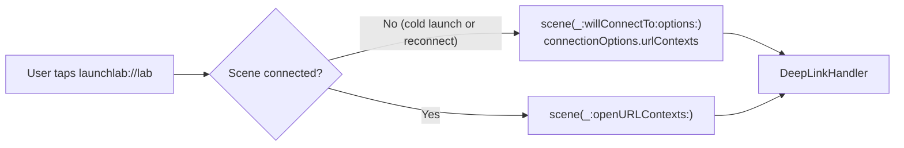

# 5.3 — UIScene & SceneDelegate

> **Where you are:** third deep dive. The per-window layer.
> **What you'll know after this file:** scene vs session, the Info.plist scene manifest, every SceneDelegate callback and what belongs in it, cold vs warm URLs, and disconnection.

## Role recap
**Owns:** the lifecycle of one instance of your UI, and building that instance's window. **LaunchLab steps:** 4, 5, 8, 9.

## Internal design

### Scene vs. scene session

| | `UIWindowScene` (scene) | `UISceneSession` (session) |
|---|---|---|
| What | The live UI instance: memory, window, delegate | The persistent record: identity, role, configuration, restoration state |
| Lifetime | Can be **disconnected** and released while backgrounded | Lasts until the user closes that window |
| On iPhone | Usually 1 | Usually 1 |
| On iPad / Mac | One per window | One per window, including windows not currently in memory |

Think of the session as a "slot" in the app switcher and the scene as whatever currently fills it. The system can drop the scene to save memory and **reconnect** a new one to the same session later, which calls `willConnectTo` again.

### The Info.plist scene manifest

```xml
<key>UIApplicationSceneManifest</key>
<dict>
  <key>UIApplicationSupportsMultipleScenes</key><true/>   <!-- iPad/Mac multi-window -->
  <key>UISceneConfigurations</key>
  <dict>
    <key>UIWindowSceneSessionRoleApplication</key>
    <array>
      <dict>
        <key>UISceneConfigurationName</key><string>Default Configuration</string>
        <key>UISceneDelegateClassName</key><string>$(PRODUCT_MODULE_NAME).SceneDelegate</string>
        <!-- Optional: <key>UISceneStoryboardFile</key><string>Main</string> -->
      </dict>
    </array>
  </dict>
</dict>
```

- The **presence** of this manifest is what opts the app into the scene lifecycle.
- If `UISceneStoryboardFile` is set, UIKit creates the window and the storyboard's initial VC **for you** before `willConnectTo`. If it's absent (as in LaunchLab), you build the window in code.

### SceneDelegate callbacks

| Callback | When | Put here |
|---|---|---|
| `scene(_:willConnectTo:options:)` | Scene created (launch, new window, reconnect) | Create window + root VC; handle `connectionOptions` (URLs, user activities, shortcut items, notification responses); restore state from `session.stateRestorationActivity` |
| `sceneWillEnterForeground(_:)` | About to be visible | Undo background work: refresh stale data, restart timers |
| `sceneDidBecomeActive(_:)` | Interactive, receiving input | Resume games/media, start camera, etc. |
| `sceneWillResignActive(_:)` | Interrupted (call, Control Center, app switcher) | Pause games/media |
| `sceneDidEnterBackground(_:)` | Not visible | Save state, release shared resources, hide sensitive UI before the snapshot is taken |
| `sceneDidDisconnect(_:)` | Scene released (not necessarily closed!) | Free scene-specific resources; **don't delete user data**, the session may come back |
| `scene(_:openURLContexts:)` | URL opened **while connected** | Deep links (warm) |
| `scene(_:continue:)` | Handoff / universal link **while connected** | Universal links (warm) |
| `stateRestorationActivity(for:)` | Background | Return an `NSUserActivity` describing this window's state |
| `windowScene(_:performActionFor:completionHandler:)` | Home-screen quick action (warm) | Shortcut items |

### Cold vs warm entry points

*Where does a URL arrive, depending on whether the scene was already running?*



The same split applies to universal links (`connectionOptions.userActivities` vs `scene(_:continue:)`), shortcut items, and notification responses. **Always route both paths to the same handler.**

## Interactions
- **← AppDelegate (5.2):** the configuration names this delegate class.
- **→ UIWindow (5.4):** creates it with `UIWindow(windowScene:)`, keeps it in `var window`, and calls `makeKeyAndVisible()`.
- **→ View controllers (5.5):** scene events are **not** forwarded as VC appearance events. VCs that care can observe `UIScene.willEnterForegroundNotification` and similar (and filter by `view.window?.windowScene`).

## ⚓ Back to the example
- **Step 5.** `willConnectTo` in LaunchLab's `SceneDelegate.swift`:
  ```swift
  guard let windowScene = scene as? UIWindowScene else { return }
  let window = UIWindow(windowScene: windowScene)
  window.rootViewController = RootRouter.makeInitialRoot()
  self.window = window
  window.makeKeyAndVisible()
  if let url = connectionOptions.urlContexts.first?.url { DeepLinkHandler.handle(url, in: window) }
  ```
  Timeline: `Scene · willConnectTo (session: 3F2A9C1B…)`.
- **Step 8.** Home and back:
  ```
  Scene  sceneWillResignActive
  Scene  sceneDidEnterBackground
  Scene  sceneWillEnterForeground
  Scene  sceneDidBecomeActive
  ```
  No AppDelegate rows, no VC rows.
- **Step 9 (warm).** `Scene · openURLContexts: launchlab://lab` → Lab tab selected.
- **Step 9 (cold).** After force-quitting, the full launch sequence logs again, plus `Scene · cold-launch URL: launchlab://lab` right after `makeKeyAndVisible`. `openURLContexts` does **not** appear. Remove the `connectionOptions` line and cold links silently do nothing, which is a very common bug.
- **Disconnect.** On iPad, open a second LaunchLab window, background it, and open many other apps. Eventually `sceneDidDisconnect` appears, and returning to it logs `willConnectTo` with the **same session id**.

## Failure behavior
| Situation | Effect |
|---|---|
| Forget `self.window = window` | Window deallocated immediately → black screen |
| Handle URLs only in `openURLContexts` | Deep links from a cold start ignored |
| Delete data in `sceneDidDisconnect` | User loses state when returning; use `didDiscardSceneSessions` for real closure |
| Storyboard in manifest **and** window built in code | Two windows / overwritten root; pick one approach |
| Scene manifest missing | App uses the legacy AppDelegate lifecycle. Apple has announced scene adoption will be required for apps built with SDKs after iOS 26 |

---
← [5.2 — UIApplication & AppDelegate](02-uiapplication-and-appdelegate.md) · Next → [5.4 — Window & Root VC](04-window-and-root-view-controller.md) · [Concept map](../03-concept-map.md)
