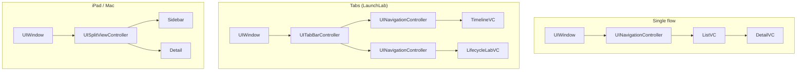

# 5.4 — UIWindow & the Root View Controller

> **Where you are:** fourth deep dive. Where the UI tree begins.
> **What you'll know after this file:** what a window does, what "key and visible" means, what the root view controller is responsible for, common root structures, and how to swap the root safely.

## Role recap
**Owns:** the window hosts one scene's entire UI; the root view controller is the single owner of everything the window shows. **LaunchLab steps:** 5, 7, 9.

## Internal design

### UIWindow
- A `UIView` subclass at the **top of a scene's view hierarchy**. It has no visible chrome of its own.
- Belongs to one `UIWindowScene` (`UIWindow(windowScene:)`). The scene keeps a list in `windowScene.windows`.
- **Key window:** the one receiving keyboard and non-touch events. **`makeKeyAndVisible()`** = show it + make it key.
- Delivers touches into its view hierarchy (via hit testing).
- A scene can have extra windows (e.g. a debug overlay at a higher `windowLevel`), but one is normally the main one.

### The root view controller's job
`window.rootViewController` is not just "the first screen". UIKit relies on it for:

| Responsibility | Why the root matters |
|---|---|
| Filling the window | The root's view is resized to the window's bounds |
| Safe areas, rotation, size classes, trait changes | Propagated from the window to the root, then down to children |
| Status bar / home indicator style | Asked of the root, which can defer to a child (`childForStatusBarStyle`) |
| Modal presentation | Presentations are anchored in the root's hierarchy |
| Appearance callbacks | Children get `viewWillAppear` etc. because the root forwards them |

So **always put UI under the root VC**. Don't add views directly to the window.

### Common root structures

*What do typical root hierarchies look like?*



Rule of thumb: **tab bar outside, navigation controllers inside** (one per tab). Not the other way around.

### Choosing and swapping the root

Many apps have several top-level states: onboarding, login, main UI, maintenance screen. Two common patterns:

1. **Swap the root** (LaunchLab): `window.rootViewController = newRoot`, optionally wrapped in `UIView.transition(with:duration:options:animations:)`. The old hierarchy is removed and, if nothing else holds it, released.
2. **Permanent container root:** a custom container VC stays as root and swaps child VCs inside it. Useful if you need custom transitions or a persistent overlay.

Avoid "presenting onboarding modally over the main UI on launch". It loads both hierarchies, flashes the main UI first, and complicates dismissal.

Keep the decision in **one place** (a router or coordinator), not scattered across the SceneDelegate and view controllers.

## Interactions
- **← SceneDelegate (5.3):** created, stored, and made key there.
- **→ View controllers (5.5):** setting the root and making the window visible triggers the root's `loadView`/`viewDidLoad` and then appearance callbacks. Swapping the root sends disappearance callbacks to the old one.

## ⚓ Back to the example
- **Step 5.** `RootRouter.makeInitialRoot()` returns `OnboardingViewController` because `hasCompletedOnboarding` is false. Timeline:
  ```
  VC      OnboardingViewController.loadView
  VC      OnboardingViewController.viewDidLoad
  Window  rootViewController = OnboardingViewController
  Window  makeKeyAndVisible
  ```
  LaunchLab writes the `Window` row just *after* the assignment, yet `viewDidLoad` appears above it. Assigning a root to a window is typically enough to make the window ask for the root's view, which loads it. Either way, `viewDidLoad` has run by the time `makeKeyAndVisible` returns. Don't rely on the exact moment.
- **Step 7.** *Get started* → `RootRouter.finishOnboarding(in:)`:
  ```swift
  UIView.transition(with: window, duration: 0.35, options: .transitionCrossDissolve) {
      window.rootViewController = main   // UITabBarController
  }
  ```
  Timeline: `Window · rootViewController → UITabBarController`, then Onboarding disappears and Timeline loads and appears.
- **Step 9 (cold link during onboarding).** `DeepLinkHandler` sees the root isn't a `UITabBarController`, finishes onboarding (root swap), then selects tab 1. Deep-link handling often has to **adjust the root first**.
- **Lab button "Replace root with onboarding".** Swaps back. Watch the tab bar's VCs get `viewWillDisappear`/`viewDidDisappear`.

## Failure behavior
| Situation | Effect |
|---|---|
| No root VC set | Black screen; console: *"Application windows are expected to have a root view controller…"* |
| Window not retained | Disappears immediately |
| Views added straight to `window` | Miss rotation, safe area, appearance callbacks; end up under modals |
| Swapping root while a modal is presented | Dismiss presented VCs first, or the presented one may leak or warn |
| Tab bar inside a navigation controller | Tab bar disappears on push; awkward back behaviour |

---
← [5.3 — Scenes & SceneDelegate](03-scenes-and-scenedelegate.md) · Next → [5.5 — View Controller Lifecycle](05-view-controller-lifecycle.md) · [Concept map](../03-concept-map.md)
