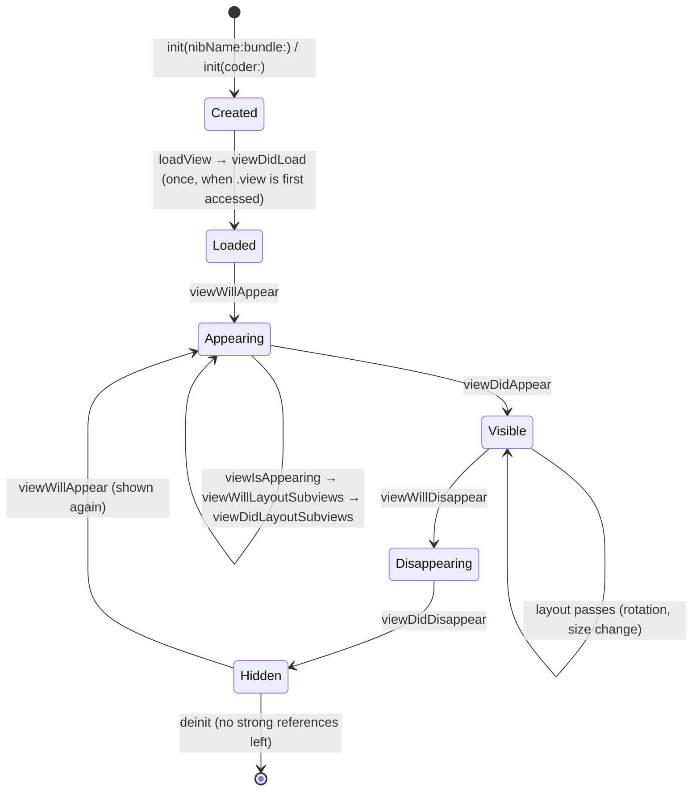

# 5.5 — The View Controller Lifecycle

> **Where you are:** fifth and last deep dive. One screen's life.
> **What you'll know after this file:** every lifecycle callback and what belongs in it, how appearance callbacks propagate through containers, the push / sheet / full-screen differences, and the "foreground isn't appearance" rule.

## Role recap
**Owns:** one screen's views and its reaction to being shown and hidden. **LaunchLab steps:** 6, 7, 8, 10.

## Internal design

### The callbacks, in order

*What's the full life of a view controller?*



| Callback | How often | Put here | Don't put here |
|---|---|---|---|
| `init` | Once | Store dependencies | Touching `view` (forces an early load) |
| `loadView` | Once | **Only** if you create the root view yourself (`view = MyView()`); don't call `super` then | Anything else |
| `viewDidLoad` | Once per view load | Build subviews, constraints, set up data sources, bind | Geometry-dependent code (sizes aren't final) |
| `viewWillAppear` | Each time it's about to appear | Refresh data that may have changed while hidden; start observing | Heavy work (it delays the transition) |
| `viewIsAppearing` (iOS 17, back-deployed to 13) | Each appearance | Work that needs **final traits and geometry** before the first frame, e.g. scroll to an item | |
| `viewWillLayoutSubviews` / `viewDidLayoutSubviews` | **Many times** | Manual frame adjustments | One-time setup, expensive work |
| `viewDidAppear` | Each appearance | Start animations, analytics "screen viewed", become first responder | Things the user needs to see in the first frame |
| `viewWillDisappear` / `viewDidDisappear` | Each disappearance | Stop timers and observation; save edits | Assuming the VC is being deallocated (check `isMovingFromParent` / `isBeingDismissed`) |
| `deinit` | Once | Final cleanup | Main-actor UI work |

### Appearance propagates down the tree
Containers forward appearance callbacks to the **visible** child only:
- `UITabBarController` → selected tab's navigation controller → its top VC.
- `UINavigationController` → top VC. On push, the old top gets `viewWillDisappear` and the new one gets `viewWillAppear`.
- Custom containers must use `addChild` / `didMove(toParent:)` correctly, or children won't get callbacks.

### Presentation styles change who "disappears"

| Action | Presenter gets disappear callbacks? | Presented VC |
|---|---|---|
| `push` | Yes | Load + appear |
| `present`, `.pageSheet` / `.formSheet` (default since iOS 13) | **No**, it stays in the hierarchy behind the sheet | Load + appear |
| `present`, `.fullScreen` | **Yes** | Load + appear |
| Interactive dismiss of a sheet, cancelled halfway | Presented VC gets `viewWillDisappear` **then** `viewWillAppear` again | |

### Foreground ≠ appearance
**Going to the background and back does not call `viewWillAppear` or `viewDidAppear`.** The VC never left the hierarchy; only the *scene* changed state. If a screen must refresh when the app returns:

```swift
NotificationCenter.default.addObserver(
    self, selector: #selector(refresh),
    name: UIScene.willEnterForegroundNotification, object: view.window?.windowScene)
```
(Register once the view is in a window, e.g. in `viewIsAppearing`, so `windowScene` isn't nil. Or pass `object: nil` and check the scene in the handler.)

## Interactions
- **← Window/root (5.4):** the root gets its callbacks from the window; children from their containers.
- **⟂ Scenes (5.3):** independent layers. Scene state is about the whole window, VC appearance is about position in the hierarchy.

## ⚓ Back to the example
- **Step 6 (launch).** A typical first launch logs:
  ```
  VC     OnboardingViewController.loadView
  VC     OnboardingViewController.viewDidLoad
  Window rootViewController = OnboardingViewController
  Window makeKeyAndVisible
  Scene  sceneWillEnterForeground
  VC     OnboardingViewController.viewWillAppear
  VC     OnboardingViewController.viewIsAppearing
  VC     OnboardingViewController.viewDidLayoutSubviews (first)
  Scene  sceneDidBecomeActive
  VC     OnboardingViewController.viewDidAppear
  ```
  (Your device may interleave Scene and VC rows slightly differently; that's why you shouldn't depend on it.)
- **Step 7 (root swap).** Onboarding: `viewWillDisappear` → `viewDidDisappear`. Then `TimelineViewController`: `loadView` → `viewDidLoad` → `viewWillAppear` → … → `viewDidAppear`. `LifecycleLabViewController` logs **nothing yet**: tab contents load lazily when first selected.
- **Step 8 (home & back).** Only Scene rows, as the rule above says.
- **Step 10 (Lifecycle Lab).**
  - *Push*: Lab `viewWillDisappear`, Detail `viewDidLoad`/`viewWillAppear`, …, Lab `viewDidDisappear`, Detail `viewDidAppear`. Back: the reverse, and Detail is released.
  - *Sheet*: only Detail rows. **Lab doesn't disappear.**
  - *Full screen*: Lab `viewWillDisappear`/`viewDidDisappear` appear too.

  (`LoggingViewController` logs only the *first* `viewDidLayoutSubviews` per VC. Logging every pass would flood the timeline.)

## Failure behavior
| Situation | Effect |
|---|---|
| Layout code in `viewDidLoad` using `view.bounds` | Wrong sizes (bounds not final); use Auto Layout or `viewIsAppearing` / `viewDidLayoutSubviews` |
| Refresh-on-return code in `viewWillAppear` | Never runs on foreground; use scene notifications |
| Forgot `super.viewWillAppear(animated)` etc. | Subtle bugs in containers and appearance forwarding |
| Accessing `view` in `init` | View loads early, before dependencies are set |
| Expensive work in `viewDidLayoutSubviews` | Janky scrolling and rotation, because it runs repeatedly |
| Retain cycle (closure captures `self` strongly) | `deinit` never runs, screens leak |

---
← [5.4 — Window & Root VC](04-window-and-root-view-controller.md) · Next → [06 — Full walkthrough](../06-walkthrough.md) · [Concept map](../03-concept-map.md)
