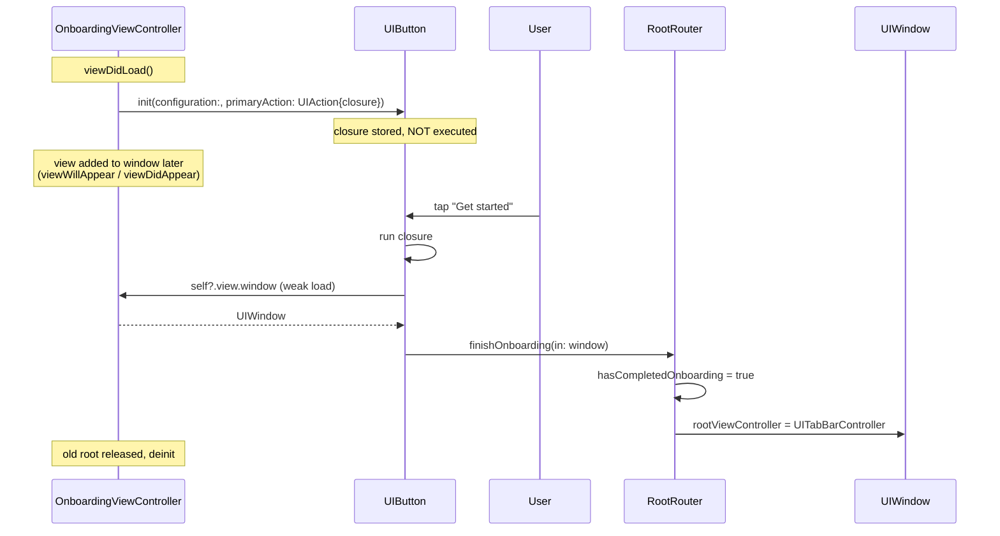
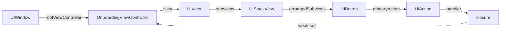

# 5.6 — Closures in Practice: The "Get started" Button

> **Where you are:** sixth and last deep dive. Zooms in on the four lines that trigger step 7 (root swap) of the [running example](../04-running-example.md), where the closure, the window, and the VC lifecycle meet.
> **What you'll know after this file:** exactly what each token in the onboarding button's closure does, why it captures `self` weakly, why it looks up the window at tap time, and what would break if you wrote it differently.

The code, from `sample/LaunchLab/Controllers/OnboardingViewController.swift:38-41`:

```swift
let button = UIButton(configuration: config, primaryAction: UIAction { [weak self] _ in
    guard let window = self?.view.window else { return }
    RootRouter.finishOnboarding(in: window)
})
```

Four lines, but they touch five Swift/UIKit ideas: trailing closures, escaping closures, capture lists, optional chaining, and deferred evaluation.

---

## 1. What kind of thing this is

### 1.1 `UIAction { ... }` is a trailing closure

`UIAction` has this initializer (iOS (iPhone Operating System) 14+):

```swift
convenience init(title: String = "",
                 image: UIImage? = nil,
                 identifier: UIAction.Identifier? = nil,
                 discoverabilityTitle: String? = nil,
                 attributes: UIMenuElement.Attributes = [],
                 state: UIMenuElement.State = .off,
                 handler: @escaping UIActionHandler)
```

Every parameter except `handler` has a default value, and `handler` is the last one. Swift lets you move a final closure argument outside the parentheses, and drop the empty `()` entirely. So these are identical:

```swift
UIAction(handler: { [weak self] _ in ... })
UIAction { [weak self] _ in ... }
```

### 1.2 The closure's type

```swift
typealias UIActionHandler = (UIAction) -> Void
```

The closure receives the `UIAction` that fired (useful if one handler serves several actions, or if you want `action.sender`). This code doesn't need it, so the parameter is named `_`, which means "accept the argument, discard it."

### 1.3 It is `@escaping`

The closure does not run now. `UIAction` **stores** it, the button **stores** the action, and UIKit calls the closure later, when the user taps. A closure that outlives the function call it was passed to is called *escaping*, and escaping closures are where retain cycles come from (section 3).

---

## 2. When each line runs

This is the most important thing to understand: **the body of the closure runs at tap time, not when `viewDidLoad` runs.**



That timing is why the code reads `view.window` **inside** the closure. In `viewDidLoad`, the view has been created but not yet added to a window, so `view.window` is `nil` at that point. A version that grabs the window early is broken:

```swift
// BROKEN: view.window is nil during viewDidLoad
let window = view.window
let button = UIButton(configuration: config, primaryAction: UIAction { _ in
    guard let window else { return }       // always returns
    RootRouter.finishOnboarding(in: window)
})
```

Reading the window lazily, at tap time, gets you the window the view is actually in *now*. It also means the controller never has to be told which window it belongs to, which matters on iPad where several scenes (and several windows) can each show onboarding.

---

## 3. `[weak self]`: the capture list

### 3.1 What a capture list does

A closure that refers to `self` keeps a reference to it so `self` is still there when the closure runs later. By default that reference is **strong**. The capture list `[weak self]` says: "inside this closure, `self` is a **weak** reference," meaning:

- it does not keep the controller alive, and
- it becomes `nil` automatically if the controller is deallocated.

Because it can become `nil`, inside the closure `self` has type `OnboardingViewController?` (an Optional), not `OnboardingViewController`.

### 3.2 The cycle it prevents

Follow the ownership arrows (solid = strong reference):



With a strong capture, that dotted arrow becomes solid and you get a loop: **VC → view → stack → button → action → closure → VC**. Nothing in the loop can reach a reference count of zero.

Here the loop is not just theoretical, because of what the closure *does*. `finishOnboarding` replaces `window.rootViewController`. The window drops its reference to the onboarding controller, which is the moment the controller should be freed. With a strong capture, the cycle keeps it alive anyway: the onboarding screen, its view hierarchy, and its button stay in memory for the rest of the app's life, and `deinit` never runs. This is the leak listed in the pitfalls table of [5.5 — View Controller Lifecycle](05-view-controller-lifecycle.md).

With `[weak self]`, once the window lets go, the controller's count drops to zero, it deallocates, and it takes the view, button, action, and closure with it.

### 3.3 Why not `[unowned self]`?

`unowned` also avoids the cycle, but it assumes `self` is always alive when the closure runs and **crashes** if not. In this exact layout the button can't really outlive the controller, so `unowned` would probably work. `weak` costs one optional check and survives refactors (e.g. someone later hands the action to an object that lives longer). The usual rule: use `weak` by default, and `unowned` only when you can prove the lifetimes.

---

## 4. `guard let window = self?.view.window else { return }`

Read it right to left:

| Piece | Type | Meaning |
|---|---|---|
| `self` | `OnboardingViewController?` | weak, may be `nil` |
| `self?.view` | `UIView?` | optional chaining: if `self` is `nil`, the whole chain stops and yields `nil` |
| `.view.window` | `UIWindow?` | `UIView.window` is already optional (`nil` when the view isn't in a window) |
| `guard let window = ...` | `UIWindow` | unwraps; `window` is non-optional below this line |
| `else { return }` | — | bail out quietly if either step was `nil` |

Optional chaining *flattens*: even though both `self` and `window` are optional, the result is a single `UIWindow?`, not `UIWindow??`.

The `guard` covers two separate "can't happen in practice, but be safe" cases:

1. **The controller is gone.** `self` is `nil`.
2. **The view isn't on screen.** `view.window` is `nil`, e.g. a tap arrives during a transition after the view was removed.

In both cases doing nothing is the correct behaviour.

### Equivalent modern spelling (Swift 5.7+)

```swift
UIAction { [weak self] _ in
    guard let self, let window = view.window else { return }
    RootRouter.finishOnboarding(in: window)
}
```

`guard let self` upgrades the weak reference to a strong one **for the duration of this call only**. After that, `self` is non-optional and you can write `view.window` without `self?.`. This doesn't bring the cycle back: the strong reference is a local that disappears when the closure returns, and the stored closure still captures `self` weakly.

---

## 5. `RootRouter.finishOnboarding(in: window)`

```swift
static func finishOnboarding(in window: UIWindow) {
    hasCompletedOnboarding = true                 // persisted in UserDefaults
    setRoot(makeMainInterface(), in: window)      // cross-dissolve to the tab bar
}
```

The closure itself makes no navigation decisions. It just hands the window to `RootRouter`, which owns the "which screen is the root" decision (see [5.4 — Window & Root VC](04-window-and-root-view-controller.md)). That keeps the onboarding screen ignorant of what comes after it. The same function is reused by `DeepLinkHandler` (`sample/LaunchLab/Infrastructure/DeepLinkHandler.swift:19`), which is the payoff of passing the window in instead of hard-coding it.

**Threading:** UIKit calls action handlers on the main thread, and `RootRouter` is `@MainActor`, so the call is allowed with no `await` and no dispatching.

---

## 6. The alternative: target-action

Before iOS 14 you would write:

```swift
button.addTarget(self, action: #selector(getStarted), for: .primaryActionTriggered)

@objc private func getStarted() {
    guard let window = view.window else { return }
    RootRouter.finishOnboarding(in: window)
}
```

`UIControl` holds its targets **weakly**, so target-action never creates this cycle and needs no capture list. The `UIAction` closure form wins on locality, since the behaviour sits next to the button that triggers it with no `@objc` method elsewhere. The cost is that *you* must remember `[weak self]`.

| | `UIAction` closure | Target-action |
|---|---|---|
| Where the code lives | inline, next to the button | separate `@objc` method |
| Retain-cycle risk | yes, needs `[weak self]` | no, targets held weakly |
| Requires `@objc` / selector | no | yes |
| Minimum iOS | 14 | 2 |

---

## Conclusions

- `UIAction { [weak self] _ in ... }` is a **trailing, escaping closure** of type `(UIAction) -> Void`. The ignored `_` is the action itself.
- The body runs **at tap time**. That's why it reads `view.window` inside the closure: in `viewDidLoad` the window is still `nil`.
- `[weak self]` breaks the cycle **VC → view → button → action → closure → VC**. Without it, the onboarding controller would leak right after `finishOnboarding` swaps it out as the root.
- `guard let window = self?.view.window` safely handles both "controller gone" and "view not in a window" by doing nothing.
- Navigation is delegated to `RootRouter`, so the closure stays a thin bridge from a UI event to an app-level decision.

---
← [5.5 — View Controller Lifecycle](05-view-controller-lifecycle.md) · Next → [06 — Full walkthrough](../06-walkthrough.md) · [Concept map](../03-concept-map.md)
