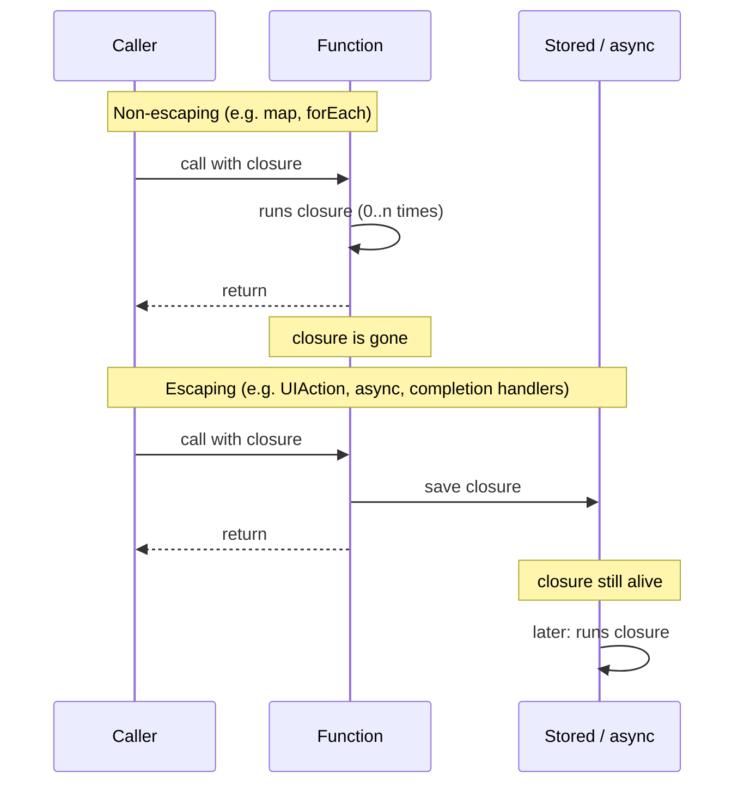
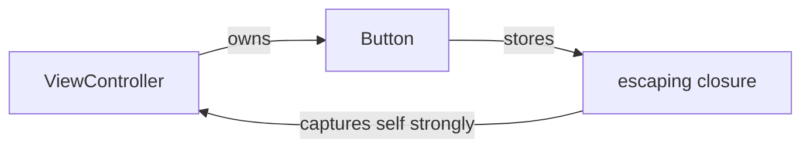

# 5.6a — Sidebar: Trailing Closures vs. Escaping Closures

> **Where you are:** a companion to [5.6 — Closures in Practice](06-onboarding-button-closure.md). That file uses both terms in passing; this one explains them properly.
> **What you'll know after this file:** that the two terms answer different questions (one is about *syntax*, the other about *lifetime*), how to recognise each, and why only one of them affects memory.

| Term | Question it answers | Affects runtime behaviour? |
|---|---|---|
| **Trailing closure** | *Where do I write the closure in the call?* | No. Pure syntax sugar. |
| **Escaping closure** | *Can the closure outlive the function it was passed to?* | Yes. Lifetime, memory, and capture rules change. |

A closure can be both, either, or neither. `UIAction { ... }` is both.

---

## 1. Trailing closures (syntax)

### 1.1 The rule

If a function's **last** argument(s) are closures, you may write them **after** the closing parenthesis instead of inside it. If that leaves the parentheses empty, you may drop them.

```swift
func perform(times: Int, work: () -> Void) { ... }

perform(times: 3, work: { print("hi") })   // ordinary call
perform(times: 3) { print("hi") }          // trailing closure — identical
```

```swift
UIAction(handler: { _ in ... })            // ordinary
UIAction() { _ in ... }                    // trailing
UIAction { _ in ... }                      // trailing, empty () dropped
```

The compiler produces exactly the same call in every case. Nothing about the closure's type, lifetime, or captures changes.

### 1.2 Familiar examples

```swift
let doubled = numbers.map { $0 * 2 }
DispatchQueue.main.async { self.label.text = "done" }
UIView.animate(withDuration: 0.3) { view.alpha = 0 }
```

### 1.3 Multiple trailing closures (Swift 5.3+)

The first trailing closure drops its argument label; later ones keep theirs:

```swift
UIView.animate(withDuration: 0.3) {
    view.alpha = 0
} completion: { _ in
    view.removeFromSuperview()
}
```

This is also what makes SwiftUI read the way it does: `Button { save() } label: { Text("Save") }`.

### 1.4 One gotcha: conditions

Inside an `if`, `guard`, or `while` condition, a trailing closure is ambiguous with the statement's own `{`. Use parentheses there:

```swift
if numbers.contains(where: { $0 > 10 }) { ... }   // OK
if numbers.contains { $0 > 10 } { ... }           // warning/error: ambiguous
```

---

## 2. Escaping closures (lifetime)

### 2.1 The definition

A closure parameter is **escaping** if it can be called **after the function that received it has returned**. That happens when the function:

- **stores** it (in a property, array, or another object), or
- **hands it to asynchronous work** that runs later.

Since Swift 3, closure parameters are **non-escaping by default**. To allow escaping you must mark the parameter `@escaping`:

```swift
final class Button {
    private var handler: (() -> Void)?

    func onTap(_ handler: @escaping () -> Void) {   // must be @escaping…
        self.handler = handler                        // …because it's stored
    }
}
```

Remove `@escaping` and the compiler refuses: *"Assigning non-escaping parameter 'handler' to an @escaping closure."*

### 2.2 The two lifetimes side by side



| | Non-escaping (default) | `@escaping` |
|---|---|---|
| Called when? | Only during the function call | Any time, possibly much later |
| Can be stored? | No | Yes |
| Typical APIs (Application Programming Interfaces) | `map`, `filter`, `forEach`, `sort(by:)`, `withLock` | `UIAction`, `DispatchQueue.async`, `URLSession` completion handlers, `NotificationCenter.addObserver(forName:…)` |
| Must write `self.` explicitly? | No | Yes (unless `self` is a value type or already captured) |
| Retain-cycle risk | None | Yes, if it captures something that owns it |
| Allocation | Can stay on the stack | Its context is heap-allocated |

### 2.3 Why escaping matters: captures and memory

A closure keeps alive everything it captures. For a non-escaping closure that's harmless, since everything is released when the call returns. An escaping closure lives as long as whoever stores it, so its captures live that long too.

If the storer is (directly or indirectly) owned by something the closure captures, you get a cycle:



Nothing in that loop ever reaches a reference count of zero under ARC (Automatic Reference Counting, 自动引用计数). The fix is a capture list:

```swift
button.onTap { [weak self] in
    self?.save()
}
```

This is exactly why Swift makes you write `self.` explicitly inside escaping closures: it is a visual prompt to think about the capture. In non-escaping closures (`numbers.map { $0 + offset }`) `self.` is optional because there is no cycle risk.

> **Rule of thumb:** "escaping" is your cue to ask *who stores this closure, and does anything it captures own that storer?* If yes, use `[weak self]` (or `unowned` when lifetimes are provable — see 5.6 §3.3).

### 2.4 Edge cases worth knowing

- **Optional closures are implicitly escaping.** `func f(_ c: (() -> Void)?)` needs no `@escaping`; wrapping a closure in an `Optional` already lets it escape.
- **Closures stored in properties are always escaping**: there's no function call for them to be limited to.
- **`withoutActuallyEscaping(_:do:)`** lets you pass a non-escaping closure to an API that demands escaping, as long as you promise it doesn't really outlive the call (checked at runtime).
- **`async` functions and `Task { }`:** `Task`'s initializer takes an escaping closure, so the same capture reasoning applies; it just runs on a different schedule.

---

## 3. Putting both together: `UIAction { [weak self] _ in … }`

```swift
UIAction { [weak self] _ in
    guard let window = self?.view.window else { return }
    RootRouter.finishOnboarding(in: window)
}
```

| Aspect | What it is here |
|---|---|
| **Trailing?** | Yes. `handler:` is the last parameter, written outside the parentheses, and the empty `()` is dropped. |
| **Escaping?** | Yes. The declaration is `handler: @escaping UIActionHandler`; the button stores the action and runs the closure on tap, long after `viewDidLoad` returns. |
| **Consequence of trailing** | Nicer to read. Nothing else. |
| **Consequence of escaping** | The closure outlives `viewDidLoad`, so (1) it must read `view.window` at tap time, and (2) it must capture `self` weakly to avoid the VC → button → action → closure → VC cycle. |

---

## Conclusions

- **Trailing closure** = a *spelling*: put the last closure argument after `)`. It changes how code looks, never how it behaves.
- **Escaping closure** = a *lifetime*: the closure may run after the function returns because it was stored or scheduled. Swift requires `@escaping` to say so, and non-escaping is the default.
- Only escaping closures can create retain cycles, which is why Swift forces explicit `self.` in them and why `[weak self]` shows up in escaping callbacks like `UIAction`, not in `map`.
- When you see a closure, ask two separate questions: *how is it written?* (trailing or not) and *how long does it live?* (escaping or not).

---
← [5.6 — Closures in Practice](06-onboarding-button-closure.md) · Next → [06 — Full walkthrough](../06-walkthrough.md) · [Concept map](../03-concept-map.md)
