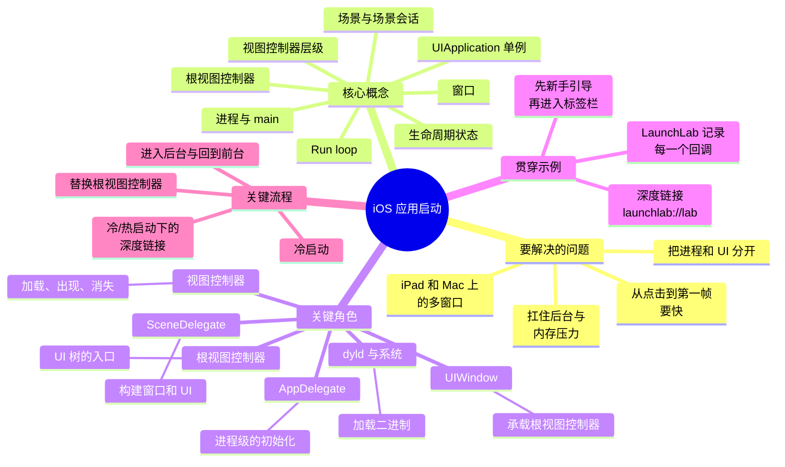

# 00 · iOS 应用启动入门：系列导读

> 英文原文：[iOS App Startup: An Introduction Series](../00-overview.md)
>
> **你在哪里：**这是一个系列的入口，讲从点下应用图标到看到第一屏之间发生了什么，以及一个 UIKit 应用里各个对象分别负责什么。
> **读完本篇你会知道：**整个领域的全景地图、阅读顺序，以及每篇文章都会回到的示例应用 LaunchLab。

## 缩写对照表

| 缩写 | 英文全称 | 中文 |
|---|---|---|
| SDK | Software Development Kit | 软件开发工具包 |
| UI | User Interface | 用户界面 |
| VC | View Controller | 视图控制器 |
| dyld | Dynamic Link Editor | 动态链接器 |
| UIKit | User Interface Kit | Apple 的 UI 框架 |

新建一个 iOS 项目时，Xcode 会给你 `AppDelegate.swift`、`SceneDelegate.swift`、`ViewController.swift` 和一个 storyboard，大多数人就直接在 `viewDidLoad` 里开始写代码了。这样一直能用，直到你得回答这类问题：

- *我的统计分析 SDK（Software Development Kit，软件开发工具包）应该在哪里初始化？*
- *为什么用户回到我的应用时，`viewWillAppear` 没有被调用？*
- *为什么深度链接在应用运行时能用，应用关闭时却不行？*
- *怎么先展示新手引导，再进入主界面？*
- *为什么 `applicationDidBecomeActive` 从来不被调用？*

这些问题归根结底都是同一件事：**搞清楚启动过程的哪一部分归哪个对象管。**这个系列会一步步把这张图画出来。

## 系列目录

| # | 文章 | 回答的问题 |
|---|---|---|
| 1 | [启动架构为什么长这样（英文）](../01-why.md) | 是哪些问题逼出了这种设计？ |
| 2 | [「应用启动」是什么，不是什么（英文）](../02-what.md) | 它从哪里开始，到哪里结束？ |
| 3 | [概念地图（英文）](../03-concept-map.md) | 有哪些角色，各自负责什么？ |
| 4 | [贯穿示例：LaunchLab（英文）](../04-running-example.md) | 一次真实的启动是什么样的？ |
| 5.1 | [进程启动与 main（英文）](../05-deep-dives/01-process-launch-and-main.md) | 在我的任何代码运行之前发生了什么？ |
| 5.2 | [UIApplication 与 AppDelegate（英文）](../05-deep-dives/02-uiapplication-and-appdelegate.md) | 哪些事属于进程层面？ |
| 5.3 | [UIScene 与 SceneDelegate（英文）](../05-deep-dives/03-scenes-and-scenedelegate.md) | 什么是场景（scene），为什么前后台事件在它那里？ |
| 5.4 | [UIWindow 与根视图控制器（英文）](../05-deep-dives/04-window-and-root-view-controller.md) | 第一屏是怎么选出来的，又怎么替换？ |
| 5.5 | [视图控制器生命周期（英文）](../05-deep-dives/05-view-controller-lifecycle.md) | `viewDidLoad`、`viewWillAppear`……究竟什么时候调用？ |
| 5.6 | [闭包实战：「开始使用」按钮（英文）](../05-deep-dives/06-onboarding-button-closure.md) | 为什么要 `[weak self]`，为什么要在点击时才读 `view.window`？ |
| 5.6a | [补充：尾随闭包与逃逸闭包（英文）](../05-deep-dives/06a-trailing-and-escaping-closures.md) | 尾随闭包和逃逸闭包有什么区别？ |
| 6 | [完整演练（英文）](../06-walkthrough.md) | 一次启动，从头到尾，完整深度 |
| 7 | [常见陷阱与下一步（英文）](../07-next-steps.md) | 常见错误、SwiftUI、启动性能 |

**交互演示：**[`demo/launch-sequence.html`](../demo/launch-sequence.html) 会按泳道一步步演示启动流程、进入后台/回到前台、深度链接、替换根视图控制器和导航，旁边有一个 iPhone 模型显示每一步屏幕上的内容。在浏览器里打开它即可（如果你在 GitHub 上看，GitHub 只会显示 HTML 源码，需要先下载）。

**示例应用：**[`sample/`](../sample/README.md) 里是 LaunchLab，一个会以毫秒级时间戳记录每一个回调的 UIKit 应用。

## 一张图看全貌

*iOS 应用启动由哪些部分组成，又怎么分组？*

## 一段话讲清核心思想

一个 iOS 应用是**一个进程**，它可以展示**多个场景**（窗口）。**AppDelegate** 代表进程：系统会告诉它进程已经启动，并询问它如何配置新的场景。每个 **SceneDelegate** 代表一个场景：它创建一个 **UIWindow**，给它一个**根视图控制器**，并在场景进入前台或后台时收到通知。从根视图控制器往下，一切都是一棵**视图控制器**树，每个视图控制器都有自己的加载、出现和消失生命周期。所谓启动，就是从进程一路走到第一个视图控制器的第一帧，而且要尽可能快。

---
下一篇 → [01 · 为什么（英文）](../01-why.md)
