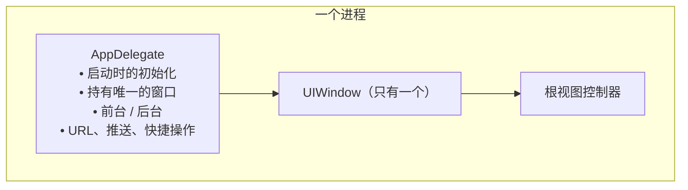

# 01 · 启动架构为什么长这样

> 英文原文：[Part 1 — Why the Startup Architecture Looks Like This](../01-why.md)
>
> **你在哪里：**第一阶段，问题本身。
> **读完本篇你会知道：**是哪些压力塑造了 UIKit 的启动流程，最初「AppDelegate 包办一切」的模式为什么不行了，以及现在的设计大致必须长成什么样。

## 缩写对照表

| 缩写 | 英文全称 | 中文 |
|---|---|---|
| OS | Operating System | 操作系统 |
| UI | User Interface | 用户界面 |
| URL | Uniform Resource Locator | 统一资源定位符 |
| SDK | Software Development Kit | 软件开发工具包 |
| UIKit | User Interface Kit | Apple 的 UI 框架 |

## 1. 应用在启动时要做哪些事

从点击图标到第一帧之间，至少要做这些事：

1. 操作系统创建一个进程，加载你的代码。
2. 得有某个东西负责和系统打交道：事件、URL、通知、状态变化。
3. 得有某个东西创建窗口，并把 UI 放进去。
4. 第一屏要被构建出来并绘制到屏幕上。

整个过程用户都在盯着看。Apple 的建议是**在大约 400 毫秒内画出第一帧**；如果启动太久（大约 20 秒），系统的看门狗（watchdog）会直接杀掉应用。下面的每一个设计选择，同时也是为了*速度*。

## 2. 最初的模式（iOS 2–12）：一个对象包办一切

*在 iOS 13 之前，一个经典的 UIKit 应用是什么样的？*

AppDelegate 要做的事：
- 在 `didFinishLaunchingWithOptions` 里初始化各种服务；
- 持有 `var window: UIWindow?`；
- 接收 `applicationDidBecomeActive`、`applicationDidEnterBackground` 等回调；
- 处理 URL（`application(_:open:options:)`）。

这套模式之所以可行，是因为 **一个应用 = 一个进程 = 一个窗口 = 一套 UI。**

## 3. 是什么打破了它

| 压力 | 为什么「AppDelegate 包办一切」行不通 |
|---|---|
| **iPad 多任务与多窗口**（iPadOS 13） | 用户可以并排打开你 UI 的*两个*副本，比如两份文档。一个 `window` 属性装不下；当只有一个窗口获得焦点时，「应用变为活跃」也说不清指的是哪个。 |
| **Mac Catalyst / visionOS / 外接显示器** | 多个窗口，每个都有自己的尺寸、状态和生命周期。 |
| **内存压力** | 系统希望能在**不杀掉进程**的情况下释放后台窗口的 UI，之后再恢复它。这需要一个比「整个应用」更小的单位。 |
| **状态恢复** | 每个窗口都需要保存*自己*的状态（打开的是哪份文档、哪个标签页）。 |
| **启动速度** | 把繁重的进程初始化和 UI 构建混在一个方法里，启动慢的时候就很难排查。 |

## 4. 解决方案要满足的约束

1. **把进程层面的事和 UI 层面的事分开。** 每个进程只有一份的东西（服务、推送注册、全局配置）放一个地方；每个窗口一份的东西（窗口、根 UI、前后台切换）放另一个地方。
2. **UI 的单位必须能被独立地创建、销毁和恢复。** 这个单位就是*场景（scene）*。
3. **由系统而不是应用来决定 UI 单位何时出现、何时消失。** 所以应用必须响应回调，而不能想当然地认为「启动 = 出现一个窗口」。
4. **让 UI 保持为一棵树，每个窗口一个根。** 容器（导航、标签栏）和子视图控制器都挂在一个根视图控制器下面，这样系统就能把一个窗口的 UI 作为整体来布局、旋转、恢复和释放。
5. **立刻显示点什么。** 在你的代码运行*之前*，系统会先画出一张静态的启动屏（launch screen），用来掩盖加载的耗时。

## 5. 预测一下设计

从这些约束出发，你自己就能画出草图：

- 一个代表**进程**的对象：*AppDelegate*，负责启动以及「配置新场景」这类回调。
- 一个代表**每个窗口生命周期**的对象：*SceneDelegate*，负责连接/断开以及前台/后台这类回调。
- 场景持有一个**窗口**，窗口持有**一个根视图控制器**，根视图控制器下面挂着一棵视图控制器树。
- 视图控制器有自己的**加载 / 出现 / 消失**回调，因为一个屏幕在同一个场景里可能出现、消失很多次。

这正是 iOS 13 以来 UIKit 的结构。Apple 还宣布，用 iOS 26 之后的 SDK（Software Development Kit，软件开发工具包）构建的应用，将**必须**采用基于场景的生命周期。本系列余下的部分会一块块把它讲清楚。

---
← [00 · 系列导读](00-overview.md) · 下一篇 → [02 · 「应用启动」是什么，又不是什么](02-what.md)
