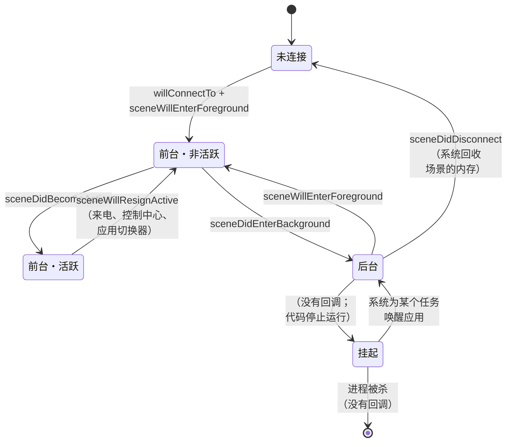
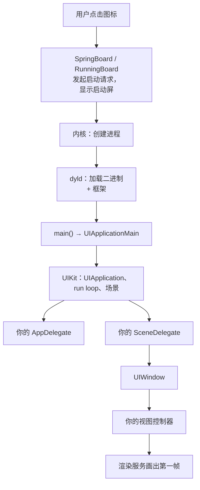

# 02 · 「应用启动」是什么，又不是什么

> 英文原文：[Part 2 — What "App Startup" Is (and Isn't)](../02-what.md)
>
> **你在哪里：**第二阶段，定义与边界。
> **读完本篇你会知道：**一个精确的定义，起点和终点在哪里，应用的生命周期状态，以及 UIKit 启动和 SwiftUI、操作系统之间的关系。

## 缩写对照表

| 缩写 | 英文全称 | 中文 |
|---|---|---|
| UI | User Interface | 用户界面 |
| VC | View Controller | 视图控制器 |
| URL | Uniform Resource Locator | 统一资源定位符 |
| dyld | Dynamic Link Editor | 动态链接器 |
| OS | Operating System | 操作系统 |
| UIKit | User Interface Kit | Apple 的 UI 框架 |

## 1. 一句话定义

> **iOS 应用启动是这样一个过程：系统创建你的进程，UIKit 创建 `UIApplication` 和你的 AppDelegate，然后连接一个场景，由场景的 SceneDelegate 构建一个带根视图控制器的 `UIWindow`，最后系统画出这个视图控制器的第一帧。整个过程把进程层面的工作和每个窗口的工作分开，好让第一帧尽快出现，也让每个窗口能各自独立地诞生和消亡。**

## 2. 起点与终点

| | 事件 | 由谁衡量 |
|---|---|---|
| **起点** | 用户点击图标（或者由 URL、通知、小组件启动应用） | 系统 |
| **终点** | UI 的**第一帧**出现在屏幕上，并且应用能响应触摸 | Xcode Organizer 的「Launch time」、Instruments 的「App Launch」 |

两者之间的一切都算「启动耗时」，全部算在你头上，连 `main` 之前的那部分也不例外。

### 冷启动、热启动与恢复

| 类型 | 进程已存在？ | 会运行什么 |
|---|---|---|
| **冷启动（Cold launch）** | 不存在（开机后第一次启动，或者进程被杀之后） | 全部：dyld → `main` → AppDelegate → 场景 → 窗口 → 视图控制器 |
| **热启动（Warm launch）** | 不存在，但应用和库的部分内容还缓存在内存里 | 步骤相同，加载更快 |
| **恢复（Resume）** | 存在，应用原本在后台 | 只有场景的前台回调。**不会**调用 `didFinishLaunching`，仍然存在的屏幕也不会再调用 `viewDidLoad` |

（从 iOS 15 开始，系统还可能对你的应用做**预热（prewarm）**：提前运行 `main` 之前的那部分，让之后的点击更快。这也是不要依赖 `main` 之前副作用的原因之一。）

## 3. 生命周期状态

*一个场景可能处于哪些状态，状态之间由哪些回调标记？*

**进程**也有自己的状态（未运行、后台、挂起）。上图中**场景**的状态，才是你的 UI 代码需要响应的。

## 4. 边界：本系列**不**讲什么

- **不讲 SwiftUI 的 `App` 协议**，尽管它底层跑的是*同一套*机制（第 7 篇会给出对应关系）。
- **不讲代码签名和安装。** 那些发生在启动之前（见[代码签名系列](../../apple-code-signing-guide/zh/00-overview.md)）。
- **不讲后台执行**（后台任务、推送唤醒），只讲理解状态所必需的部分。
- **不深入讲 Auto Layout 和视图绘制。** 我们讲到「第一帧渲染出来」为止。

## 5. 在整个技术栈中的位置

*你的启动代码相对于系统处在什么位置？*

你的代码从 `main` 开始（通常由编译器替你生成）。它上面的一切都是系统的工作，但同样计入你的启动耗时。

---
← [01 · 启动架构为什么长这样](01-why.md) · 下一篇 → [03 · 概念地图](03-concept-map.md)
