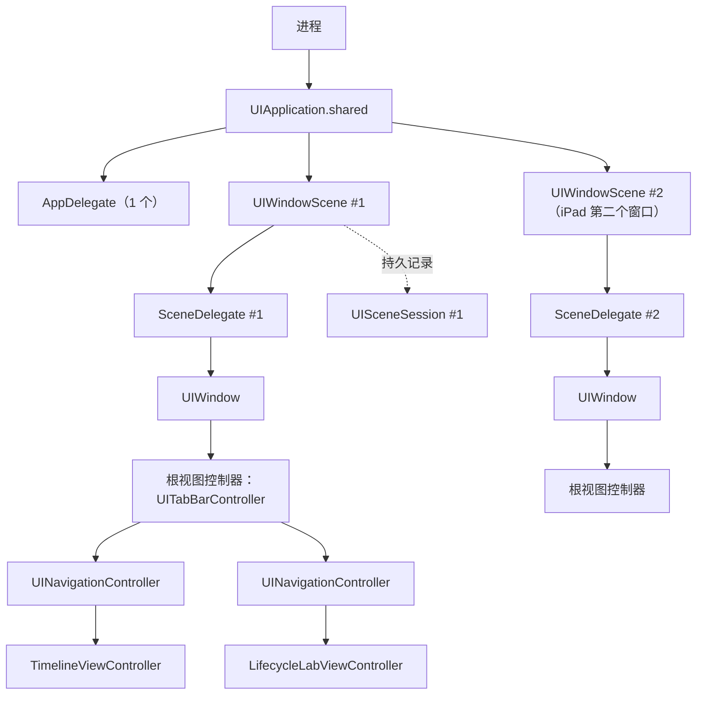
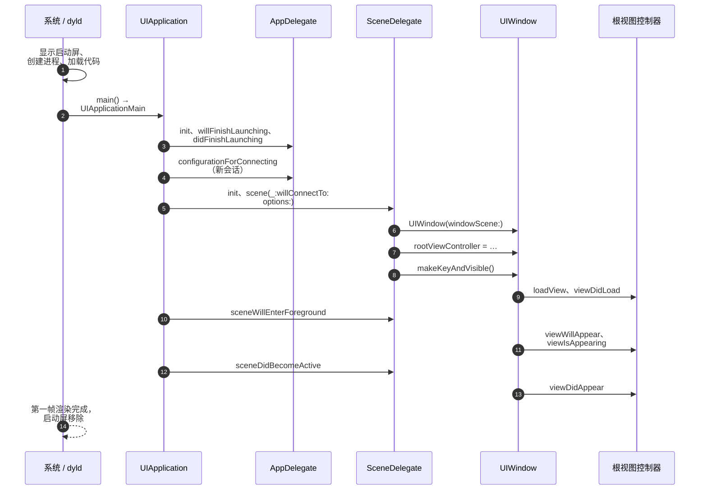

# 03 · 概念地图

> 英文原文：[Part 3 — The Concept Map](../03-concept-map.md)
>
> **你在哪里：**第三阶段，从浅层鸟瞰整个领域。
> **读完本篇你会知道：**按依赖顺序排列的核心概念，关键角色各自*负责什么 / 知道什么 / 不做什么*，以及一张图看完的冷启动流程。

## 缩写对照表

| 缩写 | 英文全称 | 中文 |
|---|---|---|
| OS | Operating System | 操作系统 |
| UI | User Interface | 用户界面 |
| VC | View Controller | 视图控制器 |
| URL | Uniform Resource Locator | 统一资源定位符 |
| dyld | Dynamic Link Editor | 动态链接器 |
| UIKit | User Interface Kit | Apple 的 UI 框架 |

## 3.1 领域映射：从问题到概念

| # | 现实问题中的要素 | UIKit 概念 | 一句话定义 | 为什么这样抽象 |
|---|---|---|---|---|
| 1 | 「应用的一份运行副本」 | **进程与 `main`** | 操作系统进程；`main()` 是你的代码中第一个运行的函数 | 一个地址空间，一个入口 |
| 2 | 「应用与系统之间的联系」 | **`UIApplication`**（单例）+ **run loop** | 接收系统事件、运行主事件循环的对象 | 把事件分发集中到主线程 |
| 3 | 「进程层面的决策」 | **AppDelegate**（`UIApplicationDelegate`） | 你的对象，接收*进程*层面的回调 | 把每个进程只做一次的初始化分离出来 |
| 4 | 「应用 UI 的一个实例」 | **场景**（`UIWindowScene`）+ **场景会话**（`UISceneSession`） | 场景是一个活着的 UI 实例；会话是它的持久记录，寿命可以比场景更长 | 让窗口能被独立地创建、释放和恢复 |
| 5 | 「响应一个 UI 实例的生命周期」 | **SceneDelegate**（`UIWindowSceneDelegate`） | 你的对象，接收*每个场景*的回调，并持有窗口 | 前台/后台是按窗口而不是按进程划分的 |
| 6 | 「屏幕上的一块显示区域」 | **`UIWindow`** | 一个场景视图层级的顶端；分发触摸；成为 *key window* 后接收输入 | 每个场景一个可绘制、可触摸的根 |
| 7 | 「UI 的入口」 | **根视图控制器** | `window.rootViewController`，持有窗口全部内容的视图控制器 | 布局、旋转、安全区域、模态呈现都只有一个负责人 |
| 8 | 「一屏内容」 | **视图控制器**及其**生命周期** | 管理一个视图层级；接收加载 / 出现 / 布局 / 消失回调 | 屏幕会在同一个场景里来来去去 |

**衍生概念：**容器视图控制器（`UINavigationController`、`UITabBarController`、`UISplitViewController`）、模态呈现、启动屏、`Info.plist` 里的场景清单（scene manifest）、`connectionOptions`、状态恢复。

*这些概念在运行时是怎么嵌套的？*

*一个进程、一个 AppDelegate、N 个场景，每个场景都有自己的 SceneDelegate、窗口和视图控制器树。*

## 3.2 关键角色

每个角色都有一篇自己的深入专题。

| 角色 | 负责什么 | 知道什么 | **不**做什么 |
|---|---|---|---|
| **系统 + dyld + `main`**（[5.1，英文](../05-deep-dives/01-process-launch-and-main.md)） | 创建进程、加载代码、调用 `UIApplicationMain` | 你的二进制、链接的框架、静态初始化器 | 对你的 UI 和窗口一无所知 |
| **UIApplication + AppDelegate**（[5.2，英文](../05-deep-dives/02-uiapplication-and-appdelegate.md)） | 进程层面的生命周期：启动完成、场景配置、推送注册、被丢弃的会话 | 启动选项、所有已连接的场景 | 在基于场景的应用里**没有窗口，也没有 UI**；使用场景时收不到前台/后台回调 |
| **UIScene + SceneDelegate**（[5.3，英文](../05-deep-dives/03-scenes-and-scenedelegate.md)） | 一个窗口的生命周期：连接、前台、活跃、后台、断开；这个窗口收到的 URL 和 activity | 它的会话、连接选项、它的窗口 | 不做进程层面的初始化；不决定每一屏显示什么 |
| **UIWindow + 根视图控制器**（[5.4，英文](../05-deep-dives/04-window-and-root-view-controller.md)） | 承载 UI 树；key window 状态；谁是根视图控制器 | 它的场景、它的根视图控制器、安全区域 | 不决定应用流程（那是 router 或 coordinator 的事） |
| **视图控制器**（[5.5，英文](../05-deep-dives/05-view-controller-lifecycle.md)） | 一屏内容：构建视图、响应出现/消失、布局 | 自己的视图、子视图控制器、呈现状态 | **不会**通过生命周期方法收到应用或场景的前台/后台事件 |

## 3.3 协作一览：冷启动

*从点击到第一帧，谁按什么顺序调用谁？*

> ⚠️ 场景回调（第 10、12 步）和视图控制器出现回调（第 11、13 步）之间的**相对顺序**属于实现细节，不同 iOS 版本之间有过变化。不要写依赖这个顺序的代码。LaunchLab 会在你的设备上显示真实的顺序。

**你还会遇到的其他流程：**
- **后台 → 前台：**只有场景回调会触发，视图控制器的 `viewWillAppear` **不会**。（5.3、5.5）
- **冷启动与热启动下的深度链接：**URL 会出现在 `connectionOptions` 里（冷启动），或者 `scene(_:openURLContexts:)` 里（热启动）。（5.3）
- **替换根视图控制器：**在新手引导结束或退出登录后，替换 `window.rootViewController`。（5.4）

---
← [02 · 「应用启动」是什么，又不是什么](02-what.md) · 下一篇 → [04 · 贯穿示例：LaunchLab](04-running-example.md)
