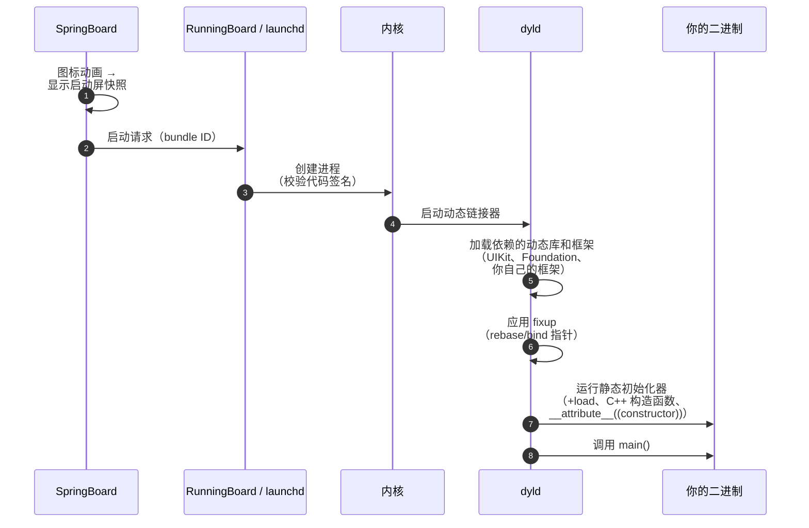

# 05.1 · 进程启动与 main

> 英文原文：[5.1 — Process Launch & main](../../05-deep-dives/01-process-launch-and-main.md)
>
> **你在哪里：**第一篇深入专题，讲你的应用代码第一行运行之前发生的一切。
> **读完本篇你会知道：**系统和 dyld 在 `main` 之前做了什么，`@main` 实际生成了什么，`UIApplicationMain` 搭建了什么，以及 `main` 之前的耗时如何影响启动。

## 缩写对照表

| 缩写 | 英文全称 | 中文 |
|---|---|---|
| dyld | Dynamic Link Editor | 动态链接器 |
| dylib | Dynamic Library | 动态库 |
| UI | User Interface | 用户界面 |
| URL | Uniform Resource Locator | 统一资源定位符 |
| ID | Identifier | 标识符 |
| UIKit | User Interface Kit | Apple 的 UI 框架 |

## 角色回顾
**负责：**把一次点击变成一个正在运行的进程，加载好你的代码，并启动 UIKit 的事件循环。**对应 LaunchLab 步骤：**1、2。

## 内部设计

### main 之前：系统的那部分

*从点击到 `main()` 之间发生了什么？*



- **启动屏。** storyboard 或 `UILaunchScreen` 字典由*系统*绘制，而不是你的代码。它的存在就是为了掩盖这段加载时间。它不能运行代码，也不能显示动态内容。
- **dyld。** 现代 dyld 会缓存一个「launch closure」，所以再次启动会更快。你每加一个**动态框架**，都会增加加载时间；静态链接（或 mergeable libraries）可以减少这部分开销。
- **静态初始化器。** Objective-C 的 `+load`、C++ 全局构造函数之类的代码会在 `main` *之前*运行，跑在主线程上，用户完全看不到进度。不要在这里做重活。Swift 的全局变量和 `static let` 是**惰性**的，所以不会在这里运行。

### main：你的代码的第一行

大多数应用会在 AppDelegate 上写 `@main`：

```swift
@main
class AppDelegate: UIResponder, UIApplicationDelegate { … }
```

编译器会把它变成一个 `main`，本质上就是：

```swift
UIApplicationMain(CommandLine.argc, CommandLine.unsafeArgv,
                  nil, NSStringFromClass(AppDelegate.self))
```

LaunchLab 在 `main.swift` 里手写了这一段，方便你看清楚。（老项目用的是 `@UIApplicationMain`，现在已被弃用，改用 `@main`。）

### UIApplicationMain：通往 UIKit 的桥

| 参数 | 含义 |
|---|---|
| `argc`、`argv` | 进程参数（比如 Xcode scheme 里配置的启动参数） |
| `principalClassName` | 要创建的 `UIApplication` 子类；`nil` 表示就用 `UIApplication` 本身（很少改） |
| `delegateClassName` | 你的 AppDelegate 类名，由 UIKit 负责实例化 |

它按顺序做这些事：
1. 创建 `UIApplication` 单例（`UIApplication.shared`）。
2. 创建你的 AppDelegate，并把它设为 delegate。
3. 加载 Info.plist 里的设置：场景清单、主 storyboard（用于不基于场景的应用）、URL 类型等。
4. 在主线程上启动**主 run loop**。从这里开始，一切都是由 run loop 分发的回调。
5. **永不返回。** 进程在被系统杀掉时结束。

## 与其他部分的交互
- **→ UIApplication/AppDelegate（[5.2，英文](../../05-deep-dives/02-uiapplication-and-appdelegate.md)）：**第一批回调就是在这个刚启动的 run loop 上分发的。
- **← 代码签名：**内核在运行任何代码之前都会校验你的签名（见代码签名系列的 [05.7 · 设备端校验](../../../apple-code-signing-guide/zh/05-deep-dives/07-on-device-verification.md)）。

## ⚓ 回到示例
- **第 1 步。** Sam 点击 LaunchLab。系统显示一个空白启动屏（Info.plist 里的 `UILaunchScreen` 是个空字典，所以就是纯系统背景色）。dyld 加载 LaunchLab、UIKit、Foundation 和 `os`。
- **第 2 步。** `main.swift` 开始运行：
  ```swift
  LaunchLog.shared.record(.process, "main() entered")
  _ = UIApplicationMain(CommandLine.argc, CommandLine.unsafeArgv, nil, NSStringFromClass(AppDelegate.self))
  ```
  `LaunchLog` 会向内核查询进程的创建时间（`sysctl` → `kp_proc.p_un.__p_starttime`）。所以 Timeline 的第一行，比如 `Process · +142.7 ms  main() entered`，显示的就是 **`main` 之前的所有工作一共花了多久**。试着加一个大的动态框架，看看这个数字会不会涨。

## 出错时的表现
| 情况 | 结果 |
|---|---|
| 在 `+load` / 静态构造函数里做重活 | 启动变慢，启动屏卡住不动。在 Instruments 的 App Launch 模板里表现为「pre-main」耗时 |
| 缺少 dylib / 框架没有嵌入 | 在 `main` 之前崩溃：`dyld: Library not loaded: @rpath/Foo.framework/Foo` |
| `delegateClassName` 写错 | 应用启动了但没有 delegate：白屏或黑屏，什么都没初始化 |
| 两个 `@main`（或 `@main` 加 `main.swift`） | 编译错误：*'main' attribute cannot be used in a module that contains top-level code* |

---
← [04 · 贯穿示例：LaunchLab](../04-running-example.md) · 下一篇 → [5.2 · UIApplication 与 AppDelegate（英文）](../../05-deep-dives/02-uiapplication-and-appdelegate.md) · [概念地图](../03-concept-map.md)
