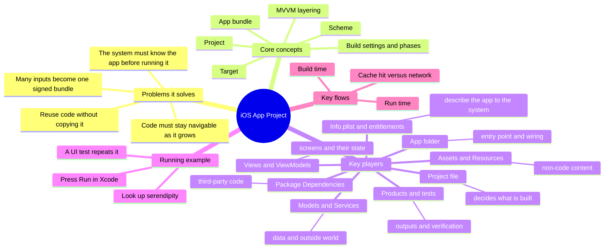

# Anatomy of an iOS App Project: A Guided Tour

> **Where you are:** the front door of a series on what the folders and files in an Xcode project navigator are, and how they combine into an app.
> **What you'll know after this file:** the map of the whole territory, the reading order, and the real project (AIPowerDict) that every article refers back to.

Open any iOS project in Xcode and the left sidebar shows something like this:

```
AIPowerDict                      ← the project
├── AIPowerDict                  ← the app target's folder
│   ├── AIPowerDict.entitlements
│   ├── Assets.xcassets
│   ├── Info.plist
│   ├── App/
│   ├── Extensions/
│   ├── Models/
│   ├── Resources/
│   ├── Services/
│   ├── ViewModels/
│   └── Views/
├── AIPowerDictUITests           ← the UI test target's folder
├── Products
│   ├── AIPowerDict.app
│   └── AIPowerDictUITests.xctest
└── Package Dependencies
    ├── Sentry 8.58.0
    └── TelemetryDeck 2.11.0
```

It looks like a plain folder tree, but the entries are four different kinds of thing:

- some are **rules Apple imposes** (`Info.plist`, `.entitlements`, `Assets.xcassets`): the system or the build tools read them, so their names and formats are fixed;
- some are **a team convention** (`App`, `Models`, `Views`, `ViewModels`, `Services`, `Extensions`): Xcode does not care what they are called;
- some are **outputs, not inputs** (`Products`);
- some are **other people's code** (`Package Dependencies`).

This series sorts the tree into those kinds and then follows one build and one user action through all of them.

## The series

| # | Article | Question it answers |
|---|---|---|
| 1 | [Why a project looks like this](01-why.md) | What problems forced this structure? |
| 2 | [What an Xcode project is (and isn't)](02-what.md) | What is the project, as opposed to the folders? |
| 3 | [The concept map](03-concept-map.md) | What are all the pieces, and who owns what? |
| 4 | [The running example](04-running-example.md) | What happens on one build and one word lookup? |
| 5.1 | [Project, targets and schemes](05-deep-dives/01-project-targets-and-schemes.md) | Who decides what gets built, and how? |
| 5.2 | [Info.plist and entitlements](05-deep-dives/02-info-plist-and-entitlements.md) | How does the app describe itself to the system? |
| 5.3 | [Assets and resources](05-deep-dives/03-assets-and-resources.md) | Where do images, colours, strings and config live? |
| 5.4 | [The App folder: entry point](05-deep-dives/04-app-entry-point.md) | Where does my code start, and what is wired there? |
| 5.5 | [Views and ViewModels](05-deep-dives/05-views-and-viewmodels.md) | How is a screen split into drawing and deciding? |
| 5.6 | [Models, Services and Extensions](05-deep-dives/06-models-services-extensions.md) | Where do data and outside-world access live? |
| 5.7 | [Package dependencies](05-deep-dives/07-package-dependencies.md) | How does third-party code get in? |
| 5.8 | [Products and tests](05-deep-dives/08-products-and-tests.md) | What comes out, and how is it tested? |
| 6 | [Full walkthrough](06-walkthrough.md) | One build and one lookup, end to end, at full depth |
| 7 | [Pitfalls and next steps](07-next-steps.md) | Common mistakes and where to go next |

## Abbreviations used in this series

| Abbreviation | Full name |
|---|---|
| API | Application Programming Interface |
| APNs | Apple Push Notification service |
| CI | Continuous Integration |
| IAP | In-App Purchase |
| IPA | iOS App Store Package (the `.ipa` file you upload or install) |
| JSON | JavaScript Object Notation |
| MVVM | Model–View–ViewModel |
| OCR | Optical Character Recognition |
| plist | property list |
| SDK | Software Development Kit |
| SPM | Swift Package Manager |
| TTS | Text To Speech |
| UI | User Interface |
| URL | Uniform Resource Locator |
| XML | Extensible Markup Language |
| YAML | YAML Ain't Markup Language |

## The whole territory, in one picture

*What are all the pieces of an iOS project, and how do they group?*



## The core idea in one paragraph

An Xcode **project** is a recipe book. Each **target** in it is one recipe that turns a set of inputs into one **product**. For the app target, the inputs are Swift source files (which become one executable), an asset catalog and resource files (which are compiled or copied next to that executable), an `Info.plist` (the app's ID card, read by the system), and an entitlements file (the permissions that get sealed into the code signature). The product is `AIPowerDict.app`, a folder called a **bundle**. Inside the source files, the sub-folders `App`, `Views`, `ViewModels`, `Models`, `Services` and `Extensions` are a human convention called MVVM (Model–View–ViewModel) that keeps drawing, deciding, data and outside-world access apart. The compiler flattens all of them into the same executable.

---
Next → [01 — Why](01-why.md)
