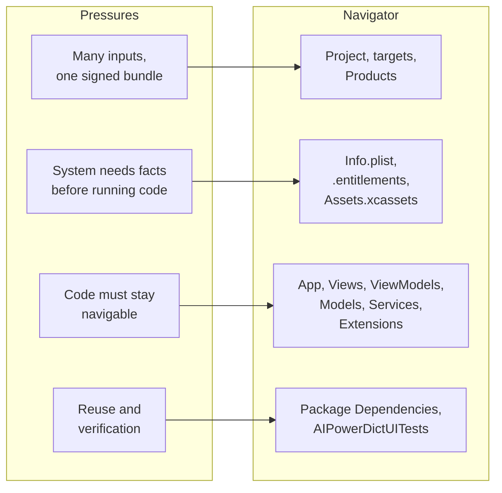

# 1 — Why a Project Looks Like This

> **Where you are:** stage one. No definitions yet, only the problems.
> **What you'll know after this file:** the four pressures that produce the structure in the navigator, so that each entry later feels necessary instead of arbitrary.

## The world without a project structure

Imagine building an iOS app with only a text editor and a compiler. You would write Swift files and run `swiftc` to get an executable. Then the trouble starts.

### Problem 1: an app is more than an executable

iOS will not run a bare executable. It installs and launches a **bundle**: a folder that holds the executable plus everything it needs, laid out in a fixed way. Producing that folder by hand means, for every build:

- compiling ~80 Swift files in the right order and linking them with third-party libraries,
- converting images and colours into the optimised format the system loads,
- copying translated strings into per-language folders,
- writing a metadata file with the right version number,
- signing the whole thing with a certificate, or the device refuses to launch it.

Someone has to remember that list and its order. A shell script could, but it would be different in every team. **Pressure: one declarative description of "what goes in and how", shared by the editor, the build system and CI (Continuous Integration).**

### Problem 2: the system must know things about the app before running any of its code

Before your first line of Swift runs, iOS already needs answers:

- What is this app's unique identifier and version?
- Which icon and name go on the Home Screen?
- Which orientations does it support?
- May it use iCloud or push notifications?
- If it asks for the camera, what sentence should the permission alert show?

The system cannot call your code to ask, because deciding whether to run your code is the point. **Pressure: declarations in static files with fixed names and formats, readable without executing anything.** This is why `Info.plist` and `.entitlements` exist and why you cannot rename their keys.

### Problem 3: code grows faster than anyone's memory

AIPowerDict has roughly 9,000 lines of Swift. In a single folder, a change to "how a word lookup works" means hunting through UI (User Interface) code, networking code and database code that have grown into each other. The usual symptoms:

- a screen file that also builds URL (Uniform Resource Locator) requests and parses JSON (JavaScript Object Notation),
- logic that cannot be tested without launching the whole UI,
- two people editing the same giant file all day.

**Pressure: a layering convention, so that each file has one reason to change and a newcomer can guess where something lives.** This is where `Models`, `Views`, `ViewModels` and `Services` come from. Xcode does not enforce it. Teams choose it.

### Problem 4: you don't want to write everything, and you want proof it works

Crash reporting and analytics are solved problems. Copy-pasting someone's source into your tree makes upgrades painful and licences unclear. **Pressure: declared, versioned dependencies** (`Package Dependencies`).

And a change in one screen can break another. **Pressure: a second, separate build product whose only job is to exercise the first one** (`AIPowerDictUITests`).

## Before and after

*How do the four pressures map onto what the navigator shows?*

## What you can already predict

If these are the pressures, a solution has to contain:

1. a file that lists inputs, outputs and build steps (it does: the `.xcodeproj`);
2. a few files with fixed formats that the system reads (it does);
3. folders whose names are up to the team (they are);
4. a way to pull in versioned external code and a way to build test code separately (both present).

---
Next → [02 — What](02-what.md) · Back to [overview](00-overview.md)
