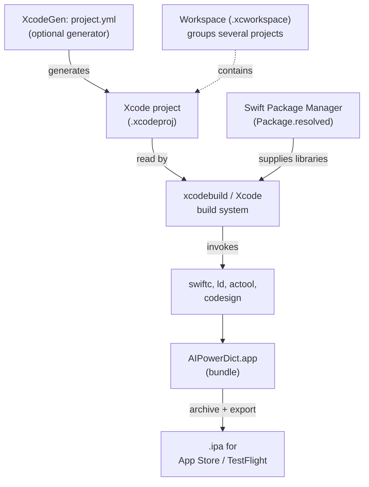

# 2 — What an Xcode Project Is (and Isn't)

> **Where you are:** stage two. The definition and its edges.
> **What you'll know after this file:** what "the project" is as opposed to the folders on disk, what it does not do, and where it sits among neighbouring tools.

## One-sentence definition

**An Xcode project is a description file (`AIPowerDict.xcodeproj`) that turns a set of source, resource and configuration files into one or more signed products, by grouping them into targets and giving each target build settings and build phases.**

Everything else in the navigator is either an *input* named by that description, an *output* of it, or a *dependency* it pulls in.

## The four kinds of entry in the navigator

| Kind | Entries in AIPowerDict | Who reads it | Can you rename it freely? |
|---|---|---|---|
| **System contract** | `Info.plist`, `AIPowerDict.entitlements`, `Assets.xcassets`, `Resources/*.lproj`, `Resources/PrivacyInfo.xcprivacy` | iOS, the App Store, Apple's build tools | The file, sometimes. The keys and formats inside, never. |
| **Team convention** | `App/`, `Views/`, `ViewModels/`, `Models/`, `Services/`, `Extensions/` | Humans only | Yes. The compiler ignores folder names. |
| **Output** | `Products/AIPowerDict.app`, `Products/AIPowerDictUITests.xctest` | The simulator, the device, the test runner | They are generated; you don't edit them. |
| **External code** | `Package Dependencies/Sentry`, `Package Dependencies/TelemetryDeck` | The compiler and linker | Managed by SPM (Swift Package Manager). |

This table is the most useful thing to remember from the series. When something in the tree confuses you, ask which row it belongs to.

## Boundaries: what the project is not

- **The navigator is not the file system.** The sidebar shows what the project file references. `Products` and `Package Dependencies` are not folders in your repository at all. On disk, AIPowerDict's root also holds `project.yml`, `publish.sh` and `ExportOptions.plist`, which the navigator does not show.
- **Folders are not modules.** `Views` cannot hide anything from `Services`. All Swift files in a target compile into one module, and any file can use any non-`private` type in any other without an `import`. The layering is discipline, not enforcement. (Real enforcement needs separate targets or local Swift packages.)
- **A project is not an app.** One project can hold many targets: an app, a widget, a watch app, test bundles. AIPowerDict has two.
- **`Extensions/` here does not mean app extensions.** In this project the folder holds Swift `extension` code (`String+Extensions.swift` and so on). *App extensions* (widgets, share sheets, keyboard extensions) are a different thing and would be separate targets with their own `Info.plist`.
- **The project file does not hold your signing identity or secrets.** It names a team and a signing style. Certificates and keys live in the keychain. See the [code signing series](../apple-code-signing-guide/00-overview.md).

## Position in the ecosystem

*What does a project sit on, and what sits around it?*

- **Below it:** the command-line tools (`swiftc` the compiler, `ld` the linker, `actool` the asset catalog compiler, `codesign`). The project decides which of them run, on which files, with which flags.
- **Beside it:** SPM, which resolves and builds third-party packages. Older projects use CocoaPods or Carthage for the same job.
- **Above it:** a *workspace* groups several projects. Every project has a tiny built-in one (`project.xcworkspace` inside the `.xcodeproj` folder), which is where the package lock file lives.
- **Generators:** `project.pbxproj` is a machine-written file that merges badly in Git. AIPowerDict keeps a small human-written `project.yml` (YAML, "YAML Ain't Markup Language") and regenerates the project with **XcodeGen**. Tuist and Bazel are alternatives. This is optional; most small projects edit the project through Xcode's UI.

## Closest neighbours, one line each

| Neighbour | How it differs |
|---|---|
| Swift package (`Package.swift`) | Describes libraries in code, with no signing, `Info.plist` or asset pipeline for apps. A project can depend on packages. |
| Android Gradle project | Same role. `build.gradle` ≈ target build settings, `AndroidManifest.xml` ≈ `Info.plist` + entitlements, `res/` ≈ asset catalog + resources. |
| Web project (`package.json` + bundler) | Same role, but the output is not signed and there is no system-read manifest of the same weight. |

---
Next → [03 — Concept map](03-concept-map.md) · Back to [overview](00-overview.md)
