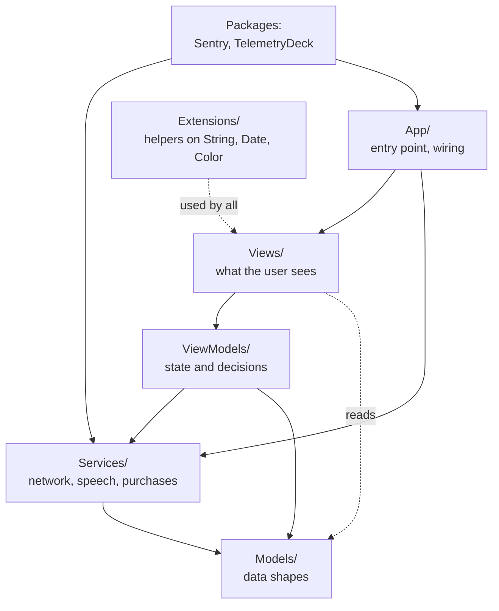
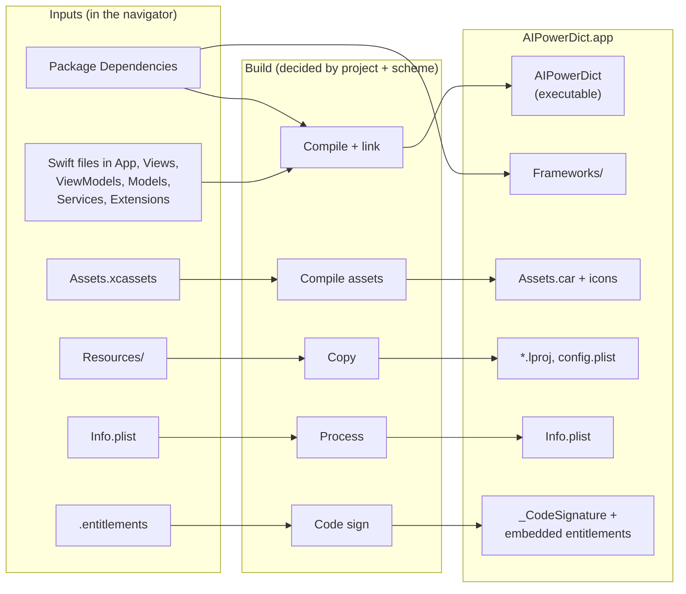

# 3 — The Concept Map

> **Where you are:** stage three. The whole territory at one shallow level.
> **What you'll know after this file:** the six core concepts, the eight key players and what each owns, and one diagram of how they cooperate. No internals yet.

## 3.1 From problem to concepts

Concepts are listed in dependency order: each one uses only those above it.

| Real-world need | Concept | Why this abstraction |
|---|---|---|
| "One place that describes everything we build" | **Project** | A single file (`.xcodeproj`) that the editor, the build system and CI all read. |
| "This set of files becomes that one thing" | **Target** | One recipe, one product. Lets an app and its tests live together but build separately. |
| "How exactly to build it" | **Build settings and build phases** | Settings are named values (Swift version, bundle identifier, signing team). Phases are ordered steps (compile sources, link, copy resources). |
| "What happens when I press Run, Test or Archive" | **Scheme** | Picks which targets to build, in which configuration (Debug or Release), and what to launch. |
| "The thing iOS installs and launches" | **App bundle** | A folder ending in `.app` with a fixed layout: executable, `Info.plist`, resources, signature. |
| "Keeping 9,000 lines navigable" | **MVVM layering** | MVVM (Model–View–ViewModel) splits code by reason to change: data, drawing, deciding, plus Services for the outside world. |

Derived concepts you will meet later, all built from these: *configuration* (a named set of build settings such as Debug), *module* (what one target's Swift code compiles into), *capability* (an entitlement plus its matching setup on Apple's side), *localisation* (per-language resource folders).

## 3.2 Key players

Each key player gets a deep dive in stage five, in this order.

| # | Key player | In the navigator | Owns | Knows | Does not do |
|---|---|---|---|---|---|
| 1 | **Project, targets, schemes** | the blue `AIPowerDict` root | What gets built, from which files, with which settings | Target membership of every file, build settings, package list | Hold any app behaviour. Deleting a file reference changes the build, not the file. |
| 2 | **Info.plist and entitlements** | `Info.plist`, `AIPowerDict.entitlements` | The app's declarations to the system | Bundle identifier, version, permission texts, URL schemes; iCloud and push rights | Grant anything by themselves. The provisioning profile and the user's consent decide. |
| 3 | **Assets and resources** | `Assets.xcassets`, `Resources/` | Everything in the bundle that is not code | Icon, colours, translated strings, runtime config, privacy manifest | Contain logic. Code looks them up by name at run time. |
| 4 | **App entry point** | `App/` | Where execution enters your code, and the wiring of shared objects | Which services exist for the whole app's life, the root view, the database container | Implement features. It assembles; others act. |
| 5 | **Views and ViewModels** | `Views/`, `ViewModels/` | A screen's appearance (View) and its state and decisions (ViewModel) | Views know layout. ViewModels know loading flags, current word, errors. | Views don't call the network. ViewModels don't know about layout. |
| 6 | **Models, Services, Extensions** | `Models/`, `Services/`, `Extensions/` | The data shapes; access to network, speech, purchases, analytics; small helpers | Models know fields and relationships. Services know endpoints and system APIs (Application Programming Interfaces). | Models don't fetch themselves. Services don't hold screen state. |
| 7 | **Package dependencies** | `Package Dependencies` | Third-party code at pinned versions | Repository URLs, version rules, resolved versions | Live in your repository. Only the references and the lock file do. |
| 8 | **Products and tests** | `Products`, `AIPowerDictUITests` | The build outputs, and a second target that drives the app from outside | Where the built `.app` is; test steps and expectations | Products are not editable. UI tests cannot see the app's internal objects. |

### How the folders layer

*Which folder may depend on which?*

Arrows point from user to used. The rule that makes the layering useful: **arrows only go down.** A Service never imports a View. A Model never calls a Service.

## 3.3 Coordination at a glance

There are two moments when the players cooperate: **build time**, when inputs become a bundle, and **run time**, when the bundle's contents act.

*How do the navigator's entries become an app, and what does each do once it runs?*

At run time the direction reverses: iOS reads `Info.plist` and the signature, starts the executable, and the code inside pulls colours from `Assets.car`, strings from the `.lproj` folders and settings from `config.plist`.

Two edge flows to keep in mind, both traced in the deep dives:

- **A file exists on disk but is not in the target.** It compiles nowhere and the app behaves as if it did not exist ([5.1](05-deep-dives/01-project-targets-and-schemes.md)).
- **The code asks for something the declarations did not announce.** Using the camera without a usage description in `Info.plist` terminates the app ([5.2](05-deep-dives/02-info-plist-and-entitlements.md)).

---
Next → [04 — Running example](04-running-example.md) · Back to [overview](00-overview.md)
