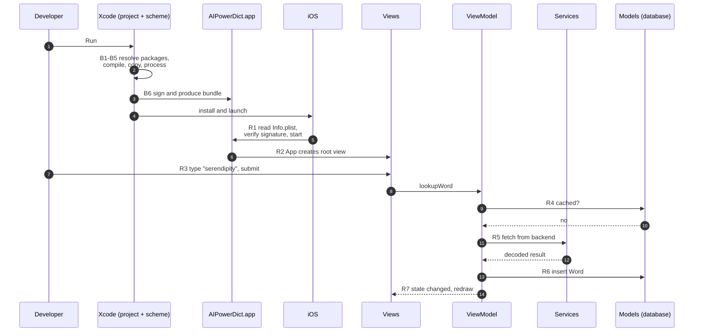

# 4 — The Running Example

> **Where you are:** stage four. One scenario, traced shallowly, that the rest of the series keeps returning to.
> **What you'll know after this file:** the numbered steps of one build and one word lookup, and which player is on stage at each step.

## The project

**AIPowerDict** is a SwiftUI dictionary app. You type or scan an English word; a backend powered by a language model returns pronunciation, definitions, examples and etymology; the word is cached locally, synced through iCloud, and scheduled for spaced-repetition review. It has five tabs: Lookup, Word Book, Scan, Review, Settings.

## The scenario in three sentences

A developer presses **Run** in Xcode. The app launches in the simulator, the user types **"serendipity"** into the Lookup tab and submits. Later, a UI test repeats the launch automatically.

That covers every entry in the navigator. The steps below are numbered **B** for build time, **R** for run time and **T** for test; later files refer to them by number.

## Build time: from navigator to bundle

| Step | What happens | Player on stage |
|---|---|---|
| **B1** | Xcode reads the **scheme** `AIPowerDict`, which says: build the **target** `AIPowerDict` in the Debug configuration, then launch it. | Project, targets, schemes |
| **B2** | The packages **Sentry** and **TelemetryDeck** are fetched at the versions pinned in `Package.resolved` and built. | Package dependencies |
| **B3** | Every Swift file under `App`, `Views`, `ViewModels`, `Models`, `Services` and `Extensions` is compiled into one module and linked with the packages into one executable. | Project (Compile Sources phase) |
| **B4** | `Assets.xcassets` is compiled into `Assets.car`. The files in `Resources/` are copied into the bundle. | Assets and resources |
| **B5** | `Info.plist` has its `$(…)` placeholders replaced with build-setting values and is written into the bundle. | Info.plist and entitlements |
| **B6** | The bundle is code signed with the rights listed in `AIPowerDict.entitlements`. The result appears as `AIPowerDict.app` under **Products**. | Info.plist and entitlements; Products |

## Run time: looking up "serendipity"

| Step | What happens | Player on stage |
|---|---|---|
| **R1** | iOS reads the bundle's `Info.plist`, checks the signature, starts the executable. Execution enters `AIPowerDictApp` in `App/`, which starts Sentry and TelemetryDeck and creates the shared services and the database container. | Info.plist; App entry point; Packages |
| **R2** | `ContentView` draws the tab bar. The label "Lookup" comes from `Localizable.strings`; colours come from the asset catalog and the theme. | App entry point; Assets and resources |
| **R3** | The user types "serendipity" in `LookupView` and submits. The view calls `lookupWord` on its view model and does nothing else. | Views |
| **R4** | `WordLookupViewModel` cleans the text, asks the database whether a `Word` named "serendipity" is already cached, and on a miss asks `UsageTracker` whether today's quota allows a request. | ViewModels; Models; Services |
| **R5** | `AIService` signs and sends the HTTPS requests to the backend and decodes the JSON replies. | Services |
| **R6** | The view model fills a `Word` model object and inserts it into the database, which saves it to disk and syncs it to iCloud. | Models; entitlements (iCloud) |
| **R7** | Because the view model's properties changed, SwiftUI redraws: the spinner disappears and `WordDetailView` shows the result. An analytics event goes out through TelemetryDeck. | Views; Services; Packages |

## Test time

| Step | What happens | Player on stage |
|---|---|---|
| **T1** | The scheme's Test action builds `AIPowerDictUITests.xctest`, launches the app as a separate process with special launch arguments, taps through the UI and checks what is on screen. | Products and tests |

## The scenario in one picture

*Which player is active at each step of the scenario?*

## Check yourself

Without scrolling up: which folder contains the code that runs at R3? At R5? Which file made step R6's iCloud sync permissible? If you can answer `Views`, `Services` and `AIPowerDict.entitlements`, the map is in place and the deep dives will fill it in.

---
Next → [5.1 — Project, targets and schemes](05-deep-dives/01-project-targets-and-schemes.md) · Back to [concept map](03-concept-map.md)
