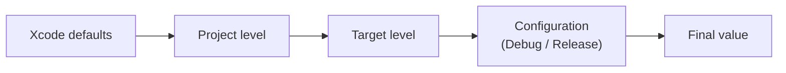

# 5.1 — Project, Targets and Schemes

> **Where you are:** first deep dive. The blue icon at the top of the navigator.
> **What you'll know after this file:** what is inside `.xcodeproj`, what a target's build phases do with each kind of file, how settings and configurations layer, and what a scheme adds.

## Role recap

**Owns:** what gets built, from which files, with which settings. **Example steps:** B1, B3 (and it directs B2 and B4–B6).

## Internal design

### What is on disk

```
AIPowerDict.xcodeproj/                  ← a folder that Finder shows as one file
├── project.pbxproj                     ← the project itself: files, targets, settings
├── project.xcworkspace/
│   └── xcshareddata/swiftpm/Package.resolved   ← package lock file (see 5.7)
├── xcshareddata/xcschemes/AIPowerDict.xcscheme ← shared scheme, committed to Git
└── xcuserdata/                         ← per-user UI state, not committed
```

`project.pbxproj` is a text file of objects identified by 24-character hexadecimal IDs. You almost never read it, but knowing it exists explains the most common beginner bug (see *Failure behavior*).

### Targets and their build phases

AIPowerDict has two targets:

| Target | Product type | Product |
|---|---|---|
| `AIPowerDict` | application | `AIPowerDict.app` |
| `AIPowerDictUITests` | UI testing bundle | `AIPowerDictUITests.xctest` |

A target is mostly a list of **build phases**. The app target has three, and each kind of file in the navigator goes to exactly one of them:

| Build phase | Takes | Produces | From the navigator |
|---|---|---|---|
| **Compile Sources** | `.swift` files | one module, one executable | everything in `App`, `Views`, `ViewModels`, `Models`, `Services`, `Extensions` |
| **Link Binary With Libraries** (Frameworks) | package products, system frameworks | linked executable | `Sentry`, `TelemetryDeck` |
| **Copy Bundle Resources** | everything else that is a member | files inside the `.app` | `Assets.xcassets`, `Localizable.strings`, `config.plist`, `PrivacyInfo.xcprivacy` |

`Info.plist` and the `.entitlements` file are **in no phase**. They are named by build settings (`INFOPLIST_FILE`, `CODE_SIGN_ENTITLEMENTS`) and handled by dedicated steps. Putting `Info.plist` into Copy Bundle Resources as well is a classic "Multiple commands produce Info.plist" error.

Whether a file belongs to a target is called **target membership**. It is visible in Xcode's File inspector (right sidebar).

### Build settings, layered

A build setting is a named value. The final value for a build comes from layers, later ones overriding earlier ones:



*How does a build setting get its final value?*

The ones worth recognising in AIPowerDict:

| Setting | Value | Effect |
|---|---|---|
| `PRODUCT_BUNDLE_IDENTIFIER` | `com.geekchow.AIPowerDict` (prefix + target name) | The app's unique ID, substituted into `Info.plist` |
| `MARKETING_VERSION` | `1.0.4` | User-visible version |
| `CURRENT_PROJECT_VERSION` | `11` | Build number |
| `SWIFT_VERSION` | `6.2` | Language mode |
| `IPHONEOS_DEPLOYMENT_TARGET` | `18.0` | Oldest iOS the app runs on |
| `ASSETCATALOG_COMPILER_APPICON_NAME` | `AppIcon` | Which icon set in the asset catalog is the app icon |
| `CODE_SIGN_STYLE` | `Automatic` | Xcode manages certificates and profiles |

### Schemes

A scheme answers "when I press this button, what happens?" It has one entry per action:

| Action | AIPowerDict's scheme says |
|---|---|
| Build | build `AIPowerDict` (and the tests for the Test action) |
| Run | Debug configuration, launch `AIPowerDict.app`, use `StoreKit.storekit` as the local purchase configuration |
| Test | run `AIPowerDictUITests` |
| Profile / Archive | Release configuration |

The scheme is also where launch arguments, environment variables and the simulated location live. That `StoreKit.storekit` line is why IAP (In-App Purchase) products appear in the simulator without an App Store connection.

### Groups, folders, and a generator

Historically the navigator's folders were **groups**: purely visual, and adding a file on disk did nothing until you also added a reference. Since Xcode 16, new projects use **folders that mirror the disk**, where every file in the folder joins the target automatically. AIPowerDict takes a third route: its project is generated from `project.yml` by XcodeGen, which scans the `AIPowerDict/` directory and writes the references for you:

```yaml
targets:
  AIPowerDict:
    type: application
    platform: iOS
    sources:
      - AIPowerDict          # scan this folder; .swift → compile, others → resources
    dependencies:
      - package: TelemetryDeck
      - package: Sentry
```

Twelve lines stand in for several hundred lines of `project.pbxproj`.

## Interactions

- **→ Packages (5.7):** the project lists package URLs and version rules; SPM (Swift Package Manager) resolves them.
- **→ Info.plist and entitlements (5.2):** build settings point at both files and provide the values for `$(…)` placeholders.
- **→ Products (5.8):** each target's output appears there.

## ⚓ Back to the example

**B1.** Pressing Run consults `AIPowerDict.xcscheme`: Run action → Debug → target `AIPowerDict`.

**B3.** The Compile Sources phase hands every member `.swift` file to the compiler *together*. That is why `LookupView.swift` in `Views/Lookup/` can mention `WordLookupViewModel` from `ViewModels/` with no `import`: folder boundaries do not exist for the compiler. In the build log this is one `SwiftCompile` group followed by one `Ld` (link) line that also names Sentry and TelemetryDeck.

You can reproduce B1–B6 without the Xcode window:

```bash
xcodebuild -project AIPowerDict.xcodeproj -scheme AIPowerDict \
           -configuration Debug -destination 'generic/platform=iOS Simulator' build
```

Same project, same scheme, same result. This is what CI (Continuous Integration) runs.

## Failure behavior

| Symptom | Cause |
|---|---|
| "Cannot find 'Foo' in scope", yet `Foo.swift` is right there | File is on disk but not a member of the target. |
| Image or `.plist` loads as `nil` at run time | Resource is not in Copy Bundle Resources. |
| "Multiple commands produce …" | The same file is in two phases, or two files share a name in the flat bundle. |
| Merge conflicts in `project.pbxproj` | Two people added files. This is the pain that generators and disk-mirroring folders remove. |
| Works in Debug, breaks in Release | A setting or `#if DEBUG` branch differs between configurations. |

---
Next → [5.2 — Info.plist and entitlements](02-info-plist-and-entitlements.md) · Back to [concept map](../03-concept-map.md)
