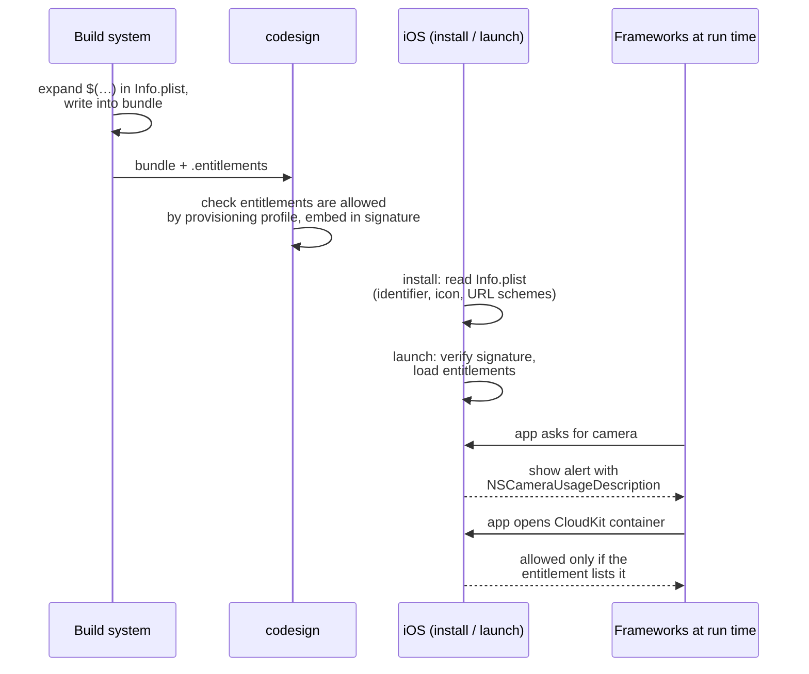

# 5.2 — Info.plist and Entitlements

> **Where you are:** second deep dive. The two files that speak to the system rather than to the compiler.
> **What you'll know after this file:** what each file declares, who reads it and when, and why they are two files instead of one.

## Role recap

**Owns:** the app's declarations to iOS and the App Store. **Example steps:** B5, B6, R1, R6.

## Internal design

Both files are **property lists** (plist): a dictionary of keys and values stored as XML (Extensible Markup Language). Xcode shows them as tables.

The difference between them is trust:

| | `Info.plist` | `AIPowerDict.entitlements` |
|---|---|---|
| Says | "Here is what I am and what I would like." | "Here is what Apple has allowed me to do." |
| Ends up | As a readable file in the bundle | Sealed inside the code signature |
| Checked against | Nothing. It is self-description. | The provisioning profile. A right not in the profile fails signing or install. |
| Read by | SpringBoard (the Home Screen), the launcher, frameworks, the App Store | The kernel and system services, at run time |
| Typical content | identifier, version, permission texts, URL schemes | iCloud, push notifications, App Groups, keychain sharing |

### Info.plist: the ID card

AIPowerDict's keys, grouped by purpose:

| Group | Key | Value | Meaning |
|---|---|---|---|
| Identity | `CFBundleIdentifier` | `$(PRODUCT_BUNDLE_IDENTIFIER)` | Unique ID of the app |
| | `CFBundleExecutable` | `$(EXECUTABLE_NAME)` | Which file in the bundle to start |
| | `CFBundleShortVersionString` | `$(MARKETING_VERSION)` | Version users see |
| | `CFBundleVersion` | `$(CURRENT_PROJECT_VERSION)` | Build number |
| Privacy | `NSCameraUsageDescription` | "Camera is used to scan text…" | Sentence shown in the camera permission alert |
| | `NSMicrophoneUsageDescription`, `NSSpeechRecognitionUsageDescription`, `NSPhotoLibraryUsageDescription` | … | Same, for voice input and photo picking |
| Appearance | `UILaunchScreen` | empty dictionary | Use a blank system launch screen |
| | `UISupportedInterfaceOrientations` | portrait | Allowed rotations on iPhone |
| Behaviour | `UIApplicationSceneManifest` | multiple scenes: no | One window only |
| | `CFBundleURLTypes` | scheme `aipowerdict` | Links like `aipowerdict://referral?code=…` open the app |
| | `UIBackgroundModes` | `remote-notification` | May be woken by silent pushes |
| Compliance | `ITSAppUsesNonExemptEncryption` | `false` | Skips the export-compliance question on upload |

The `$(…)` values are **build-setting placeholders**. The source file never contains the real version number; the build fills it in (step B5). This keeps one source of truth in the build settings.

Many modern projects have no visible `Info.plist` at all: with `GENERATE_INFOPLIST_FILE = YES`, Xcode synthesises it from `INFOPLIST_KEY_…` build settings. AIPowerDict's test target does exactly that.

### Entitlements: the permit

```xml
<key>aps-environment</key>
<string>development</string>
<key>com.apple.developer.icloud-container-identifiers</key>
<array><string>iCloud.geekchow.aipowerdict</string></array>
<key>com.apple.developer.icloud-services</key>
<array><string>CloudKit</string></array>
<key>com.apple.developer.ubiquity-kvstore-identifier</key>
<string>$(TeamIdentifierPrefix)$(CFBundleIdentifier)</string>
```

Four keys, three capabilities:

- **Push notifications** (`aps-environment`): may register with APNs (Apple Push Notification service).
- **CloudKit** (the two `icloud` keys): may read and write the named iCloud container.
- **iCloud key-value store** (`ubiquity-kvstore-identifier`): may sync small settings across devices.

You normally do not type these. Adding a capability in the target's *Signing & Capabilities* tab writes the keys and, with automatic signing, updates the App ID on Apple's side. The mechanics are in the code signing series: [App IDs and entitlements](../../apple-code-signing-guide/05-deep-dives/03-app-ids-and-entitlements.md).

## Interactions

*Who reads which file, and when?*



## ⚓ Back to the example

**B5.** The build writes the processed plist into the bundle. Inspect the result:

```bash
plutil -p AIPowerDict.app/Info.plist | grep -E 'Identifier|ShortVersion'
#  "CFBundleIdentifier" => "com.geekchow.AIPowerDict"
#  "CFBundleShortVersionString" => "1.0.4"
```

**B6.** `codesign` embeds the entitlements. Inspect them:

```bash
codesign -d --entitlements - AIPowerDict.app
```

**R1.** Before any Swift runs, iOS has already used `CFBundleExecutable` to find what to start and `UIApplicationSceneManifest` to know it is a single-window app.

**R6.** When the `Word` for "serendipity" is saved, the database is configured with `cloudKitDatabase: .private("iCloud.geekchow.aipowerdict")`. That string in `App/AIPowerDictApp.swift` must match the container in the entitlements. The code names the container; the entitlement proves the right to use it.

If the user had tapped the Scan tab instead, the first camera access would show the `NSCameraUsageDescription` text. Its translation comes from `InfoPlist.strings` in `Resources/` (see [5.3](03-assets-and-resources.md)).

## Failure behavior

| Symptom | Cause |
|---|---|
| App is terminated the moment it touches the camera, with a console message about a missing usage description | The `NS…UsageDescription` key is absent from `Info.plist`. |
| CloudKit calls fail with a permission or "not entitled" error | The entitlement is missing, or names a different container than the code. |
| Signing fails: "Provisioning profile doesn't include the … entitlement" | The file claims a right the profile does not grant. |
| Push works in development but not from TestFlight | `aps-environment` must be `production` in distribution builds. Automatic signing swaps it during export. |
| App Store upload rejected for a missing purpose string | A linked SDK (Software Development Kit) references a protected API and the matching key is missing. |

---
Next → [5.3 — Assets and resources](03-assets-and-resources.md) · Back to [concept map](../03-concept-map.md)
