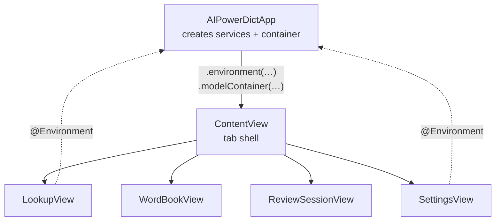

# 5.4 — The App Folder: Entry Point and Wiring

> **Where you are:** fourth deep dive. The first of the code folders, and the smallest.
> **What you'll know after this file:** where execution enters your code, what belongs in `App/`, and how shared objects reach every screen.

## Role recap

**Owns:** the entry point and the assembly of app-wide objects. **Example steps:** R1, R2.

## Internal design

`App/` holds two files:

| File | Contains |
|---|---|
| `AIPowerDictApp.swift` | The `@main` type: startup work, shared services, the database container, the window |
| `ContentView.swift` | The root view: the five-tab shell that hosts every feature screen |

### `@main`: the single entry point

```swift
@main
struct AIPowerDictApp: App {
    @State private var languageManager   = LanguageManager()
    @State private var membershipService = MembershipService()
    @State private var usageTracker      = UsageTracker()
    @State private var streakService     = StreakService()
    @State private var referralService   = ReferralService(aiService: AIService())

    static var sharedModelContainer: ModelContainer = { … }()

    init() {
        TelemetryDeck.initialize(config: …)
        SentrySDK.start { options in options.dsn = Config.sentryDSN }
    }

    var body: some Scene {
        WindowGroup {
            ContentView()
                .environment(languageManager)
                .environment(membershipService)
                .environment(usageTracker)
                .environment(streakService)
                .environment(referralService)
                .onOpenURL { url in … }
        }
        .modelContainer(Self.sharedModelContainer)
    }
}
```

Exactly one type in a target may carry `@main`. It marks where the process hands control to your code. In a SwiftUI app that type conforms to `App`; in a UIKit app the equivalent is the `AppDelegate`. What the system does before and around this point is the subject of the [app startup series](../../ios-app-startup/00-overview.md).

This one file does four jobs, and all four are **assembly**, not features:

| Job | Code | Why here |
|---|---|---|
| Start crash reporting and analytics | `init()` | Must run first so that launch crashes are captured |
| Create long-lived services | the `@State` properties | One instance for the whole app's life |
| Create the database container | `sharedModelContainer` | Lists every model type; chooses on-disk, in-memory or iCloud |
| Build the window and inject everything | `body` | The only place that knows both the services and the root view |

### Dependency injection through the environment

The `.environment(…)` calls put each service into SwiftUI's **environment**, a lookup table that flows down the view tree. Any view below can ask for one by type:

```swift
// Views/Lookup/LookupView.swift
@Environment(\.modelContext)     private var modelContext
@Environment(MembershipService.self) private var membership
@Environment(UsageTracker.self)      private var usage
```

*How does an object created in `App/` reach a screen several levels down?*



No view constructs a service and no intermediate view has to pass one along. `App/` is the only place that says which concrete objects exist. This is why the folder sits at the top of the layering diagram in the [concept map](../03-concept-map.md): it may know everybody; nobody needs to know it.

### The root view

`ContentView` defines the tabs (`lookup`, `wordBook`, `scan`, `review`, `settings`), owns the view models that must survive tab switches, and places each feature's top-level view:

```swift
@State private var lookupViewModel = WordLookupViewModel()
…
LookupView(resetToken: lookupResetToken, viewModel: lookupViewModel)
```

It is in `App/` rather than `Views/` because it is the shell, not a feature. Some teams put it in `Views/`; both are fine.

## Interactions

- **→ Services (5.6):** creates them and decides their lifetime.
- **→ Models (5.6):** registers every `@Model` type in the container's schema. A model missing from this list cannot be stored.
- **→ Packages (5.7):** one of only three files that import a third-party package (the others are `AnalyticsService.swift` and `AIService.swift`).
- **← Info.plist (5.2):** the URL scheme declared there is what makes `.onOpenURL` fire.

## ⚓ Back to the example

**R1.** After iOS starts the executable, `AIPowerDictApp.init()` runs: TelemetryDeck is initialised with an ID read from `config.plist`, then Sentry. The five services are created. `sharedModelContainer` is built with the schema `[Word, WordCategory, ReviewRecord, SearchHistory, DailyReviewActivity]`; on a device it attaches to the private iCloud database, in the simulator it stays local:

```swift
#if targetEnvironment(simulator)
    cloudKitDatabase: .none
#else
    cloudKitDatabase: .private("iCloud.geekchow.aipowerdict")
#endif
```

**R2.** `body` is evaluated: a `WindowGroup` containing `ContentView` with everything injected. `ContentView` creates `lookupViewModel` and shows `LookupView` as the first tab. From here on, `App/` is no longer on stage; the objects it created are.

## Failure behavior

| Symptom | Cause |
|---|---|
| Crash: "No Observable object of type UsageTracker found" | A view asks the environment for something that `App/` never injected (often in previews or tests). |
| Crash at launch in `ModelContainer` creation | The stored data no longer matches the model definitions, or CloudKit rules are violated (for example a non-optional property with no default). |
| Slow launch | Too much synchronous work in `init()`. Keep it to what must happen before the first frame. |
| "'main' attribute can only apply to one type in a module" | Two `@main` types in the target. |

---
Next → [5.5 — Views and ViewModels](05-views-and-viewmodels.md) · Back to [concept map](../03-concept-map.md)
