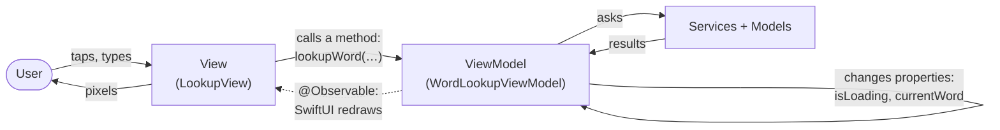

# 5.5 — Views and ViewModels

> **Where you are:** fifth deep dive. The two folders that together make a screen.
> **What you'll know after this file:** how a screen is split between drawing and deciding, how the two halves stay in sync, and how the `Views/` folder is organised.

## Role recap

**Views own** what the user sees and touches. **ViewModels own** a screen's state and the decisions about it. **Example steps:** R3, R4, R7.

## Internal design

### The split

A screen has two kinds of code that change for different reasons:

| | View | ViewModel |
|---|---|---|
| Changes when | The design changes | The behaviour changes |
| Contains | Layout, colours, animation, gestures | Flags, current data, validation, the order of operations |
| Example | "Show a spinner while loading" | "Loading starts on submit and ends when the first reply arrives" |
| Type | `struct … : View` | `@Observable class` |
| Lifetime | Recreated constantly; cheap and disposable | Lives as long as the screen needs its state |
| Testable without a screen? | No | Yes |

MVVM (Model–View–ViewModel) is the name for this split plus the Models from [5.6](06-models-services-extensions.md). The ViewModel is literally *a model of the view*: every fact the screen needs, as plain properties.

### `Views/`: organised by feature

```
Views/
├── Lookup/       LookupView, WordDetailView, B2WordList
├── WordBook/     WordBookView, WordRowView
├── OCR/          OCRContainerView, CameraView
├── Review/       ReviewSessionView, EmptyReviewView
├── Membership/   MembershipView, QuotaHUD
├── Settings/     SettingsView, ReferralView
├── Components/   SearchBarView, WordChipView, VoiceInputButton   ← reused across features
└── Theme/        AppTheme                                         ← shared colours, fonts, spacing
```

Six feature folders mirror the tabs and flows a user would name. Two shared folders hold what several features use. (OCR is Optical Character Recognition: reading text from a camera image.)

### `ViewModels/`: one per stateful feature

```
ViewModels/
├── WordLookupViewModel.swift
├── WordBookViewModel.swift
├── OCRViewModel.swift
└── ReviewViewModel.swift
```

Four view models for six feature folders. Settings and Membership read the shared services from the environment directly and need no state of their own. A view model is added when a screen has state worth separating, not by quota.

### How the two halves stay in sync

```swift
// ViewModels/WordLookupViewModel.swift
@MainActor
@Observable
class WordLookupViewModel {
    var searchText = ""
    var isLoading = false
    var showDetail = false
    var showPaywall = false
    var currentWord: Word?
    var errorMessage: String?

    private let aiService = AIService()

    func lookupWord(_ text: String, modelContext: ModelContext,
                    membership: MembershipService, usage: UsageTracker) async { … }
}
```

```swift
// Views/Lookup/LookupView.swift
struct LookupView: View {
    @Bindable var viewModel: WordLookupViewModel

    var body: some View {
        if viewModel.isLoading { /* spinner */ }
        else if let error = viewModel.errorMessage { /* retry page */ }
        else { SearchBarView(text: $viewModel.searchText, onSubmit: { … }) }
    }
}
```

Three mechanisms connect them:

- **`@Observable`** makes SwiftUI record which properties a view's `body` read. When one of them changes, that view is redrawn. Nobody calls "refresh".
- **`@Bindable`** and the `$` prefix give a two-way connection: typing in the search bar writes to `viewModel.searchText`.
- **`@MainActor`** guarantees the properties are only changed on the main thread, where UI work must happen.

*What is the cycle between user, View and ViewModel?*



Data flows in one direction around the loop: intent goes down as method calls, state comes back as observed properties. The View never reaches past the ViewModel to a Service.

## Interactions

- **← App (5.4):** `ContentView` creates the view model and hands it in; shared services arrive through `@Environment`.
- **→ Services, Models (5.6):** the view model calls them. In AIPowerDict the view passes the environment's `modelContext`, `membership` and `usage` into `lookupWord` as arguments, because a view model cannot read the SwiftUI environment itself.
- **→ Resources (5.3):** views look up text by key and colours by name.
- **Views → Models directly:** allowed for *reading*. `LookupView` lists recent searches with `@Query(sort: \SearchHistory.timestamp, order: .reverse)`, a SwiftData feature that keeps a view in step with the database.

## ⚓ Back to the example

**R3.** The user types "serendipity". Each keystroke goes through `$viewModel.searchText` into the view model. On submit, `LookupView` runs:

```swift
await viewModel.lookupWord(text, modelContext: modelContext,
                           membership: membership, usage: usage)
```

That is all the view does. It does not know whether the answer will come from cache or network.

**R4.** Inside `lookupWord` the view model sets `isLoading = true`. `LookupView.body` had read `isLoading`, so SwiftUI redraws it with the spinner. The view model then makes its decisions in order: clean the text, check the cache, check the quota, call the service. (The other end of those calls is in 5.6.)

**R7.** When results arrive, the view model sets `currentWord`, `isLoading = false` and `showDetail = true`. The view's navigation is bound to `showDetail`, so `WordDetailView(word:viewModel:)` appears. If the quota had been exhausted the view model would have set `showPaywall = true` instead and the same view would have presented the paywall. One flag, one visible outcome.

## Failure behavior

| Symptom | Cause |
|---|---|
| The screen does not update after data changes | The class is not `@Observable`, or the view kept a copy instead of a reference. |
| State resets when switching tabs | The view model is created inside a view that gets recreated. Own it higher up with `@State`, as `ContentView` does. |
| A 1,000-line view file | Logic that belongs in a view model, or sub-views that belong in `Components/`. |
| A view model that imports SwiftUI for layout types | The split has leaked. View models should expose facts ("is loading"), not appearance ("spinner colour"). |
| Purple runtime warning: "Publishing changes from background threads" or a Swift 6 isolation error | State was changed off the main thread. `@MainActor` on the view model prevents it. |

---
Next → [5.6 — Models, Services and Extensions](06-models-services-extensions.md) · Back to [concept map](../03-concept-map.md)
