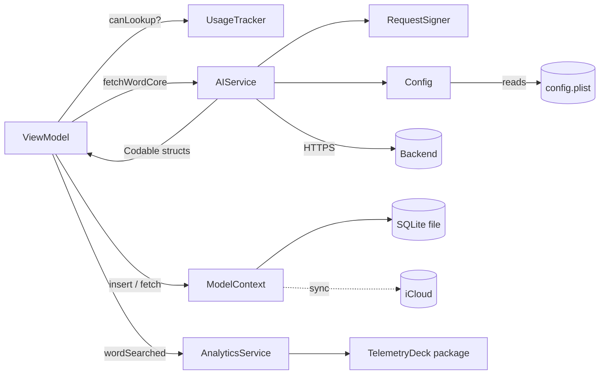

# 5.6 — Models, Services and Extensions

> **Where you are:** sixth deep dive. The bottom layers of the code: data, the outside world, and helpers.
> **What you'll know after this file:** what a model is and how it is stored, what makes something a service, and what the `Extensions/` folder is for.

## Role recap

**Models own** the shape of the app's data. **Services own** access to everything outside the screen: network, speech, purchases, analytics. **Extensions own** small additions to existing types. **Example steps:** R4, R5, R6, R7.

## Internal design

### Models: the nouns

```
Models/
├── Word.swift                 the central entity
├── WordCategory.swift         user-defined groups of words
├── ReviewRecord.swift         spaced-repetition state of one word
├── SearchHistory.swift        what was searched and when
├── DailyReviewActivity.swift  per-day review counts
└── TrendingModels.swift       shapes of trending-word data from the backend
```

A model describes *what a thing is*, with no knowledge of screens or networks:

```swift
// Models/Word.swift
@Model
final class Word {
    var text: String = ""
    var ipaUK: String?
    var definitions: [DefinitionSense] = []
    var isSaved: Bool = false
    var category: WordCategory?      // relationship
    var reviewRecord: ReviewRecord?  // relationship
    var dateAdded: Date = Date()
}
```

The `@Model` macro comes from **SwiftData**, Apple's persistence framework. It turns a plain class into a stored one: instances inserted into a `ModelContext` are written to a database file, and can be queried back. Three objects cooperate:

| Object | Role | Where in AIPowerDict |
|---|---|---|
| `@Model` class | The schema: fields and relationships | `Models/` |
| `ModelContainer` | The database itself: file location, iCloud sync | Created once in `App/AIPowerDictApp.swift` |
| `ModelContext` | A working session: fetch, insert, delete, save | Delivered through `@Environment(\.modelContext)` |

There are two flavours of model in a typical project, and both are present here:

- **Persistent models** (`@Model`): stored on the device. `Word`, `ReviewRecord`.
- **Transfer models** (`Codable` structs): the shape of a JSON (JavaScript Object Notation) reply, decoded and then discarded. `TrendingWord` in `Models/`, and `WordCore`, `WordExplanation` declared beside the code that decodes them in `Services/AIService.swift`.

### Services: the verbs

```
Services/
├── AIService.swift               calls the backend
├── RequestSigner.swift           signs each request
├── CertificatePinner.swift       accepts only the expected server certificate
├── AIPrompts.swift               prompt text
├── Config.swift                  reads config.plist
├── OCRService.swift              text from images (Vision framework)
├── SpeechService.swift           voice to text
├── TextToSpeechService.swift     TTS (Text To Speech) pronunciation
├── MembershipService.swift       purchases (StoreKit)
├── UsageTracker.swift            daily free quota
├── ReferralService.swift         referral codes
├── StreakService.swift           consecutive-day streaks
├── SpacedRepetitionService.swift review scheduling algorithm
├── LanguageManager.swift         in-app language switch
├── AnalyticsService.swift        event tracking
└── PerformanceMeasurer.swift     timing
```

A service wraps **one capability** behind a small Swift interface so that the rest of the app does not deal with its details. Sixteen files fall into four families:

| Family | Members | Wraps |
|---|---|---|
| Backend | `AIService`, `RequestSigner`, `CertificatePinner`, `AIPrompts`, `Config` | HTTPS and the server's API (Application Programming Interface) |
| Device | `OCRService`, `SpeechService`, `TextToSpeechService` | System frameworks: Vision, Speech, AVFoundation |
| Business rules | `MembershipService`, `UsageTracker`, `ReferralService`, `StreakService`, `SpacedRepetitionService`, `LanguageManager` | Rules and state shared by several screens |
| Observability | `AnalyticsService`, `PerformanceMeasurer` | Third-party SDKs (Software Development Kits) |

Services come in two lifetimes. **App-wide, stateful** ones (`UsageTracker`, `MembershipService`) are `@Observable` classes created once in `App/` and injected through the environment, because several screens must see the same quota. **Stateless** ones (`AIService`, `AnalyticsService`) are created where needed or used through static functions.

The difference from a view model: a view model holds the state of **one screen**; a service holds a capability that **any screen** may use.

```swift
// Services/AIService.swift
actor AIService {
    private let session: URLSession   // configured with CertificatePinner as delegate

    func fetchWordCore(_ word: String, context: String? = nil)
        async throws -> TimedResult<WordCore> { … }
}
```

`actor` means calls from different tasks are serialised automatically, so concurrent lookups cannot corrupt shared state.

The observability family shows a pattern worth copying: `AnalyticsService` is the only feature-level file that imports `TelemetryDeck`. Every other file calls `AnalyticsService.wordSearched(…)`. Replacing the analytics vendor means editing one file.

### Extensions: the adjectives

```
Extensions/
├── String+Extensions.swift
├── Color+Extensions.swift     e.g. Color(hex: "#007AFF")
├── Date+Extensions.swift
└── KeychainHelper.swift       read and write secrets in the Keychain
```

A Swift `extension` adds methods to a type you do not own. The `Type+Something.swift` naming is a convention. The folder is a utility drawer: small, stateless helpers used from any layer. (`KeychainHelper` is not an extension in the language sense; it lives here as a helper.) As noted in [02 — What](../02-what.md), this has nothing to do with *app extensions*.

## Interactions

*Who calls whom in the bottom layers?*



## ⚓ Back to the example

**R4.** The view model asks the database for a cached entry:

```swift
let descriptor = FetchDescriptor<Word>(predicate: #Predicate { $0.text == cleanedText })
if let cached = try? modelContext.fetch(descriptor).first, !cached.definitions.isEmpty {
    currentWord = cached          // cache hit: no network, no quota cost
    …
    return
}
guard usage.canLookup(isPremium: membership.isPremium) else {
    showPaywall = true            // quota exhausted
    return
}
usage.recordLookup()
```

The `Word` model defines what can be queried. `UsageTracker` holds the rule "how many free lookups per day".

**R5.** On a miss, `AIService` builds a request for "serendipity". `Config` supplies the backend URL from `config.plist`. `RequestSigner` adds signature headers computed with HMAC-SHA256 (a keyed hash). `URLSession` sends it, and `CertificatePinner` rejects the connection unless the server presents the expected certificate. The JSON reply is decoded into `WordCore` and related structs. Several requests run in parallel so that pronunciation arrives before the long etymology.

**R6.** The view model copies the decoded fields into a `Word` and calls `modelContext.insert(word)`. SwiftData writes it to the local database, and on a real device mirrors it to the private iCloud database, which the entitlement from [5.2](02-info-plist-and-entitlements.md) permits. A `SearchHistory` record is inserted too, and the recent-searches list on `LookupView` updates by itself through `@Query`.

**R7.** `AnalyticsService.wordSearched(source: .text, cacheHit: false)` sends an event through the TelemetryDeck package.

## Failure behavior

| Symptom | Cause and how the design copes |
|---|---|
| No network | `AIService` throws; the view model catches it and sets `errorMessage`; the view shows a retry page. Cached words still open. |
| Backend returns unexpected JSON | Decoding throws at the service boundary, so malformed data never reaches a model or a view. |
| Crash after renaming a model property | The stored data no longer matches. `Word.swift` carries a warning comment about never reusing an old property name for this reason. Changing persistent models needs a migration plan. |
| Quota resets or double counts | Rule lives in one place (`UsageTracker`), so there is one place to fix. |
| A service that needs a view | The dependency arrow points the wrong way. Return data or throw; let the view model decide what to show. |

---
Next → [5.7 — Package dependencies](07-package-dependencies.md) · Back to [concept map](../03-concept-map.md)
