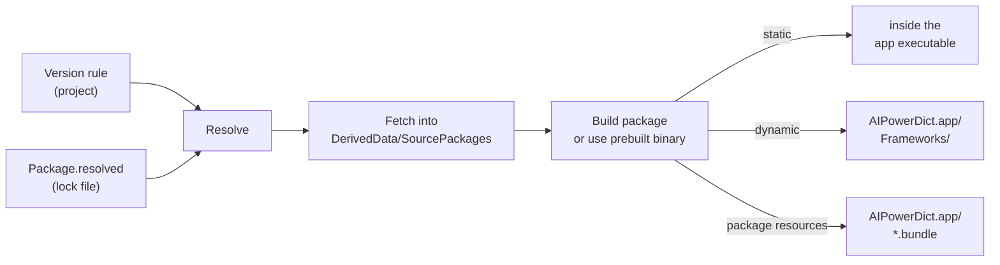

# 5.7 — Package Dependencies

> **Where you are:** seventh deep dive. The section at the bottom of the navigator.
> **What you'll know after this file:** how third-party code is declared, pinned, built and delivered into the app.

## Role recap

**Owns:** external code at known versions. **Example steps:** B2, B3, R1, R7.

## Internal design

AIPowerDict uses two packages:

| Package | Purpose | Declared rule | Resolved version |
|---|---|---|---|
| **Sentry** | Crash and error reporting | from 8.49.0 | 8.58.0 |
| **TelemetryDeck** | Privacy-friendly usage analytics | from 2.5.0 | 2.11.0 |

Both come through **SPM (Swift Package Manager)**, which is built into Xcode. A package is a Git repository with a `Package.swift` manifest at its root.

### Rule versus resolution

Two pieces of information exist for each dependency, in two places:

| | Where | Says | Example |
|---|---|---|---|
| **Version rule** | `project.pbxproj` (written from `project.yml`) | What you accept | "8.49.0 or later, below 9.0.0" |
| **Resolved version** | `AIPowerDict.xcodeproj/project.xcworkspace/xcshareddata/swiftpm/Package.resolved` | What you actually got | 8.58.0, with the exact commit hash |

`Package.resolved` is a **lock file**. Commit it, so that every developer and the CI (Continuous Integration) machine build the same code. The version numbers beside the names in the navigator come from it.

"From 8.49.0" relies on **semantic versioning**: within major version 8, updates should not break existing API (Application Programming Interface) use, so SPM may pick any 8.x at or above 8.49.0.

### Package, product, target

A package can offer several **products** (libraries). A target links the products it wants:

```yaml
# project.yml
packages:
  Sentry:
    url: https://github.com/getsentry/sentry-cocoa
    from: 8.49.0
targets:
  AIPowerDict:
    dependencies:
      - package: Sentry
        product: Sentry
```

Adding a package to the project is not enough. A product must also be listed in the target's **Link Binary With Libraries** phase ([5.1](01-project-targets-and-schemes.md)); otherwise `import Sentry` fails.

### How the code arrives in the app

*What path does package code take into the bundle?*



The two packages illustrate both delivery styles. Looking into the built bundle:

```
AIPowerDict.app/
├── AIPowerDict                           ← executable; TelemetryDeck's code is inside
├── Frameworks/Sentry.framework           ← Sentry ships as a dynamic framework
└── TelemetryDeck_TelemetryDeck.bundle    ← TelemetryDeck's own resources
```

- **Static linking** copies the library's code into your executable. Nothing extra to load at launch.
- **Dynamic linking** keeps it as a separate `.framework` in `Frameworks/`, loaded when the app starts and signed along with the app.

The package author chooses. You only notice when inspecting the bundle or measuring launch time.

Package sources are downloaded to Xcode's `DerivedData` folder, **not into your repository**. The navigator shows them read-only.

## Interactions

- **← Project (5.1):** holds the rules and the link phase entries.
- **→ App (5.4), Services (5.6):** the only importers. Sentry and TelemetryDeck are started in `AIPowerDictApp.init()`; events go through `AnalyticsService`.
- **→ Resources (5.3):** each SDK (Software Development Kit) brings its own privacy manifest; the App Store combines them with yours.
- **→ Signing (5.2):** embedded frameworks are signed with the app's identity during B6.

## ⚓ Back to the example

**B2.** On a fresh clone, Xcode shows "Resolving Package Graph", reads `Package.resolved`, fetches Sentry 8.58.0 and TelemetryDeck 2.11.0, and builds them before the app's own sources.

**B3.** The link step merges TelemetryDeck into the executable and records a load-time reference to `Sentry.framework`, which a later step copies into `Frameworks/`.

**R1.** `SentrySDK.start { … }` and `TelemetryDeck.initialize(config:)` run in `AIPowerDictApp.init()`. From then on, a crash anywhere in the lookup of "serendipity" would be reported.

**R7.** `AnalyticsService.wordSearched(…)` forwards to TelemetryDeck's signal API.

## Failure behavior

| Symptom | Cause |
|---|---|
| "No such module 'Sentry'" | Product not linked to this target, or package resolution failed. |
| "Package resolution failed" or builds that differ between machines | `Package.resolved` missing or not committed. *File › Packages › Reset Package Caches* clears a corrupt cache. |
| Crash at launch: "Library not loaded: @rpath/Sentry.framework" | A dynamic framework was linked but not embedded in the bundle. |
| A major version update breaks the build | Expected: a new major version may change the API. The "from" rule protects you by not crossing it automatically. |
| App size or launch time grows | Each dependency has a cost. Measure before adding. |

---
Next → [5.8 — Products and tests](08-products-and-tests.md) · Back to [concept map](../03-concept-map.md)
