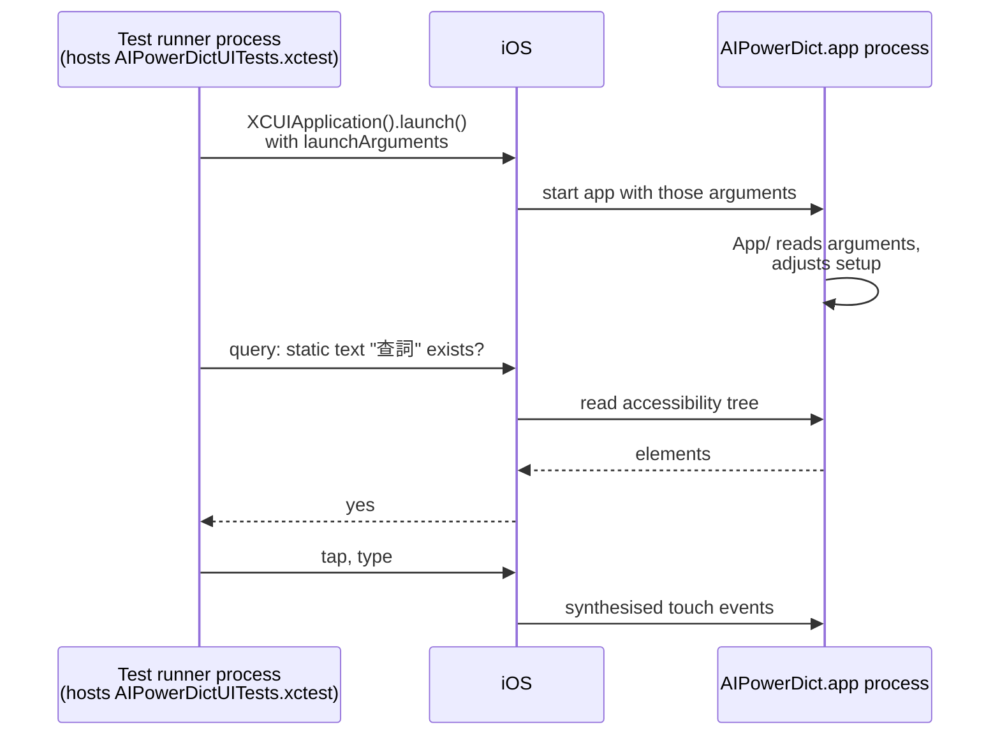

# 5.8 — Products and Tests

> **Where you are:** last deep dive. The outputs of the build, and the second target that checks the first.
> **What you'll know after this file:** what the `Products` group shows, what is inside the `.app`, and how a UI test target relates to the app.

## Role recap

**Products own** nothing; they are references to build outputs. **The UI test target owns** automated checks that drive the app from outside. **Example steps:** B6, T1.

## Internal design

### The Products group

```
Products
├── AIPowerDict.app
└── AIPowerDictUITests.xctest
```

One entry per target. These are **not files in your repository**. They point into Xcode's build folder:

```
~/Library/Developer/Xcode/DerivedData/AIPowerDict-<hash>/Build/Products/Debug-iphonesimulator/
```

The folder name combines configuration and platform, so a Debug simulator build and a Release device build never overwrite each other. An entry is greyed out or red when that product has not been built yet, as `AIPowerDictUITests.xctest` is in the screenshot. Right-click › *Show in Finder* opens the real thing.

### Inside the bundle

`AIPowerDict.app` is a folder. This is the complete top level of a release build, with the origin of each entry:

| In the bundle | Origin | Covered in |
|---|---|---|
| `AIPowerDict` (executable) | All Swift files in `App`, `Views`, `ViewModels`, `Models`, `Services`, `Extensions`, plus statically linked packages | 5.1, 5.4–5.7 |
| `Info.plist` | `Info.plist`, placeholders expanded | 5.2 |
| `Assets.car`, `AppIcon*.png` | `Assets.xcassets` | 5.3 |
| `en.lproj/`, `zh-Hans.lproj/`, `zh-Hant.lproj/` | `Resources/*.lproj` | 5.3 |
| `config.plist`, `PrivacyInfo.xcprivacy`, `StoreKit.storekit` | `Resources/` | 5.3 |
| `Frameworks/Sentry.framework` | Sentry package | 5.7 |
| `TelemetryDeck_TelemetryDeck.bundle` | TelemetryDeck package resources | 5.7 |
| `_CodeSignature/` | Code signing; seals every file above and carries the entitlements | 5.2 |
| `embedded.mobileprovision` | The provisioning profile (device builds only) | code signing series |
| `PkgInfo` | Legacy type marker | — |

This table is the answer to "how do the folders make up an app": **six code folders become one file; everything else is copied or compiled alongside it; a signature seals the lot.**

For distribution, *Product › Archive* builds in Release and wraps the `.app` in an `.xcarchive`; exporting that yields the IPA (iOS App Store Package), a zip of the bundle, which is what TestFlight and the App Store receive.

### The UI test target

```
AIPowerDictUITests/
├── LanguageUITests.swift
├── LanguageScreenshotTests.swift
├── PronunciationScreenshotTests.swift
├── ReviewFlashCardScreenshotTests.swift
└── … (9 files)
```

Xcode offers two kinds of test target:

| | Unit tests | UI tests |
|---|---|---|
| Runs | Inside the app's process (or with no app) | In a **separate process** |
| Sees | The app's types and functions, via `@testable import` | Only what is on screen, through the accessibility system |
| Good for | View models, services, algorithms | Whole flows, localisation, screenshots |
| Speed | Fast | Slow |

AIPowerDict has only the second kind, and uses it for two jobs: checking language behaviour and generating marketing screenshots.

*How does a UI test reach the app?*



Because the test cannot reach into the app, the only channel from test to app is **launch arguments**, and the app must cooperate. AIPowerDict does, in `App/AIPowerDictApp.swift`:

```swift
// UI screenshot tests inject "-seedReviewWord YES" to get an isolated in-memory store
let isUITest = UserDefaults.standard.bool(forKey: "seedReviewWord")
…
if CommandLine.arguments.contains("-uiTestScreenshotMode") {
    UIView.setAnimationsEnabled(false)
}
```

The test target depends on the app target (`dependencies: - target: AIPowerDict` in `project.yml`), so testing always rebuilds the app first. It has its own bundle identifier and a generated `Info.plist`.

## Interactions

- **← Project (5.1):** the scheme's Test action lists the test target.
- **← App (5.4):** honours launch arguments.
- **← Resources (5.3):** localisation tests assert on strings that come from the `.lproj` files.

## ⚓ Back to the example

**B6.** Signing finishes and `AIPowerDict.app` under Products turns from grey to black. Xcode installs that folder into the simulator and launches it. Verify what was built:

```bash
ls AIPowerDict.app                      # the table above
codesign -dv AIPowerDict.app            # identifier, team, signature details
```

**T1.** Pressing ⌘U runs, among others (condensed, with the launch helper inlined):

```swift
// AIPowerDictUITests/LanguageUITests.swift
func testTraditionalChineseAutoDetected_zhTW() {
    let app = XCUIApplication()
    app.launchArguments = ["-AppleLanguages", "(zh-TW)", "-AppleLocale", "zh_TW",
                           "-appLanguage", "system"]
    app.launch()

    XCTAssertTrue(app.staticTexts["設定"].waitForExistence(timeout: 5))
    XCTAssertTrue(app.staticTexts["查詞"].exists)
}
```

This one test crosses most of the project: the scheme builds both targets; iOS launches the bundle pretending the device is set to Traditional Chinese; `App/` wires the services; `LanguageManager` picks `zh-Hant.lproj`; `ContentView` draws the tabs; and the test passes only if the string from `Resources/zh-Hant.lproj/Localizable.strings` is on screen. A UI test for the lookup itself would continue with `app.textFields.firstMatch.typeText("serendipity\n")` and wait for the detail screen.

## Failure behavior

| Symptom | Cause |
|---|---|
| A change does not show up when running | A stale product. *Product › Clean Build Folder* deletes the outputs and forces a full rebuild. |
| UI test cannot find an element | It is identified by visible text that changed, or by language. Stable `accessibilityIdentifier` values in the views fix this. |
| UI tests pass alone but fail together | State left over between runs. This is what the in-memory store launch argument is for. |
| Flaky screenshot comparisons | Animations still running. This is what `-uiTestScreenshotMode` is for. |
| Test-only code paths shipping in the app | Launch-argument hooks are compiled into release builds. Keep them harmless or wrap them in `#if DEBUG`. |

---
Next → [06 — Full walkthrough](../06-walkthrough.md) · Back to [concept map](../03-concept-map.md)
